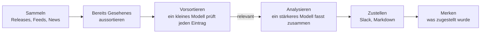

<p align="center">
  <picture>
    <source media="(prefers-color-scheme: dark)" srcset="docs/pochi-dark.svg">
    
  </picture>
</p>

<h1 align="center">Pochi</h1>

<p align="center">
  <strong>Nicht die Flut durchwühlen.<br>Nur holen, was dein Projekt braucht.</strong>
</p>

<p align="center">
  Ein CLI, das anhand deines Repositorys entscheidet, was es im Blick behält,<br>
  und dir jeden Tag ein kurzes Briefing in Slack oder als Markdown schickt.
</p>

<p align="center">
  <a href="https://github.com/OWNER/pochi/actions/workflows/ci.yml"></a>
  <a href="LICENSE"></a>
  
</p>

<p align="center">
  <a href="#schnellstart">Schnellstart</a> ·
  <a href="#wie-es-funktioniert">Wie es funktioniert</a> ·
  <a href="docs/configuration.md">Konfiguration</a> ·
  <a href="docs/scheduling.md">Zeitplan</a>
</p>

<p align="center">
  <sub>
    <a href="README.md">English</a> ·
    <a href="README.ja.md">日本語</a> ·
    <a href="README.zh-CN.md">简体中文</a> ·
    <a href="README.zh-TW.md">繁體中文</a> ·
    <a href="README.es.md">Español</a> ·
    <a href="README.fr.md">Français</a> ·
    <a href="README.de.md">Deutsch</a> ·
    <a href="README.pt-BR.md">Português</a> ·
    <a href="README.ko.md">한국어</a>
  </sub>
</p>

<p align="center"><sub>Dies ist eine Übersetzung. Bei Abweichungen gilt die englische <a href="README.md">README.md</a>.</sub></p>

<p align="center">
  
  <br>
  <sub>Erst wird das Setup geprüft, dann folgt ein Probelauf für ein Beispiel-Helpdesk-SaaS.</sub>
</p>

## Warum Pochi

Zu deinem Tech-Stack, deinem Markt und deinen Wettbewerbern erscheint mehr, als irgendjemand verfolgen kann. Pochi sammelt nicht erst alles ein, um es dann zu filtern. Es geht von deinem Projekt aus und holt nur das, was dafür relevant ist.

**Es beobachtet nur, wovon dein Projekt abhängt.** Ein Coding-Agent liest dein Repository und schlägt vor, welche Themen dich beschäftigen sollten und welche Quellen es zu beobachten gilt: die Bibliotheken, die du nutzt, die Dienste, die du aufrufst, deine Wettbewerber, deinen Markt. Zu jedem Vorschlag nennt er die Dateien, auf die er sich stützt. Was nichts mit deinem Projekt zu tun hat, wird gar nicht erst abgerufen.

**Es reicht nur weiter, was zählt, und sagt dir, warum.** Auch was abgerufen wurde, wird Eintrag für Eintrag gegen deine Themen geprüft. Was durchkommt, bringt mit, warum es wichtig ist, wie wichtig (High, Medium, Low) und was zu tun ist. Nichts, was du schon gesehen hast, taucht wieder auf, mehrere Berichte über dieselbe Geschichte kommen als einer an, und an ruhigen Tagen bleibt Pochi still.

<sub>Quellen: GitHub-Releases, RSS- und Atom-Feeds, Google News (kostenlos), Tavily-Websuche · LLM: dein Claude- oder Codex-Abo oder ein Anthropic-API-Key · Läuft mit: launchd, cron oder GitHub Actions</sub>

## Was du bekommst

Das Briefing für ein Beispielprojekt an dem Tag, an dem diese README entstand: ein Helpdesk-SaaS auf Next.js, das Antworten mit KI vorformuliert ([seine Konfiguration](docs/demo/)). Seine 12 Quellen brachten an diesem Tag 11 lesenswerte Einträge zu Sicherheit, Markt, Wettbewerbern und Regulierung. Drei davon, gekürzt. Das Beispiel wurde mit `language: English` erzeugt; mit `language: German` erscheinen Zusammenfassungen und Handlungsempfehlungen auf Deutsch, Labels wie High und Action bleiben englisch.

> ### [High] [HTTP2Shell Brotli vulnerability reaches beyond Node.js](https://news.google.com/rss/articles/CBMiowFBVV95cUxNaktOLUVHRnNGOUVQSHZFU2R5SDNxTWJjYlBaLVZfQXpZMFN5Ukl1T2JzNGtCaWp6bS1VTXlfTzRmbHVxanJMRS1nMHRydjRmaUVyeHRNV1VIakhHdE9qZjJKa0xNeWdINWtvWkFzU1ZKYjM5aEo1dkczNFR2ak1kWElKR1pmdEI5M3dfSTdpR2RXaTJ4YlRVSHQ3MUJXeVpSRk44?oc=5)
>
> Check Point reports a Brotli-related flaw, nicknamed HTTP2Shell, that affects more than Node.js. Helpdesk serves Next.js over HTTP, so the flaw could reach it through the runtime, a proxy or a dependency.
>
> **Action:** Check whether Node, your reverse proxy/CDN and any Brotli dependencies are affected, and patch them or disable Brotli/HTTP2 where needed.
>
> ### [Medium] [AI is moving SaaS billing from seats to performance metrics](https://news.google.com/rss/articles/CBMiiAFBVV95cUxQVW1BWTVfNXFvcjhNUTZ3MElJMncybGxiTGdySmtPRHk0LTRBSng3TEhPNUFmbTdJYVE4anFfbXBSXzF0Q3pVQzNHQ3ZKZUR1RXNRMThWbzc2ZFJRTzdmNEREemdPTmhxc2Vid3VEYWRIdkozRmhnc0dneUxJUUFqV1FwSmkxWDVu?oc=5)
>
> SaaS vendors are moving from per-user pricing to outcome-based billing, which matches per-resolution AI pricing in help desks. Seat-based pricing for Helpdesk may come under pressure as AI reduces the number of agents customers need.
>
> **Action:** Model an outcome-based or hybrid pricing option for the AI assistant, and compare it with competitors' per-resolution prices.
>
> ### [Medium] [Zendesk launches employee service AI agents and advanced action flows](https://news.google.com/rss/articles/CBMixwFBVV95cUxQeC1ESnhiT0xmcmNjZGFmalk1dmVuWFNTQlZVX0dsT3ZqSFp3SzE3QWl1OEozVnJEemtkTk5QX25VbUxlZGU0RFpaWXlzbV80WUxuT21yRUx4Ymp2eGUyejE3ZUtWZFhnRVVvYmhySEJUaktCa040MnJJdkc0TldFRklBVWwzay10MFVoWkpHOXNDR3UzRE5Ha0pwMXZPbm5VZkhLSnBBR2pMWjRQYVFORlRmLXdjUW4walpac3pTNnZ2d0RfN1VZ?oc=5)
>
> Zendesk is extending its AI agents to internal employee service and adding action flows for multi-step automation: agents that take actions, not just draft replies.
>
> **Action:** Compare Zendesk's action flows with Helpdesk's roadmap and decide whether action-taking automation should be prioritized.

Das Briefing landet als Markdown-Datei in `reports/`, als Slack-Nachricht oder beides.

## Schnellstart

Du brauchst Node.js 22.18 oder neuer und eines von diesen: das [`claude`](https://docs.claude.com/en/docs/claude-code) CLI, das [`codex`](https://github.com/openai/codex) CLI oder einen `ANTHROPIC_API_KEY`. Slack und Tavily sind optional.

Pochi gibt es nicht auf npm: Du betreibst es aus deiner eigenen Kopie dieses Repositorys. Klick auf **Use this template** (empfohlen, damit geplante Läufe funktionieren) oder klone es:

```sh
git clone https://github.com/OWNER/pochi && cd pochi
npm ci && npm run build
alias pochi="node $PWD/dist/pochi.mjs"
```

**1. Starte bei deinem Repository** (empfohlen). Lass dir von einem Coding-Agent einen Vorschlag schreiben, nur mit Lesezugriff, und baue daraus deine Konfiguration:

```sh
pochi init --print-prompt > /tmp/pochi-prompt.md
(cd ~/code/your-project && claude -p --allowedTools "Read,Glob,Grep" < /tmp/pochi-prompt.md > /tmp/proposal.md)
pochi init --from /tmp/proposal.md
```

Oder beantworte stattdessen ein paar Fragen: `pochi init`.

**2. Prüfen, dann ein Probelauf**, der nichts verschickt:

```sh
pochi doctor          # Konfiguration, LLM, Schlüssel und Status; ruft kein Modell auf, kostet nichts
pochi run --dry-run   # gibt das heutige Briefing aus
```

**3. Jeden Morgen laufen lassen:** `pochi schedule install`. Für GitHub Actions siehe [Zeitplan](docs/scheduling.md).

## Vom Repository zur Watchlist

Der Prompt bittet den Agenten, deinen Code, deine Doku und deine Konfiguration zu lesen, aber nichts Geheimes, und zwar entlang von vier Achsen: dein Tech-Stack, dein Geschäft, dein Markt und deine Wettbewerber sowie dein Betrieb. Jeder Vorschlag nennt seine Belege. Hier ein Teil dessen, was er für Pochi selbst vorgeschlagen hat (gekürzt):

```json
"problems": [
  { "text": "Changes to Claude Code and Codex CLI flags, JSON output, auth or safe mode that affect how Pochi spawns them",
    "axis": "tech", "evidence": "src/llm/cli.ts, src/llm/codex.ts, src/llm/adapter.ts" },
  { "text": "Launches and pricing of competing AI news digests, release-tracking and changelog-monitoring tools",
    "axis": "market", "evidence": "package.json description 'Daily briefing for your project'" }
],
"repos": [{ "repo": "colinhacks/zod", "evidence": "package.json zod ^4; src/config/schema.ts" }],
"queries": [{ "query": "AI changelog monitoring tool launch", "intent": "competitor", "topic": "news" }]
```

Mit `pochi init --from` wählst du daraus aus. Pochi prüft, ob jedes Repository existiert, ruft jede Quelle einmal ab, um dir zu zeigen, was sie liefert, und schreibt `config/context.yml` und `config/sources.yml`. Willst du bestimmte Akteure verfolgen, nenn sie beim Namen: `--competitor`, `--adopter` und `--news-site` (alle mehrfach verwendbar).

## Wie es funktioniert



Nur Einträge, die für dich neu sind, gehen ans LLM, und nur die relevanten erreichen das stärkere Modell. Fällt eine Quelle oder ein Batch aus, läuft der Rest trotzdem weiter.

## Befehle

| Befehl | |
| --- | --- |
| `pochi init` | Konfiguration interaktiv erstellen oder mit `--from` aus dem Vorschlag eines Agenten |
| `pochi doctor` | Konfiguration, LLM, Keys und State prüfen, ohne ein Modell aufzurufen oder etwas zu verschicken |
| `pochi run` | Das heutige Briefing sammeln, filtern und zustellen (`--dry-run`, um es nur auszugeben) |
| `pochi schedule install` | Nach dem Zeitplan in `context.yml` ausführen, mit launchd, cron oder GitHub Actions |

Jeder Befehl hat `--help`.

## Konfiguration

Zwei Dateien in `config/`, beide von `pochi init` erzeugt:

- **`context.yml`**: worum es in deinem Projekt geht, welche Themen dich beschäftigen, was ausgeschlossen wird, die Sprache des Briefings und wohin es zugestellt wird.
- **`sources.yml`**: die GitHub-Repositorys, Feeds, Google-News-Suchen und Tavily-Abfragen, die beobachtet werden.

<details>
<summary>Ein minimales Beispiel</summary>

```yaml
# config/context.yml
version: 1
project:
  name: my-app
  description: Eine Next.js-SaaS-App mit Postgres-Backend und LLM-gestütztem Support-Chat.
problems:
  - Breaking Changes und Sicherheitsfixes in Next.js und React
  - Günstigere oder schnellere LLMs für den Kundensupport-Chat
exclude:
  - Finanzierungsrunden und Firmenübernahmen
language: German
notify:
  channels:
    - type: file    # schreibt reports/<Datum>.md; oder type: slack mit SLACK_WEBHOOK_URL
```

```yaml
# config/sources.yml
version: 1
feeds:
  - { id: nextjs, type: github, name: Next.js releases, repo: vercel/next.js }
  - { id: llm-news, type: googlenews, query: Kundensupport LLM, locale: de-DE }
```

</details>

Alle Schlüssel findest du in [docs/configuration.md](docs/configuration.md) (Englisch) und in den kommentierten Dateien [`config/context.example.yml`](config/context.example.yml) und [`config/sources.example.yml`](config/sources.example.yml).

## Kosten

- **LLM.** Ein kleines Modell (Claude Haiku) sortiert jeden neuen Eintrag vor; ein stärkeres (Claude Sonnet) schreibt nur die wenigen relevanten aus. Mit dem `claude`- oder `codex`-CLI laufen die Durchläufe über dein Abo. Für CI oder alles, was geteilt wird, nimm einen API-Key: Die Abos sind für die persönliche Nutzung gedacht.
- **Quellen.** GitHub, Feeds und Google News sind kostenlos. Tavily bietet ein Gratiskontingent von 1.000 Credits pro Monat; jede Abfrage kostet einen Credit pro Lauf.

## Dokumentation (Englisch)

- [Konfiguration](docs/configuration.md): alle Schlüssel, Umgebungsvariablen, die State-Datei
- [Zeitplan](docs/scheduling.md): launchd, cron und GitHub Actions
- [Fehlerbehebung](docs/troubleshooting.md): `pochi doctor` und Exit-Codes
- [Sicherheit](SECURITY.md): wie Keys und nicht vertrauenswürdiger Text behandelt werden und wie du eine Schwachstelle meldest

## Mitmachen

Issues und Pull Requests sind willkommen.

```sh
npm ci
npm run typecheck && npm test
npm run dev -- run --dry-run   # direkt aus dem Quellcode starten
```

Commits folgen den [Conventional Commits](https://www.conventionalcommits.org/de/); Releases erstellt release-please.

## Lizenz

[MIT](LICENSE)

<p align="center"><sub>Pochi ist ein Shiba. Probier mal <code>pochi woof</code>.</sub></p>
