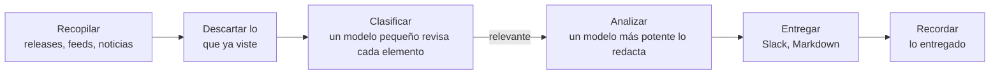

<p align="center">
  <picture>
    <source media="(prefers-color-scheme: dark)" srcset="docs/pochi-dark.svg">
    
  </picture>
</p>

<h1 align="center">Pochi</h1>

<p align="center">
  <strong>No persigas la avalancha.<br>Trae solo lo que tu proyecto necesita.</strong>
</p>

<p align="center">
  Una CLI que decide qué vigilar a partir de tu repositorio<br>
  y envía cada día un breve resumen a Slack o a Markdown.
</p>

<p align="center">
  <a href="https://github.com/tanatyu12/pochi/actions/workflows/ci.yml"></a>
  <a href="LICENSE"></a>
  
</p>

<p align="center">
  <a href="#inicio-rápido">Inicio rápido</a> ·
  <a href="#cómo-funciona">Cómo funciona</a> ·
  <a href="docs/configuration.md">Configuración</a> ·
  <a href="docs/scheduling.md">Programación</a>
</p>

<p align="center">
  <sub>
    <a href="README.md">English</a> ·
    <a href="README.ja.md">日本語</a> ·
    <a href="README.zh-CN.md">简体中文</a> ·
    <a href="README.zh-TW.md">繁體中文</a> ·
    <a href="README.es.md">Español</a> ·
    <a href="README.fr.md">Français</a> ·
    <a href="README.de.md">Deutsch</a> ·
    <a href="README.pt-BR.md">Português</a> ·
    <a href="README.ko.md">한국어</a>
  </sub>
</p>

<p align="center"><sub>Esta es una traducción. Si difiere de <a href="README.md">README.md</a> (en inglés), prevalece el original.</sub></p>

<p align="center">
  
  <br>
  <sub>Comprobación de la configuración y ejecución de prueba para un SaaS de soporte al cliente de ejemplo.</sub>
</p>

## Por qué Pochi

Hay más noticias sobre tu stack, tu mercado y tu competencia de las que nadie puede seguir. Pochi no es una herramienta que lo recoge todo y luego filtra. Parte de tu proyecto y trae solo lo que tiene que ver con él.

**Vigila solo aquello de lo que depende tu proyecto.** Un agente de programación lee tu repositorio y propone los problemas que te importan y las fuentes que conviene vigilar: las bibliotecas que usas, los servicios a los que llamas, tu competencia, tu mercado. Cada propuesta cita los archivos en los que se basa. Lo que no tiene relación con tu proyecto nunca se descarga.

**Te pasa solo lo importante, y te dice por qué.** Lo que trae se contrasta igualmente con tus problemas, elemento por elemento. Lo que pasa el filtro llega con el motivo por el que importa, cuánto importa (High, Medium, Low) y qué hacer al respecto. Nada de lo que ya viste vuelve a aparecer, varias noticias sobre un mismo tema llegan como una sola y, en un día tranquilo, Pochi no dice nada.

<sub>Fuentes: releases de GitHub, feeds RSS y Atom, Google News (gratis), búsqueda web de Tavily · LLM: tu suscripción a Claude o Codex, o una clave de API de Anthropic · Se ejecuta con: launchd, cron o GitHub Actions</sub>

## Qué recibes

El resumen de un proyecto de ejemplo del día en que se escribió este README: un SaaS de soporte al cliente hecho con Next.js que redacta respuestas con IA ([su configuración](docs/demo/)). Sus 12 fuentes trajeron ese día 11 elementos que valía la pena leer, sobre seguridad, mercado, competencia y regulación. Aquí van tres, abreviados. Se generaron con `language: English`; con `language: Spanish`, los resúmenes y las acciones salen en español, mientras que etiquetas como High y Action se mantienen en inglés.

> ### [High] [HTTP2Shell Brotli vulnerability reaches beyond Node.js](https://news.google.com/rss/articles/CBMiowFBVV95cUxNaktOLUVHRnNGOUVQSHZFU2R5SDNxTWJjYlBaLVZfQXpZMFN5Ukl1T2JzNGtCaWp6bS1VTXlfTzRmbHVxanJMRS1nMHRydjRmaUVyeHRNV1VIakhHdE9qZjJKa0xNeWdINWtvWkFzU1ZKYjM5aEo1dkczNFR2ak1kWElKR1pmdEI5M3dfSTdpR2RXaTJ4YlRVSHQ3MUJXeVpSRk44?oc=5)
>
> Check Point reports a Brotli-related flaw, nicknamed HTTP2Shell, that affects more than Node.js. Helpdesk serves Next.js over HTTP, so the flaw could reach it through the runtime, a proxy or a dependency.
>
> **Action:** Check whether Node, your reverse proxy/CDN and any Brotli dependencies are affected, and patch them or disable Brotli/HTTP2 where needed.
>
> ### [Medium] [AI is moving SaaS billing from seats to performance metrics](https://news.google.com/rss/articles/CBMiiAFBVV95cUxQVW1BWTVfNXFvcjhNUTZ3MElJMncybGxiTGdySmtPRHk0LTRBSng3TEhPNUFmbTdJYVE4anFfbXBSXzF0Q3pVQzNHQ3ZKZUR1RXNRMThWbzc2ZFJRTzdmNEREemdPTmhxc2Vid3VEYWRIdkozRmhnc0dneUxJUUFqV1FwSmkxWDVu?oc=5)
>
> SaaS vendors are moving from per-user pricing to outcome-based billing, which matches per-resolution AI pricing in help desks. Seat-based pricing for Helpdesk may come under pressure as AI reduces the number of agents customers need.
>
> **Action:** Model an outcome-based or hybrid pricing option for the AI assistant, and compare it with competitors' per-resolution prices.
>
> ### [Medium] [Zendesk launches employee service AI agents and advanced action flows](https://news.google.com/rss/articles/CBMixwFBVV95cUxQeC1ESnhiT0xmcmNjZGFmalk1dmVuWFNTQlZVX0dsT3ZqSFp3SzE3QWl1OEozVnJEemtkTk5QX25VbUxlZGU0RFpaWXlzbV80WUxuT21yRUx4Ymp2eGUyejE3ZUtWZFhnRVVvYmhySEJUaktCa040MnJJdkc0TldFRklBVWwzay10MFVoWkpHOXNDR3UzRE5Ha0pwMXZPbm5VZkhLSnBBR2pMWjRQYVFORlRmLXdjUW4walpac3pTNnZ2d0RfN1VZ?oc=5)
>
> Zendesk is extending its AI agents to internal employee service and adding action flows for multi-step automation: agents that take actions, not just draft replies.
>
> **Action:** Compare Zendesk's action flows with Helpdesk's roadmap and decide whether action-taking automation should be prioritized.

Llega como un archivo Markdown en `reports/`, como un mensaje de Slack, o de ambas formas.

## Inicio rápido

Necesitas Node.js 22.18 o posterior y una de estas opciones: la CLI [`claude`](https://docs.claude.com/en/docs/claude-code), la CLI [`codex`](https://github.com/openai/codex) o una `ANTHROPIC_API_KEY`. Slack y Tavily son opcionales.

Pochi no está en npm: se ejecuta desde tu propia copia de este repositorio. Haz clic en **Use this template** (recomendado, para que funcionen las ejecuciones programadas) o clónalo:

```sh
git clone https://github.com/tanatyu12/pochi && cd pochi
npm ci && npm run build
alias pochi="node $PWD/dist/pochi.mjs"
```

**1. Parte de tu repositorio** (recomendado). Pide a un agente de programación una propuesta, en modo de solo lectura, y genera tu configuración a partir de ella:

```sh
pochi init --print-prompt > /tmp/pochi-prompt.md
(cd ~/code/your-project && claude -p --allowedTools "Read,Glob,Grep" < /tmp/pochi-prompt.md > /tmp/proposal.md)
pochi init --from /tmp/proposal.md
```

O responde unas pocas preguntas: `pochi init`.

**2. Comprueba y haz una prueba** que no publica nada:

```sh
pochi doctor          # configuración, LLM, claves y estado; no llama a ningún modelo, no cuesta nada
pochi run --dry-run   # muestra el resumen de hoy
```

**3. Ejecútalo cada mañana:** `pochi schedule install`. Para GitHub Actions, consulta [Programación](docs/scheduling.md).

## De tu repositorio a una lista de vigilancia

El prompt le pide al agente que lea tu código, tu documentación y tu configuración, sin tocar nada secreto, desde cinco ejes: tu stack técnico, tu diseño, tu negocio, tu mercado y cómo llegas a él, y tu forma de operar. Cada propuesta cita su evidencia. Esto es parte de lo que propuso para el propio Pochi (abreviado):

```json
"problems": [
  { "text": "Changes to Claude Code and Codex CLI flags, JSON output, auth or safe mode that affect how Pochi spawns them",
    "axis": "tech", "evidence": "src/llm/cli.ts, src/llm/codex.ts, src/llm/adapter.ts" },
  { "text": "Launches and pricing of competing AI news digests, release-tracking and changelog-monitoring tools",
    "axis": "market", "evidence": "package.json description 'Daily briefing for your project'" }
],
"repos": [{ "repo": "colinhacks/zod", "evidence": "package.json zod ^4; src/config/schema.ts" }],
"queries": [{ "query": "AI changelog monitoring tool launch", "intent": "competitor", "topic": "news" }]
```

`pochi init --from` te deja elegir entre lo propuesto, comprueba que cada repositorio exista, descarga cada fuente una vez para mostrarte qué contiene y escribe `config/context.yml` y `config/sources.yml`. Para seguir a actores concretos, nómbralos con `--competitor`, `--adopter` y `--news-site` (todas se pueden repetir).

## Cómo funciona



Solo los elementos nuevos para ti llegan al LLM, y solo los relevantes llegan al modelo más potente. Si falla una fuente o un lote, la ejecución continúa.

## Comandos

| Comando | |
| --- | --- |
| `pochi init` | Crea la configuración de forma interactiva, o `--from` la propuesta de un agente |
| `pochi doctor` | Comprueba la configuración, el LLM, las claves y el estado sin llamar a ningún modelo ni enviar nada |
| `pochi run` | Recopila, filtra y entrega el resumen del día (`--dry-run` para solo mostrarlo) |
| `pochi schedule install` | Lo ejecuta según la programación de `context.yml`, con launchd, cron o GitHub Actions |

Todos los comandos tienen `--help`.

## Configuración

Dos archivos en `config/`, ambos generados por `pochi init`:

- **`context.yml`**: de qué trata tu proyecto, los problemas que te importan, qué excluir, el idioma del resumen y adónde enviarlo.
- **`sources.yml`**: los repositorios de GitHub, feeds, búsquedas de Google News y consultas de Tavily que se vigilan.

El resumen puede escribirse en cualquier idioma. `pochi init` ofrece inglés, japonés, chino, español, francés, alemán, portugués y coreano, y sus búsquedas de noticias usan la edición de Google News de ese idioma. Las etiquetas como High y Action se mantienen en inglés ([docs/configuration.md](docs/configuration.md)).

<details>
<summary>Un ejemplo mínimo</summary>

```yaml
# config/context.yml
version: 1
project:
  name: my-app
  description: Una app SaaS con Next.js, backend en Postgres y un chat de soporte basado en un LLM.
problems:
  - Cambios incompatibles y correcciones de seguridad en Next.js y React
  - LLM más baratos o más rápidos para el chat de soporte al cliente
exclude:
  - Noticias de rondas de financiación y adquisiciones de empresas
language: Spanish
notify:
  channels:
    - type: file    # escribe reports/<fecha>.md; o type: slack con SLACK_WEBHOOK_URL
```

```yaml
# config/sources.yml
version: 1
feeds:
  - { id: nextjs, type: github, name: Next.js releases, repo: vercel/next.js }
  - { id: llm-news, type: googlenews, query: LLM atención al cliente, locale: es-ES }  # es-MX, es-AR, etc. eligen otra edición
```

</details>

Todas las claves están en [docs/configuration.md](docs/configuration.md) (en inglés) y en los archivos comentados [`config/context.example.yml`](config/context.example.yml) y [`config/sources.example.yml`](config/sources.example.yml).

## Costo

- **LLM.** Un modelo pequeño (Claude Haiku) clasifica cada elemento nuevo; uno más potente (Claude Sonnet) redacta solo los pocos relevantes. Con la CLI `claude` o `codex`, las ejecuciones usan tu suscripción. Usa una clave de API para CI o cualquier entorno compartido: las suscripciones son para uso personal.
- **Fuentes.** GitHub, los feeds y Google News son gratis. Tavily tiene un nivel gratuito de 1.000 créditos al mes; cada consulta consume uno por ejecución.

## Documentación (en inglés)

- [Configuración](docs/configuration.md): todas las claves, variables de entorno y el archivo de estado
- [Programación](docs/scheduling.md): launchd, cron y GitHub Actions
- [Actualizar](docs/updating.md): llevar una nueva versión a tu copia
- [Solución de problemas](docs/troubleshooting.md): `pochi doctor` y códigos de salida
- [Seguridad](SECURITY.md): cómo se manejan las claves y el texto no confiable, y cómo reportar una vulnerabilidad

## Contribuir

Los issues y pull requests son bienvenidos.

```sh
npm ci
npm run typecheck && npm test
npm run dev -- run --dry-run   # ejecutar desde el código fuente
```

Los commits siguen [Conventional Commits](https://www.conventionalcommits.org/es/); las versiones las publica release-please.

## Licencia

[MIT](LICENSE)

<p align="center"><sub>Pochi es un Shiba. Prueba <code>pochi woof</code>.</sub></p>
