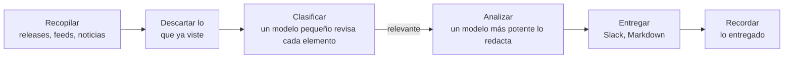

<p align="center">
  <picture>
    <source media="(prefers-color-scheme: dark)" srcset="docs/pochi-dark.svg">
    
  </picture>
</p>

<h1 align="center">Pochi</h1>

<p align="center">
  <strong>Un resumen diario de lo que cambió en torno a tu proyecto:<br>solo lo que importa, y qué hacer al respecto.</strong>
</p>

<p align="center">
  Pochi lee tu repositorio, decide qué vigilar<br>
  y envía cada mañana un breve resumen a Slack o a Markdown.
</p>

<p align="center">
  <a href="https://github.com/tanatyu12/pochi/actions/workflows/ci.yml"></a>
  <a href="LICENSE"></a>
  
</p>

<p align="center">
  <a href="#inicio-rápido">Inicio rápido</a> ·
  <a href="#cómo-funciona">Cómo funciona</a> ·
  <a href="#documentación-en-inglés">Documentación</a>
</p>

<p align="center">
  <sub>
    <a href="README.md">English</a> ·
    <a href="README.ja.md">日本語</a> ·
    <a href="README.zh-CN.md">简体中文</a> ·
    <a href="README.zh-TW.md">繁體中文</a> ·
    <a href="README.es.md">Español</a> ·
    <a href="README.fr.md">Français</a> ·
    <a href="README.de.md">Deutsch</a> ·
    <a href="README.pt-BR.md">Português</a> ·
    <a href="README.ko.md">한국어</a>
  </sub>
</p>

<p align="center"><sub>Esta es una traducción. Si difiere de <a href="README.md">README.md</a> (en inglés), prevalece el original.</sub></p>

<p align="center">
  
  <br>
  <sub>Comprobación de la configuración y ejecución de prueba para un SaaS de soporte al cliente de ejemplo.</sub>
</p>

## Qué aspecto tiene un resumen

Tres de los 11 elementos que Pochi encontró un día para un SaaS de soporte al cliente de ejemplo hecho con Next.js ([su configuración](docs/demo/)):

> ### [High] [HTTP2Shell Brotli vulnerability reaches beyond Node.js](https://news.google.com/rss/articles/CBMiowFBVV95cUxNaktOLUVHRnNGOUVQSHZFU2R5SDNxTWJjYlBaLVZfQXpZMFN5Ukl1T2JzNGtCaWp6bS1VTXlfTzRmbHVxanJMRS1nMHRydjRmaUVyeHRNV1VIakhHdE9qZjJKa0xNeWdINWtvWkFzU1ZKYjM5aEo1dkczNFR2ak1kWElKR1pmdEI5M3dfSTdpR2RXaTJ4YlRVSHQ3MUJXeVpSRk44?oc=5)
>
> Check Point reports a Brotli-related flaw, nicknamed HTTP2Shell, that affects more than Node.js. Helpdesk serves Next.js over HTTP, so the flaw could reach it through the runtime, a proxy or a dependency.
>
> **Action:** Check whether Node, your reverse proxy/CDN and any Brotli dependencies are affected, and patch them or disable Brotli/HTTP2 where needed.
>
> ### [Medium] [AI is moving SaaS billing from seats to performance metrics](https://news.google.com/rss/articles/CBMiiAFBVV95cUxQVW1BWTVfNXFvcjhNUTZ3MElJMncybGxiTGdySmtPRHk0LTRBSng3TEhPNUFmbTdJYVE4anFfbXBSXzF0Q3pVQzNHQ3ZKZUR1RXNRMThWbzc2ZFJRTzdmNEREemdPTmhxc2Vid3VEYWRIdkozRmhnc0dneUxJUUFqV1FwSmkxWDVu?oc=5)
>
> SaaS vendors are moving from per-user pricing to outcome-based billing, which matches per-resolution AI pricing in help desks. Seat-based pricing for Helpdesk may come under pressure as AI reduces the number of agents customers need.
>
> **Action:** Model an outcome-based or hybrid pricing option for the AI assistant, and compare it with competitors' per-resolution prices.
>
> ### [Medium] [Zendesk launches employee service AI agents and advanced action flows](https://news.google.com/rss/articles/CBMixwFBVV95cUxQeC1ESnhiT0xmcmNjZGFmalk1dmVuWFNTQlZVX0dsT3ZqSFp3SzE3QWl1OEozVnJEemtkTk5QX25VbUxlZGU0RFpaWXlzbV80WUxuT21yRUx4Ymp2eGUyejE3ZUtWZFhnRVVvYmhySEJUaktCa040MnJJdkc0TldFRklBVWwzay10MFVoWkpHOXNDR3UzRE5Ha0pwMXZPbm5VZkhLSnBBR2pMWjRQYVFORlRmLXdjUW4walpac3pTNnZ2d0RfN1VZ?oc=5)
>
> Zendesk is extending its AI agents to internal employee service and adding action flows for multi-step automation: agents that take actions, not just draft replies.
>
> **Action:** Compare Zendesk's action flows with Helpdesk's roadmap and decide whether action-taking automation should be prioritized.

## Lo más destacado

- **Vigila solo aquello de lo que depende tu proyecto.** Un agente de programación lee tu repositorio y propone los problemas y las fuentes que conviene vigilar, cada uno citando los archivos en los que se basa. No se descarga nada que no tenga relación.
- **Te dice por qué importa y qué hacer.** Cada elemento llega con su relevancia, una valoración High, Medium o Low y una acción sugerida.
- **Nunca se repite.** Lo que ya viste no vuelve a aparecer, varias noticias sobre un mismo tema llegan como una sola y, en un día tranquilo, Pochi no dice nada.
- **Funciona con la suscripción que ya tienes.** Usa tu sesión de la CLI `claude` o `codex`, o una clave de API de Anthropic.
- **Fuentes gratuitas.** Las releases de GitHub, los feeds RSS y Atom y Google News no cuestan nada; la búsqueda web de Tavily es opcional.
- **Se ejecuta solo cada mañana.** `pochi schedule install` lo configura con launchd, cron o GitHub Actions.

## Inicio rápido

Necesitas Node.js 22.18 o posterior y una de estas opciones: la CLI [`claude`](https://docs.claude.com/en/docs/claude-code), la CLI [`codex`](https://github.com/openai/codex) o una `ANTHROPIC_API_KEY`. Pochi no está en npm: haz clic en **Use this template** (recomendado, para que funcionen las ejecuciones programadas) o clona este repositorio.

```sh
git clone https://github.com/tanatyu12/pochi && cd pochi
npm ci && npm run build
alias pochi="node $PWD/dist/pochi.mjs"

pochi init              # answer a few questions to write config/
pochi doctor            # check the setup; sends no prompt, costs nothing
pochi run --dry-run     # print today's briefing without posting it
pochi schedule install  # run it every morning
```

### Deja que un agente lea tu repositorio (recomendado)

En lugar de responder preguntas, pide a un agente de programación que lea tu proyecto, en modo de solo lectura, y proponga qué vigilar:

```sh
pochi init --print-prompt > /tmp/pochi-prompt.md
(cd ~/code/your-project && claude -p --allowedTools "Read,Glob,Grep" < /tmp/pochi-prompt.md > /tmp/proposal.md)
pochi init --from /tmp/proposal.md
```

El agente examina tu stack técnico, tu diseño, tu negocio, tu mercado y tu forma de operar, y cita su evidencia para cada propuesta. `pochi init --from` te deja elegir entre lo propuesto, comprueba que cada repositorio exista, descarga cada fuente una vez para mostrarte qué contiene y escribe `config/context.yml` y `config/sources.yml`. Para seguir a actores concretos, añade `--competitor`, `--adopter` o `--news-site` (todas se pueden repetir).

<details>
<summary>Parte de lo que propuso para el propio Pochi</summary>

```json
"problems": [
  { "text": "Changes to Claude Code and Codex CLI flags, JSON output, auth or safe mode that affect how Pochi spawns them",
    "axis": "tech", "evidence": "src/llm/cli.ts, src/llm/codex.ts, src/llm/adapter.ts" },
  { "text": "Launches and pricing of competing AI news digests, release-tracking and changelog-monitoring tools",
    "axis": "market", "evidence": "package.json description 'Daily briefing for your project'" }
],
"repos": [{ "repo": "colinhacks/zod", "evidence": "package.json zod ^4; src/config/schema.ts" }],
"queries": [{ "query": "AI changelog monitoring tool launch", "intent": "competitor", "topic": "news" }]
```

</details>

## Cómo funciona



Solo los elementos nuevos para ti llegan al LLM, y solo los relevantes llegan al modelo más potente. Si falla una fuente o un lote, la ejecución continúa.

## Más información

| Comando | |
| --- | --- |
| `pochi init` | Crea la configuración de forma interactiva, o `--from` la propuesta de un agente |
| `pochi doctor` | Comprueba la configuración, que la clave o la sesión del LLM funcione, las claves y el estado, sin enviar ningún prompt |
| `pochi run` | Recopila, filtra y entrega el resumen del día (`--dry-run` para solo mostrarlo) |
| `pochi schedule install` | Lo ejecuta según la programación de `context.yml`, con launchd, cron o GitHub Actions |

Todos los comandos tienen `--help`.

**Configuración.** `config/context.yml` indica de qué trata tu proyecto, los problemas que te importan, qué excluir, el idioma del resumen y adónde enviarlo; `config/sources.yml` enumera los repositorios, feeds y búsquedas que se vigilan. El resumen puede escribirse en cualquier idioma; `pochi init` ofrece ocho.

<details>
<summary>Un ejemplo mínimo</summary>

```yaml
# config/context.yml
version: 1
project:
  name: my-app
  description: Una app SaaS con Next.js, backend en Postgres y un chat de soporte basado en un LLM.
problems:
  - Cambios incompatibles y correcciones de seguridad en Next.js y React
  - LLM más baratos o más rápidos para el chat de soporte al cliente
exclude:
  - Noticias de rondas de financiación y adquisiciones de empresas
language: Spanish
notify:
  channels:
    - type: file    # escribe reports/<fecha>.md; o type: slack con SLACK_WEBHOOK_URL
```

```yaml
# config/sources.yml
version: 1
feeds:
  - { id: nextjs, type: github, name: Next.js releases, repo: vercel/next.js }
  - { id: llm-news, type: googlenews, query: LLM atención al cliente, locale: es-ES }  # es-MX, es-AR, etc. eligen otra edición
```

</details>

**Costo.** Un modelo pequeño (Claude Haiku) clasifica cada elemento nuevo y uno más potente (Claude Sonnet) redacta solo los pocos relevantes. Las suscripciones de `claude` y `codex` son para uso personal, así que usa una clave de API para CI o cualquier entorno compartido. El nivel gratuito de Tavily da 1.000 créditos al mes; cada consulta consume uno por ejecución.

### Documentación (en inglés)

- [Configuración](docs/configuration.md): todas las claves, variables de entorno y el archivo de estado
- [Programación](docs/scheduling.md): launchd, cron y GitHub Actions
- [Actualizar](docs/updating.md): llevar una nueva versión a tu copia
- [Solución de problemas](docs/troubleshooting.md): `pochi doctor` y códigos de salida
- [Seguridad](SECURITY.md): cómo se manejan las claves y el texto no confiable, y cómo reportar una vulnerabilidad

## Contribuir

Los issues y pull requests son bienvenidos.

```sh
npm ci
npm run typecheck && npm test
npm run dev -- run --dry-run   # run from source
```

Los commits siguen [Conventional Commits](https://www.conventionalcommits.org/es/); las versiones las publica release-please.

## Licencia

[MIT](LICENSE)

<p align="center"><sub>Pochi es un Shiba. Prueba <code>pochi woof</code>.</sub></p>
