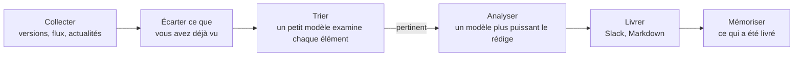

<p align="center">
  <picture>
    <source media="(prefers-color-scheme: dark)" srcset="docs/pochi-dark.svg">
    
  </picture>
</p>

<h1 align="center">Pochi</h1>

<p align="center">
  <strong>Un résumé quotidien de ce qui a changé autour de votre projet :<br>seulement l'essentiel, et ce qu'il faut en faire.</strong>
</p>

<p align="center">
  Pochi lit votre dépôt, décide quoi surveiller,<br>
  et envoie chaque matin un bref résumé sur Slack ou en Markdown.
</p>

<p align="center">
  <a href="https://github.com/tanatyu12/pochi/actions/workflows/ci.yml"></a>
  <a href="LICENSE"></a>
  
</p>

<p align="center">
  <a href="#démarrage-rapide">Démarrage rapide</a> ·
  <a href="#comment-ça-marche">Comment ça marche</a> ·
  <a href="#documentation-en-anglais">Docs</a>
</p>

<p align="center">
  <sub>
    <a href="README.md">English</a> ·
    <a href="README.ja.md">日本語</a> ·
    <a href="README.zh-CN.md">简体中文</a> ·
    <a href="README.zh-TW.md">繁體中文</a> ·
    <a href="README.es.md">Español</a> ·
    <a href="README.fr.md">Français</a> ·
    <a href="README.de.md">Deutsch</a> ·
    <a href="README.pt-BR.md">Português</a> ·
    <a href="README.ko.md">한국어</a>
  </sub>
</p>

<p align="center"><sub>Ceci est une traduction. En cas de différence, c'est le <a href="README.md">README.md</a> (en anglais) qui fait foi.</sub></p>

<p align="center">
  
  <br>
  <sub>Vérification de la configuration, puis exécution à blanc pour un SaaS de help desk fictif.</sub>
</p>

## À quoi ressemble un résumé

Trois des 11 éléments que Pochi a trouvés un jour pour un SaaS de help desk fictif sous Next.js ([sa configuration](docs/demo/)) :

> ### [High] [HTTP2Shell Brotli vulnerability reaches beyond Node.js](https://news.google.com/rss/articles/CBMiowFBVV95cUxNaktOLUVHRnNGOUVQSHZFU2R5SDNxTWJjYlBaLVZfQXpZMFN5Ukl1T2JzNGtCaWp6bS1VTXlfTzRmbHVxanJMRS1nMHRydjRmaUVyeHRNV1VIakhHdE9qZjJKa0xNeWdINWtvWkFzU1ZKYjM5aEo1dkczNFR2ak1kWElKR1pmdEI5M3dfSTdpR2RXaTJ4YlRVSHQ3MUJXeVpSRk44?oc=5)
>
> Check Point reports a Brotli-related flaw, nicknamed HTTP2Shell, that affects more than Node.js. Helpdesk serves Next.js over HTTP, so the flaw could reach it through the runtime, a proxy or a dependency.
>
> **Action:** Check whether Node, your reverse proxy/CDN and any Brotli dependencies are affected, and patch them or disable Brotli/HTTP2 where needed.
>
> ### [Medium] [AI is moving SaaS billing from seats to performance metrics](https://news.google.com/rss/articles/CBMiiAFBVV95cUxQVW1BWTVfNXFvcjhNUTZ3MElJMncybGxiTGdySmtPRHk0LTRBSng3TEhPNUFmbTdJYVE4anFfbXBSXzF0Q3pVQzNHQ3ZKZUR1RXNRMThWbzc2ZFJRTzdmNEREemdPTmhxc2Vid3VEYWRIdkozRmhnc0dneUxJUUFqV1FwSmkxWDVu?oc=5)
>
> SaaS vendors are moving from per-user pricing to outcome-based billing, which matches per-resolution AI pricing in help desks. Seat-based pricing for Helpdesk may come under pressure as AI reduces the number of agents customers need.
>
> **Action:** Model an outcome-based or hybrid pricing option for the AI assistant, and compare it with competitors' per-resolution prices.
>
> ### [Medium] [Zendesk launches employee service AI agents and advanced action flows](https://news.google.com/rss/articles/CBMixwFBVV95cUxQeC1ESnhiT0xmcmNjZGFmalk1dmVuWFNTQlZVX0dsT3ZqSFp3SzE3QWl1OEozVnJEemtkTk5QX25VbUxlZGU0RFpaWXlzbV80WUxuT21yRUx4Ymp2eGUyejE3ZUtWZFhnRVVvYmhySEJUaktCa040MnJJdkc0TldFRklBVWwzay10MFVoWkpHOXNDR3UzRE5Ha0pwMXZPbm5VZkhLSnBBR2pMWjRQYVFORlRmLXdjUW4walpac3pTNnZ2d0RfN1VZ?oc=5)
>
> Zendesk is extending its AI agents to internal employee service and adding action flows for multi-step automation: agents that take actions, not just draft replies.
>
> **Action:** Compare Zendesk's action flows with Helpdesk's roadmap and decide whether action-taking automation should be prioritized.

## Points forts

- **Il ne surveille que ce dont votre projet dépend.** Un agent de code lit votre dépôt et propose les problèmes à suivre et les sources à surveiller, chaque proposition citant les fichiers sur lesquels elle s'appuie. Rien de ce qui est sans rapport n'est récupéré.
- **Il dit pourquoi c'est important et ce qu'il faut faire.** Chaque élément arrive avec sa pertinence, une note High, Medium ou Low, et une action suggérée.
- **Il ne se répète jamais.** Ce que vous avez déjà vu ne revient pas, plusieurs articles sur un même sujet n'en font qu'un, et les jours calmes, Pochi se tait.
- **Il fonctionne avec l'abonnement que vous avez déjà.** Utilisez votre connexion à la CLI `claude` ou `codex`, ou une clé d'API Anthropic.
- **Des sources gratuites.** Les versions GitHub, les flux RSS et Atom et Google News ne coûtent rien ; la recherche web Tavily est facultative.
- **Il tourne tout seul chaque matin.** `pochi schedule install` configure launchd, cron ou GitHub Actions.

## Démarrage rapide

Il vous faut Node.js 22.18 ou plus récent, et au choix la CLI [`claude`](https://docs.claude.com/en/docs/claude-code), la CLI [`codex`](https://github.com/openai/codex) ou une `ANTHROPIC_API_KEY`. Pochi n'est pas publié sur npm : cliquez sur **Use this template** (recommandé, pour que les exécutions planifiées fonctionnent) ou clonez ce dépôt.

```sh
git clone https://github.com/tanatyu12/pochi && cd pochi
npm ci && npm run build
alias pochi="node $PWD/dist/pochi.mjs"

pochi init              # answer a few questions to write config/
pochi doctor            # check the setup; sends no prompt, costs nothing
pochi run --dry-run     # print today's briefing without posting it
pochi schedule install  # run it every morning
```

### Laissez un agent lire votre dépôt (recommandé)

Plutôt que de répondre à des questions, demandez à un agent de code de lire votre projet, en lecture seule, et de proposer quoi surveiller :

```sh
pochi init --print-prompt > /tmp/pochi-prompt.md
(cd ~/code/your-project && claude -p --allowedTools "Read,Glob,Grep" < /tmp/pochi-prompt.md > /tmp/proposal.md)
pochi init --from /tmp/proposal.md
```

L'agent examine votre stack technique, votre design, votre activité, votre marché et votre fonctionnement au quotidien, et cite ses éléments à l'appui pour chaque proposition. `pochi init --from` vous laisse choisir dans cette proposition, vérifie que chaque dépôt existe, récupère une fois chaque source pour montrer ce qu'elle contient, puis écrit `config/context.yml` et `config/sources.yml`. Pour suivre des acteurs précis, ajoutez `--competitor`, `--adopter` ou `--news-site` (chacune peut être répétée).

<details>
<summary>Une partie de ce qu'il a proposé pour Pochi lui-même</summary>

```json
"problems": [
  { "text": "Changes to Claude Code and Codex CLI flags, JSON output, auth or safe mode that affect how Pochi spawns them",
    "axis": "tech", "evidence": "src/llm/cli.ts, src/llm/codex.ts, src/llm/adapter.ts" },
  { "text": "Launches and pricing of competing AI news digests, release-tracking and changelog-monitoring tools",
    "axis": "market", "evidence": "package.json description 'Daily briefing for your project'" }
],
"repos": [{ "repo": "colinhacks/zod", "evidence": "package.json zod ^4; src/config/schema.ts" }],
"queries": [{ "query": "AI changelog monitoring tool launch", "intent": "competitor", "topic": "news" }]
```

</details>

## Comment ça marche



Seuls les éléments nouveaux pour vous passent par le LLM, et seuls les éléments pertinents parviennent au modèle le plus puissant. Une source ou un lot en échec n'interrompt pas l'exécution.

## Pour aller plus loin

| Commande | Rôle |
| --- | --- |
| `pochi init` | Crée la configuration de façon interactive, ou à partir de la proposition d'un agent avec `--from` |
| `pochi doctor` | Vérifie la configuration, le bon fonctionnement de la clé ou de la connexion du LLM, les clés et l'état, sans envoyer de prompt |
| `pochi run` | Collecte, filtre et livre le résumé du jour (`--dry-run` pour seulement l'afficher) |
| `pochi schedule install` | L'exécute selon le planning de `context.yml`, avec launchd, cron ou GitHub Actions |

Chaque commande dispose de `--help`.

**Configuration.** `config/context.yml` indique ce qu'est votre projet, les problèmes qui vous importent, ce qu'il faut exclure, la langue du résumé et où le livrer ; `config/sources.yml` liste les dépôts, les flux et les recherches à surveiller. Le résumé peut être rédigé dans n'importe quelle langue ; `pochi init` en propose huit.

<details>
<summary>Un exemple minimal</summary>

```yaml
# config/context.yml
version: 1
project:
  name: my-app
  description: Une application SaaS Next.js avec un backend Postgres et un chat de support propulsé par un LLM.
problems:
  - Changements incompatibles et correctifs de sécurité dans Next.js et React
  - Des LLM moins chers ou plus rapides pour le chat de support client
exclude:
  - Levées de fonds et rachats d'entreprises
language: French
notify:
  channels:
    - type: file    # écrit reports/<date>.md ; ou type: slack avec SLACK_WEBHOOK_URL
```

```yaml
# config/sources.yml
version: 1
feeds:
  - { id: nextjs, type: github, name: Next.js releases, repo: vercel/next.js }
  - { id: llm-news, type: googlenews, query: support client LLM, locale: fr-FR }
```

</details>

**Coût.** Un petit modèle (Claude Haiku) trie chaque nouvel élément et un modèle plus puissant (Claude Sonnet) ne rédige que les quelques éléments pertinents. Les abonnements `claude` et `codex` sont réservés à un usage personnel : utilisez donc une clé d'API pour la CI ou tout environnement partagé. L'offre gratuite de Tavily donne 1 000 crédits par mois, à raison d'un crédit par requête et par exécution.

### Documentation (en anglais)

- [Configuration](docs/configuration.md) : toutes les clés, les variables d'environnement, le fichier d'état
- [Planification](docs/scheduling.md) : launchd, cron et GitHub Actions
- [Mettre à jour](docs/updating.md) : intégrer une nouvelle version dans votre copie
- [Dépannage](docs/troubleshooting.md) : `pochi doctor` et les codes de sortie
- [Sécurité](SECURITY.md) : le traitement des clés et des textes non fiables, et comment signaler une vulnérabilité

## Contribuer

Les issues et les pull requests sont les bienvenues.

```sh
npm ci
npm run typecheck && npm test
npm run dev -- run --dry-run   # run from source
```

Les commits suivent les [Conventional Commits](https://www.conventionalcommits.org/) ; les versions sont publiées par release-please.

## Licence

[MIT](LICENSE)

<p align="center"><sub>Pochi est un Shiba. Essayez <code>pochi woof</code>.</sub></p>
