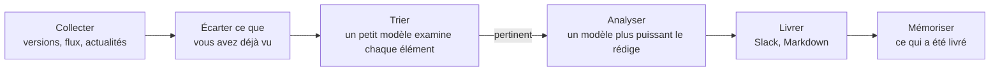

<p align="center">
  <picture>
    <source media="(prefers-color-scheme: dark)" srcset="docs/pochi-dark.svg">
    
  </picture>
</p>

<h1 align="center">Pochi</h1>

<p align="center">
  <strong>Inutile de tout suivre.<br>Allez chercher seulement ce qui compte pour votre projet.</strong>
</p>

<p align="center">
  Une CLI qui choisit quoi surveiller à partir de votre dépôt,<br>
  et envoie chaque jour un bref résumé sur Slack ou en Markdown.
</p>

<p align="center">
  <a href="https://github.com/OWNER/pochi/actions/workflows/ci.yml"></a>
  <a href="LICENSE"></a>
  
</p>

<p align="center">
  <a href="#démarrage-rapide">Démarrage rapide</a> ·
  <a href="#comment-ça-marche">Comment ça marche</a> ·
  <a href="docs/configuration.md">Configuration</a> ·
  <a href="docs/scheduling.md">Planification</a>
</p>

<p align="center">
  <sub>
    <a href="README.md">English</a> ·
    <a href="README.ja.md">日本語</a> ·
    <a href="README.zh-CN.md">简体中文</a> ·
    <a href="README.zh-TW.md">繁體中文</a> ·
    <a href="README.es.md">Español</a> ·
    <a href="README.fr.md">Français</a> ·
    <a href="README.de.md">Deutsch</a> ·
    <a href="README.pt-BR.md">Português</a> ·
    <a href="README.ko.md">한국어</a>
  </sub>
</p>

<p align="center"><sub>Ceci est une traduction. En cas de différence, c'est le <a href="README.md">README.md</a> (en anglais) qui fait foi.</sub></p>

<p align="center">
  
  <br>
  <sub>Vérification de la configuration, puis exécution à blanc pour un SaaS de help desk fictif.</sub>
</p>

## Pourquoi Pochi

Il y a plus d'actualités sur votre stack, votre marché et vos concurrents que quiconque ne peut en suivre. Pochi n'est pas un outil qui ramasse tout pour ensuite filtrer. Il part de votre projet, et ne va chercher que ce qui le concerne.

**Il ne surveille que ce dont votre projet dépend.** Un agent de code lit votre dépôt et propose les problèmes à suivre et les sources à surveiller : les bibliothèques que vous utilisez, les services que vous appelez, vos concurrents, votre marché. Chaque proposition cite les fichiers sur lesquels elle s'appuie. Ce qui n'a rien à voir avec votre projet n'est jamais récupéré.

**Il ne vous transmet que l'essentiel, et dit pourquoi.** Ce qu'il récupère est encore confronté à vos problèmes, élément par élément. Ce qui passe le filtre arrive avec la raison pour laquelle c'est important, à quel point (High, Medium, Low) et ce qu'il faut faire. Rien de ce que vous avez déjà vu ne revient, plusieurs articles sur un même sujet n'en font qu'un, et les jours calmes, Pochi se tait.

<sub>Sources : versions GitHub, flux RSS et Atom, Google News (gratuit), recherche web Tavily · LLM : votre abonnement Claude ou Codex, ou une clé d'API Anthropic · Exécution : launchd, cron ou GitHub Actions</sub>

## Ce que vous recevez

Voici le résumé produit pour un projet d'exemple le jour où ce README a été écrit : un SaaS de help desk sous Next.js qui rédige des brouillons de réponse avec l'IA ([sa configuration](docs/demo/)). Ce jour-là, ses 12 sources ont remonté 11 éléments dignes d'intérêt, sur la sécurité, le marché, les concurrents et la réglementation. En voici trois, abrégés. L'exemple a été produit avec `language: English` ; avec `language: French`, les résumés et les actions sont rédigés en français, tandis que les libellés comme High et Action restent en anglais.

> ### [High] [HTTP2Shell Brotli vulnerability reaches beyond Node.js](https://news.google.com/rss/articles/CBMiowFBVV95cUxNaktOLUVHRnNGOUVQSHZFU2R5SDNxTWJjYlBaLVZfQXpZMFN5Ukl1T2JzNGtCaWp6bS1VTXlfTzRmbHVxanJMRS1nMHRydjRmaUVyeHRNV1VIakhHdE9qZjJKa0xNeWdINWtvWkFzU1ZKYjM5aEo1dkczNFR2ak1kWElKR1pmdEI5M3dfSTdpR2RXaTJ4YlRVSHQ3MUJXeVpSRk44?oc=5)
>
> Check Point reports a Brotli-related flaw, nicknamed HTTP2Shell, that affects more than Node.js. Helpdesk serves Next.js over HTTP, so the flaw could reach it through the runtime, a proxy or a dependency.
>
> **Action:** Check whether Node, your reverse proxy/CDN and any Brotli dependencies are affected, and patch them or disable Brotli/HTTP2 where needed.
>
> ### [Medium] [AI is moving SaaS billing from seats to performance metrics](https://news.google.com/rss/articles/CBMiiAFBVV95cUxQVW1BWTVfNXFvcjhNUTZ3MElJMncybGxiTGdySmtPRHk0LTRBSng3TEhPNUFmbTdJYVE4anFfbXBSXzF0Q3pVQzNHQ3ZKZUR1RXNRMThWbzc2ZFJRTzdmNEREemdPTmhxc2Vid3VEYWRIdkozRmhnc0dneUxJUUFqV1FwSmkxWDVu?oc=5)
>
> SaaS vendors are moving from per-user pricing to outcome-based billing, which matches per-resolution AI pricing in help desks. Seat-based pricing for Helpdesk may come under pressure as AI reduces the number of agents customers need.
>
> **Action:** Model an outcome-based or hybrid pricing option for the AI assistant, and compare it with competitors' per-resolution prices.
>
> ### [Medium] [Zendesk launches employee service AI agents and advanced action flows](https://news.google.com/rss/articles/CBMixwFBVV95cUxQeC1ESnhiT0xmcmNjZGFmalk1dmVuWFNTQlZVX0dsT3ZqSFp3SzE3QWl1OEozVnJEemtkTk5QX25VbUxlZGU0RFpaWXlzbV80WUxuT21yRUx4Ymp2eGUyejE3ZUtWZFhnRVVvYmhySEJUaktCa040MnJJdkc0TldFRklBVWwzay10MFVoWkpHOXNDR3UzRE5Ha0pwMXZPbm5VZkhLSnBBR2pMWjRQYVFORlRmLXdjUW4walpac3pTNnZ2d0RfN1VZ?oc=5)
>
> Zendesk is extending its AI agents to internal employee service and adding action flows for multi-step automation: agents that take actions, not just draft replies.
>
> **Action:** Compare Zendesk's action flows with Helpdesk's roadmap and decide whether action-taking automation should be prioritized.

Le résumé arrive sous forme de fichier Markdown dans `reports/`, de message Slack, ou les deux.

## Démarrage rapide

Il vous faut Node.js 22.18 ou plus récent, et au choix la CLI [`claude`](https://docs.claude.com/en/docs/claude-code), la CLI [`codex`](https://github.com/openai/codex) ou une `ANTHROPIC_API_KEY`. Slack et Tavily sont facultatifs.

Pochi n'est pas publié sur npm : vous l'exécutez depuis votre propre copie de ce dépôt. Cliquez sur **Use this template** (recommandé, pour que les exécutions planifiées fonctionnent) ou clonez-le :

```sh
git clone https://github.com/OWNER/pochi && cd pochi
npm ci && npm run build
alias pochi="node $PWD/dist/pochi.mjs"
```

**1. Partez de votre dépôt** (recommandé). Demandez une proposition à un agent de code, en lecture seule, puis construisez votre configuration à partir de celle-ci :

```sh
pochi init --print-prompt > /tmp/pochi-prompt.md
(cd ~/code/your-project && claude -p --allowedTools "Read,Glob,Grep" < /tmp/pochi-prompt.md > /tmp/proposal.md)
pochi init --from /tmp/proposal.md
```

Vous pouvez aussi simplement répondre à quelques questions : `pochi init`.

**2. Vérifiez, puis faites un essai** qui n'envoie rien :

```sh
pochi doctor          # config, LLM, clés et état ; n'appelle aucun modèle, ne coûte rien
pochi run --dry-run   # affiche le résumé du jour
```

**3. Lancez-le chaque matin :** `pochi schedule install`. Pour GitHub Actions, voir [Planification](docs/scheduling.md).

## Du dépôt à la liste de veille

Le prompt demande à l'agent de lire votre code, votre documentation et votre configuration, sans rien de secret, selon quatre axes : votre stack technique, votre activité, votre marché et vos concurrents, et votre fonctionnement au quotidien. Chaque proposition cite ses éléments à l'appui. Voici une partie de ce qu'il a proposé pour Pochi lui-même (abrégé) :

```json
"problems": [
  { "text": "Changes to Claude Code and Codex CLI flags, JSON output, auth or safe mode that affect how Pochi spawns them",
    "axis": "tech", "evidence": "src/llm/cli.ts, src/llm/codex.ts, src/llm/adapter.ts" },
  { "text": "Launches and pricing of competing AI news digests, release-tracking and changelog-monitoring tools",
    "axis": "market", "evidence": "package.json description 'Daily briefing for your project'" }
],
"repos": [{ "repo": "colinhacks/zod", "evidence": "package.json zod ^4; src/config/schema.ts" }],
"queries": [{ "query": "AI changelog monitoring tool launch", "intent": "competitor", "topic": "news" }]
```

`pochi init --from` vous laisse choisir dans cette proposition, vérifie que chaque dépôt existe, récupère une fois chaque source pour vous montrer ce qu'elle contient, puis écrit `config/context.yml` et `config/sources.yml`. Pour suivre des acteurs précis, nommez-les avec `--competitor`, `--adopter` et `--news-site` (chacune peut être répétée).

## Comment ça marche



Seuls les éléments nouveaux pour vous passent par le LLM, et seuls les éléments pertinents parviennent au modèle le plus puissant. Une source ou un lot en échec n'interrompt pas l'exécution.

## Commandes

| Commande | Rôle |
| --- | --- |
| `pochi init` | Crée la configuration de façon interactive, ou à partir de la proposition d'un agent avec `--from` |
| `pochi doctor` | Vérifie la configuration, le LLM, les clés et l'état, sans appeler de modèle ni rien envoyer |
| `pochi run` | Collecte, filtre et livre le résumé du jour (`--dry-run` pour seulement l'afficher) |
| `pochi schedule install` | L'exécute selon le planning de `context.yml`, avec launchd, cron ou GitHub Actions |

Chaque commande dispose de `--help`.

## Configuration

Deux fichiers dans `config/`, tous deux écrits par `pochi init` :

- **`context.yml`** : ce qu'est votre projet, les problèmes qui vous importent, ce qu'il faut exclure, la langue du résumé et où le livrer.
- **`sources.yml`** : les dépôts GitHub, les flux, les recherches Google News et les requêtes Tavily à surveiller.

<details>
<summary>Un exemple minimal</summary>

```yaml
# config/context.yml
version: 1
project:
  name: my-app
  description: Une application SaaS Next.js avec un backend Postgres et un chat de support propulsé par un LLM.
problems:
  - Changements incompatibles et correctifs de sécurité dans Next.js et React
  - Des LLM moins chers ou plus rapides pour le chat de support client
exclude:
  - Levées de fonds et rachats d'entreprises
language: French
notify:
  channels:
    - type: file    # écrit reports/<date>.md ; ou type: slack avec SLACK_WEBHOOK_URL
```

```yaml
# config/sources.yml
version: 1
feeds:
  - { id: nextjs, type: github, name: Next.js releases, repo: vercel/next.js }
  - { id: llm-news, type: googlenews, query: support client LLM, locale: fr-FR }
```

</details>

Toutes les clés sont décrites dans [docs/configuration.md](docs/configuration.md) (en anglais) et dans les fichiers commentés [`config/context.example.yml`](config/context.example.yml) et [`config/sources.example.yml`](config/sources.example.yml).

## Coût

- **LLM.** Un petit modèle (Claude Haiku) trie chaque nouvel élément ; un modèle plus puissant (Claude Sonnet) ne rédige que les quelques éléments pertinents. Avec la CLI `claude` ou `codex`, les exécutions passent par votre abonnement. Utilisez une clé d'API pour la CI ou tout environnement partagé : les abonnements sont réservés à un usage personnel.
- **Sources.** GitHub, les flux et Google News sont gratuits. Tavily propose une offre gratuite de 1 000 crédits par mois, à raison d'un crédit par requête et par exécution.

## Documentation (en anglais)

- [Configuration](docs/configuration.md) : toutes les clés, les variables d'environnement, le fichier d'état
- [Planification](docs/scheduling.md) : launchd, cron et GitHub Actions
- [Dépannage](docs/troubleshooting.md) : `pochi doctor` et les codes de sortie
- [Sécurité](SECURITY.md) : le traitement des clés et des textes non fiables, et comment signaler une vulnérabilité

## Contribuer

Les issues et les pull requests sont les bienvenues.

```sh
npm ci
npm run typecheck && npm test
npm run dev -- run --dry-run   # exécuter depuis les sources
```

Les commits suivent les [Conventional Commits](https://www.conventionalcommits.org/) ; les versions sont publiées par release-please.

## Licence

[MIT](LICENSE)

<p align="center"><sub>Pochi est un Shiba. Essayez <code>pochi woof</code>.</sub></p>
