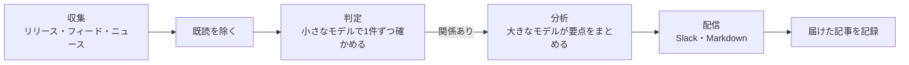

<p align="center">
  <picture>
    <source media="(prefers-color-scheme: dark)" srcset="docs/pochi-dark.svg">
    
  </picture>
</p>

<h1 align="center">Pochi</h1>

<p align="center">
  <strong>プロジェクトに関係する情報だけを、取りにいく。</strong>
</p>

<p align="center">
  リポジトリを読んで追うべき情報源を決め、<br>
  その日知っておくべきことだけを Slack や Markdown にまとめる CLI です。
</p>

<p align="center">
  <a href="https://github.com/OWNER/pochi/actions/workflows/ci.yml"></a>
  <a href="LICENSE"></a>
  
</p>

<p align="center">
  <a href="#はじめかた">はじめかた</a> ·
  <a href="#しくみ">しくみ</a> ·
  <a href="docs/configuration.md">設定</a> ·
  <a href="docs/scheduling.md">定期実行</a>
</p>

<p align="center">
  <sub>
    <a href="README.md">English</a> ·
    <a href="README.ja.md">日本語</a> ·
    <a href="README.zh-CN.md">简体中文</a> ·
    <a href="README.zh-TW.md">繁體中文</a> ·
    <a href="README.es.md">Español</a> ·
    <a href="README.fr.md">Français</a> ·
    <a href="README.de.md">Deutsch</a> ·
    <a href="README.pt-BR.md">Português</a> ·
    <a href="README.ko.md">한국어</a>
  </sub>
</p>

<p align="center">
  
  <br>
  <sub>設定を確認し、サンプルのヘルプデスク SaaS 向けに試し実行するところ。</sub>
</p>

## Pochi について

技術、市場、競合のニュースは、とても一人で追いきれる量ではありません。Pochi は、手当たりしだいに集めてから絞り込むツールではありません。プロジェクトを起点に、関係する情報だけを取りにいきます。

**見る先を、リポジトリから決める。** コーディングエージェントがリポジトリを読み、気にかけるべき課題と、見張るべき情報源を提案します。使っているライブラリ、呼び出しているサービス、競合、市場。どの案にも根拠のファイルが添えられます。プロジェクトに関係のない情報は、そもそも取りにいきません。

**届けるのは、関係あることだけ。** 取ってきた記事も、登録した課題に照らして1件ずつ確かめます。届くのは関係のあるものだけで、関係する理由、影響の大きさ（High / Medium / Low）、取るべき対応が添えられます。一度届いた記事は二度と届かず、同じ話題は1件にまとまり、何もない日は何も届きません。

<sub>情報源：GitHub のリリース、RSS・Atom フィード、Google ニュース（無料）、Tavily の Web 検索 · LLM：Claude や Codex のサブスク、または Anthropic の API キー · 定期実行：launchd、cron、GitHub Actions</sub>

## 届くもの

この README を書いた日に、サンプルのプロジェクト向けに作ったブリーフィングです。サンプルは Next.js で作ったヘルプデスク SaaS で、返信の下書きに AI を使っています（[設定](docs/demo/)）。12の情報源から、この日は14件が届きました。セキュリティだけでなく、市場の動き、競合、規制の話題も含まれています。そのうち3件を、一部省略して載せます（出力言語を日本語にして実行）。

> ### [High] [Brotliの重大脆弱性「HTTP2Shell」で緊急パッチ](https://news.google.com/rss/articles/CBMitgFBVV95cUxQNGVrMWJmTkxqcDhLTzhhTGFyMU0yeTU0cDR2WTk4dmdkcVFhZVNLUVVWalUtS1p2ZUlxcWQ4MHFkT2FPOHlDYVFaNng2LW43NUxqeGpHNGlnVTZ3dXkwNTFic1ZDU1pkZ1N5YzdZemk3czR6Ni1RZ1owQ1RaNnJUZ04xSkpPVm5vNU16czM3TThQVjR0RFRsMWRQYTFRbjNrRGtHeUg1ZlJERnEzTC1sb0o4MlZOUQ?oc=5)
>
> BleepingComputerによると、Brotliに関する重大な脆弱性「HTTP2Shell」に対して緊急パッチが出ています。Node.js、HTTP/2、プロキシ、CDNなど圧縮処理を使う経路に影響する可能性があります。
>
> **Action:** 影響を受けるコンポーネント(Node.js、Next.js、リバースプロキシ、CDN)を特定し、パッチ適用状況を今週中に確認して適用する。
>
> ### [Medium] [SaaS課金がユーザー数から成果指標へ移行](https://news.google.com/rss/articles/CBMiiAFBVV95cUxQVW1BWTVfNXFvcjhNUTZ3MElJMncybGxiTGdySmtPRHk0LTRBSng3TEhPNUFmbTdJYVE4anFfbXBSXzF0Q3pVQzNHQ3ZKZUR1RXNRMThWbzc2ZFJRTzdmNEREemdPTmhxc2Vid3VEYWRIdkozRmhnc0dneUxJUUFqV1FwSmkxWDVu?oc=5)
>
> AIの普及でSaaSの課金が席数ベースから成果(パフォーマンス)指標ベースへ移っていると報じられています。サポート分野では解決件数課金のような料金モデルが該当し、Helpdeskの料金設計にも影響し得ます。
>
> **Action:** 現行の席数課金に加え、解決件数ベースなどの成果連動型料金を試算し、次回の料金会議で検討する。
>
> ### [Medium] [Zendeskが従業員向けAIエージェントと高度なアクションフローを発表](https://news.google.com/rss/articles/CBMixwFBVV95cUxQeC1ESnhiT0xmcmNjZGFmalk1dmVuWFNTQlZVX0dsT3ZqSFp3SzE3QWl1OEozVnJEemtkTk5QX25VbUxlZGU0RFpaWXlzbV80WUxuT21yRUx4Ymp2eGUyejE3ZUtWZFhnRVVvYmhySEJUaktCa040MnJJdkc0TldFRklBVWwzay10MFVoWkpHOXNDR3UzRE5Ha0pwMXZPbm5VZkhLSnBBR2pMWjRQYVFORlRmLXdjUW4walpac3pTNnZ2d0RfN1VZ?oc=5)
>
> Zendeskが従業員サービス向けのAIエージェントと高度なアクションフローを発表しました。顧客サポート以外へ領域を広げ、AIによる自動実行機能を強化する動きです。
>
> **Action:** Zendeskの新機能を調べ、自社ロードマップのアクション自動化機能と比較する。

レポートは `reports/` に Markdown で保存するか、Slack に投稿するか、その両方を選べます。

## はじめかた

必要なもの：

- Node.js 22.18 以上
- LLM：[`claude`](https://docs.claude.com/en/docs/claude-code) CLI、[`codex`](https://github.com/openai/codex) CLI、`ANTHROPIC_API_KEY` のどれか1つ
- Slack と Tavily はなくても動きます

Pochi は npm では配布していません。このリポジトリを自分用にコピーして使います。GitHub の **Use this template** から作るのがおすすめです（フォークだと定期実行が動きません）。clone でもかまいません。

```sh
git clone https://github.com/OWNER/pochi && cd pochi
npm ci && npm run build
alias pochi="node $PWD/dist/pochi.mjs"
```

**1. リポジトリから設定を作る**（おすすめ）。まずコーディングエージェントに、読み取り専用で提案を書いてもらいます。それを読み込んで設定を作ります。

```sh
pochi init --print-prompt > /tmp/pochi-prompt.md
(cd ~/code/your-project && claude -p --allowedTools "Read,Glob,Grep" < /tmp/pochi-prompt.md > /tmp/proposal.md)
pochi init --from /tmp/proposal.md
```

質問に答えながら一から作ることもできます：`pochi init`

**2. 確認して、試しに動かす。** どちらも何も送信しません。

```sh
pochi doctor          # 設定・LLM のキーやログイン・キー・状態ファイルを確認する。プロンプトを送らないので無料
pochi run --dry-run   # 今日のブリーフィングを画面に出す
```

**3. 毎朝動くようにする：** `pochi schedule install`。GitHub Actions で動かすときは[定期実行](docs/scheduling.md)を見てください。

## リポジトリから情報源を決める

`--print-prompt` が出すプロンプトは、エージェントにコード・ドキュメント・設定を読ませます。`.env` などの秘密のファイルは開かせません。技術基盤、デザイン、ビジネス、市場とマーケティング、運用の5つの観点から、課題と情報源を根拠つきで挙げさせます。Pochi 自身のリポジトリで試したときの提案から、一部を抜き出しました。

```json
"problems": [
  { "text": "Changes to Claude Code and Codex CLI flags, JSON output, auth or safe mode that affect how Pochi spawns them",
    "axis": "tech", "evidence": "src/llm/cli.ts, src/llm/codex.ts, src/llm/adapter.ts" },
  { "text": "Launches and pricing of competing AI news digests, release-tracking and changelog-monitoring tools",
    "axis": "market", "evidence": "package.json description 'Daily briefing for your project'" }
],
"repos": [{ "repo": "colinhacks/zod", "evidence": "package.json zod ^4; src/config/schema.ts" }],
"queries": [{ "query": "AI changelog monitoring tool launch", "intent": "competitor", "topic": "news" }]
```

`pochi init --from` では、この提案から使うものを選びます。リポジトリが実在するかを確かめ、各情報源を一度取得して中身を見せてから、`config/context.yml` と `config/sources.yml` を書き出します。特定の競合や業界を追いたいときは、`--competitor`、`--adopter`、`--news-site` で名指しできます（どれも複数指定できます）。

## しくみ



LLM が読むのは初めて見る記事だけで、大きなモデルが読むのは関係のある記事だけです。一部の情報源や LLM の呼び出しが失敗しても、残りの処理は続きます。

## コマンド

| コマンド | できること |
| --- | --- |
| `pochi init` | 対話で設定を作る。`--from` でエージェントの提案から作る |
| `pochi doctor` | 設定・LLM のキーやログインが使えるか・キー・状態ファイルを確認する。プロンプトも通知も送らない |
| `pochi run` | 見張っている情報源から新着を取得し、今日のブリーフィングを届ける。`--dry-run` なら画面に出すだけ |
| `pochi schedule install` | `context.yml` のスケジュールどおりに、launchd・cron・GitHub Actions で定期実行する |

詳しい使い方は、各コマンドの `--help` で確認できます。

## 設定

設定は `config/` の2つのファイルで、どちらも `pochi init` が作ります。

- **`context.yml`**：プロジェクトの説明、気にかけている課題、除外したい話題、ブリーフィングの言語、届け先
- **`sources.yml`**：見張る GitHub リポジトリ、フィード、Google ニュースの検索語、Tavily の検索語

ブリーフィングはどの言語でも書けます。`pochi init` では英語、日本語、中国語、スペイン語、フランス語、ドイツ語、ポルトガル語、韓国語を選べ、ニュース検索もその言語の Google ニュースを使います。High や Action などのラベルは英語のままです（[docs/configuration.md](docs/configuration.md)）。

<details>
<summary>最小限の設定例</summary>

```yaml
# config/context.yml
version: 1
project:
  name: my-app
  description: Next.js と Postgres で作った SaaS。サポートチャットに LLM を使っている。
problems:
  - Next.js と React の破壊的変更とセキュリティ修正
  - サポートチャットに使える、より安くて速い LLM
exclude:
  - 資金調達や企業買収のニュース
language: Japanese
notify:
  channels:
    - type: file    # reports/<日付>.md に書き出す。Slack なら type: slack と SLACK_WEBHOOK_URL
```

```yaml
# config/sources.yml
version: 1
feeds:
  - { id: nextjs, type: github, name: Next.js releases, repo: vercel/next.js }
  - { id: llm-news, type: googlenews, query: カスタマーサポート LLM, locale: ja-JP }
```

</details>

すべての項目は [docs/configuration.md](docs/configuration.md)（英語）と、コメントつきの [`config/context.example.yml`](config/context.example.yml)・[`config/sources.example.yml`](config/sources.example.yml) で確認できます。

## 費用

- **LLM**：新着の記事すべてに目を通すのは小さなモデル（Claude Haiku）です。大きなモデル（Claude Sonnet）が読むのは、関係のある数件だけです。`claude` や `codex` の CLI を使えば、手持ちのサブスクの範囲で動きます。サブスクは個人での利用が前提なので、CI やチームで共有する環境では API キーを使ってください。
- **情報源**：GitHub、フィード、Google ニュースは無料です。Tavily には月1,000クレジットの無料枠があり、1回の実行で検索語1つにつき1クレジットを使います。

## ドキュメント（英語）

- [設定](docs/configuration.md)：すべての項目、環境変数、状態ファイル
- [定期実行](docs/scheduling.md)：launchd、cron、GitHub Actions
- [困ったときは](docs/troubleshooting.md)：`pochi doctor` の見方と終了コード
- [セキュリティ](SECURITY.md)：キーや外部の文章の扱い、脆弱性の報告先

## 開発に参加する

Issue や Pull Request は大歓迎です。

```sh
npm ci
npm run typecheck && npm test
npm run dev -- run --dry-run   # ビルドせずにソースから動かす
```

コミットメッセージは [Conventional Commits](https://www.conventionalcommits.org/ja/) の形式で書いてください。リリースは release-please が作ります。

## ライセンス

[MIT](LICENSE)

<p align="center"><sub>ポチは柴犬です。<code>pochi woof</code> と打ってみてください。</sub></p>
