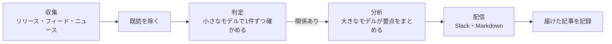

<p align="center">
  <picture>
    <source media="(prefers-color-scheme: dark)" srcset="docs/pochi-dark.svg">
    
  </picture>
</p>

<h1 align="center">Pochi</h1>

<p align="center">
  <strong>プロジェクトのまわりで変わったことを、毎日まとめて届ける。<br>大事なことだけを、取るべき対応とともに。</strong>
</p>

<p align="center">
  Pochi はリポジトリを読んで見張る先を決め、<br>
  毎朝、短いブリーフィングを Slack や Markdown に届けます。
</p>

<p align="center">
  <a href="https://github.com/tanatyu12/pochi/actions/workflows/ci.yml"></a>
  <a href="LICENSE"></a>
  
</p>

<p align="center">
  <a href="#はじめかた">はじめかた</a> ·
  <a href="#しくみ">しくみ</a> ·
  <a href="#ドキュメント英語">ドキュメント</a>
</p>

<p align="center">
  <sub>
    <a href="README.md">English</a> ·
    <a href="README.ja.md">日本語</a> ·
    <a href="README.zh-CN.md">简体中文</a> ·
    <a href="README.zh-TW.md">繁體中文</a> ·
    <a href="README.es.md">Español</a> ·
    <a href="README.fr.md">Français</a> ·
    <a href="README.de.md">Deutsch</a> ·
    <a href="README.pt-BR.md">Português</a> ·
    <a href="README.ko.md">한국어</a>
  </sub>
</p>

<p align="center">
  
  <br>
  <sub>設定を確認し、サンプルのヘルプデスク SaaS 向けに試し実行するところ。</sub>
</p>

## ブリーフィングの例

Next.js で作ったサンプルのヘルプデスク SaaS 向けに、ある日 Pochi が見つけた14件のうち3件です（[設定](docs/demo/)。出力言語を日本語にして実行）。

> ### [High] [Brotliの重大脆弱性「HTTP2Shell」で緊急パッチ](https://news.google.com/rss/articles/CBMitgFBVV95cUxQNGVrMWJmTkxqcDhLTzhhTGFyMU0yeTU0cDR2WTk4dmdkcVFhZVNLUVVWalUtS1p2ZUlxcWQ4MHFkT2FPOHlDYVFaNng2LW43NUxqeGpHNGlnVTZ3dXkwNTFic1ZDU1pkZ1N5YzdZemk3czR6Ni1RZ1owQ1RaNnJUZ04xSkpPVm5vNU16czM3TThQVjR0RFRsMWRQYTFRbjNrRGtHeUg1ZlJERnEzTC1sb0o4MlZOUQ?oc=5)
>
> BleepingComputerによると、Brotliに関する重大な脆弱性「HTTP2Shell」に対して緊急パッチが出ています。Node.js、HTTP/2、プロキシ、CDNなど圧縮処理を使う経路に影響する可能性があります。
>
> **Action:** 影響を受けるコンポーネント(Node.js、Next.js、リバースプロキシ、CDN)を特定し、パッチ適用状況を今週中に確認して適用する。
>
> ### [Medium] [SaaS課金がユーザー数から成果指標へ移行](https://news.google.com/rss/articles/CBMiiAFBVV95cUxQVW1BWTVfNXFvcjhNUTZ3MElJMncybGxiTGdySmtPRHk0LTRBSng3TEhPNUFmbTdJYVE4anFfbXBSXzF0Q3pVQzNHQ3ZKZUR1RXNRMThWbzc2ZFJRTzdmNEREemdPTmhxc2Vid3VEYWRIdkozRmhnc0dneUxJUUFqV1FwSmkxWDVu?oc=5)
>
> AIの普及でSaaSの課金が席数ベースから成果(パフォーマンス)指標ベースへ移っていると報じられています。サポート分野では解決件数課金のような料金モデルが該当し、Helpdeskの料金設計にも影響し得ます。
>
> **Action:** 現行の席数課金に加え、解決件数ベースなどの成果連動型料金を試算し、次回の料金会議で検討する。
>
> ### [Medium] [Zendeskが従業員向けAIエージェントと高度なアクションフローを発表](https://news.google.com/rss/articles/CBMixwFBVV95cUxQeC1ESnhiT0xmcmNjZGFmalk1dmVuWFNTQlZVX0dsT3ZqSFp3SzE3QWl1OEozVnJEemtkTk5QX25VbUxlZGU0RFpaWXlzbV80WUxuT21yRUx4Ymp2eGUyejE3ZUtWZFhnRVVvYmhySEJUaktCa040MnJJdkc0TldFRklBVWwzay10MFVoWkpHOXNDR3UzRE5Ha0pwMXZPbm5VZkhLSnBBR2pMWjRQYVFORlRmLXdjUW4walpac3pTNnZ2d0RfN1VZ?oc=5)
>
> Zendeskが従業員サービス向けのAIエージェントと高度なアクションフローを発表しました。顧客サポート以外へ領域を広げ、AIによる自動実行機能を強化する動きです。
>
> **Action:** Zendeskの新機能を調べ、自社ロードマップのアクション自動化機能と比較する。

## 特長

- **プロジェクトが依存するものだけを見張る。** コーディングエージェントがリポジトリを読み、気にかけるべき課題と見張るべき情報源を提案します。どの案にも根拠のファイルが添えられます。関係のない情報は、そもそも取りにいきません。
- **関係する理由と、取るべき対応を添える。** 届く記事にはどれも、関係する理由、High / Medium / Low の評価、取るべき対応が添えられます。
- **同じことを二度届けない。** 一度届いた記事は二度と届かず、同じ話題は1件にまとまり、何もない日は何も届きません。
- **手持ちのサブスクで動く。** `claude` や `codex` の CLI のログイン、または Anthropic の API キーを使います。
- **情報源は無料。** GitHub のリリース、RSS・Atom フィード、Google ニュースは無料です。Tavily の Web 検索は使わなくてもかまいません。
- **毎朝ひとりでに動く。** `pochi schedule install` で launchd、cron、GitHub Actions に登録します。

## はじめかた

必要なのは Node.js 22.18 以上と、[`claude`](https://docs.claude.com/en/docs/claude-code) CLI、[`codex`](https://github.com/openai/codex) CLI、`ANTHROPIC_API_KEY` のどれか1つです。Pochi は npm では配布していません。GitHub の **Use this template** から作るか（定期実行が動くのでおすすめです）、このリポジトリを clone してください。

```sh
git clone https://github.com/tanatyu12/pochi && cd pochi
npm ci && npm run build
alias pochi="node $PWD/dist/pochi.mjs"

pochi init              # answer a few questions to write config/
pochi doctor            # check the setup; sends no prompt, costs nothing
pochi run --dry-run     # print today's briefing without posting it
pochi schedule install  # run it every morning
```

### リポジトリをエージェントに読ませる（おすすめ）

質問に答える代わりに、コーディングエージェントに読み取り専用でプロジェクトを読ませ、見張る先を提案してもらいます。

```sh
pochi init --print-prompt > /tmp/pochi-prompt.md
(cd ~/code/your-project && claude -p --allowedTools "Read,Glob,Grep" < /tmp/pochi-prompt.md > /tmp/proposal.md)
pochi init --from /tmp/proposal.md
```

エージェントは技術基盤、デザイン、ビジネス、市場、運用の観点からプロジェクトを見て、どの案にも根拠を添えます。`pochi init --from` では、この提案から使うものを選びます。リポジトリが実在するかを確かめ、各情報源を一度取得して中身を見せてから、`config/context.yml` と `config/sources.yml` を書き出します。特定の競合や業界を追いたいときは、`--competitor`、`--adopter`、`--news-site` を付けます（どれも複数指定できます）。

<details>
<summary>Pochi 自身のリポジトリで試したときの提案の一部</summary>

```json
"problems": [
  { "text": "Changes to Claude Code and Codex CLI flags, JSON output, auth or safe mode that affect how Pochi spawns them",
    "axis": "tech", "evidence": "src/llm/cli.ts, src/llm/codex.ts, src/llm/adapter.ts" },
  { "text": "Launches and pricing of competing AI news digests, release-tracking and changelog-monitoring tools",
    "axis": "market", "evidence": "package.json description 'Daily briefing for your project'" }
],
"repos": [{ "repo": "colinhacks/zod", "evidence": "package.json zod ^4; src/config/schema.ts" }],
"queries": [{ "query": "AI changelog monitoring tool launch", "intent": "competitor", "topic": "news" }]
```

</details>

## しくみ



LLM が読むのは初めて見る記事だけで、大きなモデルが読むのは関係のある記事だけです。一部の情報源や LLM の呼び出しが失敗しても、残りの処理は続きます。

## もっと詳しく

| コマンド | できること |
| --- | --- |
| `pochi init` | 対話で設定を作る。`--from` でエージェントの提案から作る |
| `pochi doctor` | 設定・LLM のキーやログインが使えるか・キー・状態ファイルを確認する。プロンプトは送らない |
| `pochi run` | 見張っている情報源から新着を取得し、今日のブリーフィングを届ける。`--dry-run` なら画面に出すだけ |
| `pochi schedule install` | `context.yml` のスケジュールどおりに、launchd・cron・GitHub Actions で定期実行する |

詳しい使い方は、各コマンドの `--help` で確認できます。

**設定。** `config/context.yml` には、プロジェクトの説明、気にかけている課題、除外したい話題、ブリーフィングの言語、届け先を書きます。`config/sources.yml` には、見張るリポジトリ、フィード、検索語を並べます。ブリーフィングはどの言語でも書けます。`pochi init` では8つの言語から選べます。

<details>
<summary>最小限の設定例</summary>

```yaml
# config/context.yml
version: 1
project:
  name: my-app
  description: Next.js と Postgres で作った SaaS。サポートチャットに LLM を使っている。
problems:
  - Next.js と React の破壊的変更とセキュリティ修正
  - サポートチャットに使える、より安くて速い LLM
exclude:
  - 資金調達や企業買収のニュース
language: Japanese
notify:
  channels:
    - type: file    # reports/<日付>.md に書き出す。Slack なら type: slack と SLACK_WEBHOOK_URL
```

```yaml
# config/sources.yml
version: 1
feeds:
  - { id: nextjs, type: github, name: Next.js releases, repo: vercel/next.js }
  - { id: llm-news, type: googlenews, query: カスタマーサポート LLM, locale: ja-JP }
```

</details>

**費用。** 新着の記事すべてに目を通すのは小さなモデル（Claude Haiku）で、大きなモデル（Claude Sonnet）がまとめるのは関係のある数件だけです。`claude` や `codex` のサブスクは個人での利用が前提なので、CI やチームで共有する環境では API キーを使ってください。Tavily の無料枠は月1,000クレジットで、1回の実行で検索語1つにつき1クレジットを使います。

### ドキュメント（英語）

- [設定](docs/configuration.md)：すべての項目、環境変数、状態ファイル
- [定期実行](docs/scheduling.md)：launchd、cron、GitHub Actions
- [アップデート](docs/updating.md)：新しいリリースを自分のコピーに取り込む
- [困ったときは](docs/troubleshooting.md)：`pochi doctor` の見方と終了コード
- [セキュリティ](SECURITY.md)：キーや外部の文章の扱い、脆弱性の報告先

## 開発に参加する

Issue や Pull Request は大歓迎です。

```sh
npm ci
npm run typecheck && npm test
npm run dev -- run --dry-run   # run from source
```

コミットメッセージは [Conventional Commits](https://www.conventionalcommits.org/ja/) の形式で書いてください。リリースは release-please が作ります。

## ライセンス

[MIT](LICENSE)

<p align="center"><sub>ポチは柴犬です。<code>pochi woof</code> と打ってみてください。</sub></p>
