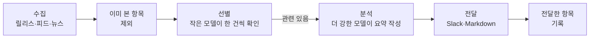

<p align="center">
  <picture>
    <source media="(prefers-color-scheme: dark)" srcset="docs/pochi-dark.svg">
    
  </picture>
</p>

<h1 align="center">Pochi</h1>

<p align="center">
  <strong>쏟아지는 정보를 쫓지 마세요.<br>프로젝트에 필요한 것만 가져옵니다.</strong>
</p>

<p align="center">
  리포지토리를 읽고 지켜볼 정보원을 정한 뒤,<br>
  매일 짧은 브리핑을 Slack이나 Markdown으로 보내 주는 CLI입니다.
</p>

<p align="center">
  <a href="https://github.com/OWNER/pochi/actions/workflows/ci.yml"></a>
  <a href="LICENSE"></a>
  
</p>

<p align="center">
  <a href="#빠른-시작">빠른 시작</a> ·
  <a href="#동작-방식">동작 방식</a> ·
  <a href="docs/configuration.md">설정</a> ·
  <a href="docs/scheduling.md">정기 실행</a>
</p>

<p align="center">
  <sub>
    <a href="README.md">English</a> ·
    <a href="README.ja.md">日本語</a> ·
    <a href="README.zh-CN.md">简体中文</a> ·
    <a href="README.zh-TW.md">繁體中文</a> ·
    <a href="README.es.md">Español</a> ·
    <a href="README.fr.md">Français</a> ·
    <a href="README.de.md">Deutsch</a> ·
    <a href="README.pt-BR.md">Português</a> ·
    <a href="README.ko.md">한국어</a>
  </sub>
</p>

<p align="center"><sub>이 문서는 번역본입니다. 내용이 다를 경우 영어판 <a href="README.md">README.md</a>를 기준으로 합니다.</sub></p>

<p align="center">
  
  <br>
  <sub>설정을 점검한 뒤, 샘플 헬프데스크 SaaS를 대상으로 시험 실행하는 모습입니다.</sub>
</p>

## 왜 Pochi인가

기술 스택, 시장, 경쟁사에 관한 뉴스는 혼자서 다 따라갈 수 없을 만큼 많습니다. Pochi는 일단 모두 모은 다음 걸러 내는 도구가 아닙니다. 프로젝트에서 출발해, 프로젝트와 관련된 정보만 가져옵니다.

**프로젝트가 의존하는 것만 지켜봅니다.** 코딩 에이전트가 리포지토리를 읽고, 신경 써야 할 과제와 지켜볼 정보원을 제안합니다. 사용 중인 라이브러리, 호출하는 서비스, 경쟁사, 시장 같은 것들입니다. 모든 제안에는 근거가 된 파일이 함께 표시됩니다. 프로젝트와 관계없는 정보는 애초에 가져오지 않습니다.

**중요한 것만, 이유와 함께 전달합니다.** 가져온 항목도 등록한 과제에 비추어 한 건씩 다시 확인합니다. 통과한 항목에는 왜 중요한지, 얼마나 중요한지(High, Medium, Low), 무엇을 해야 하는지가 함께 붙습니다. 이미 본 항목은 다시 오지 않고, 같은 소식을 다룬 여러 기사는 한 건으로 묶이며, 별일 없는 날에는 아무것도 보내지 않습니다.

<sub>정보원: GitHub 릴리스, RSS·Atom 피드, Google 뉴스(무료), Tavily 웹 검색 · LLM: Claude 또는 Codex 구독, 혹은 Anthropic API 키 · 실행 환경: launchd, cron, GitHub Actions</sub>

## 받게 되는 것

이 README를 작성한 날, 샘플 프로젝트를 대상으로 만든 브리핑입니다. 샘플은 Next.js로 만든 헬프데스크 SaaS로, AI로 답장 초안을 작성합니다([설정](docs/demo/)). 이날 12개의 정보원에서 읽어 볼 만한 항목 11건이 도착했으며, 보안뿐 아니라 시장, 경쟁사, 규제에 관한 내용도 포함되어 있었습니다. 그중 3건을 줄여서 싣습니다. 이 샘플은 `language: English`로 실행한 결과입니다. `language: Korean`으로 설정하면 요약과 대응 방안이 한국어로 작성되며, High나 Action 같은 레이블은 영어로 유지됩니다.

> ### [High] [HTTP2Shell Brotli vulnerability reaches beyond Node.js](https://news.google.com/rss/articles/CBMiowFBVV95cUxNaktOLUVHRnNGOUVQSHZFU2R5SDNxTWJjYlBaLVZfQXpZMFN5Ukl1T2JzNGtCaWp6bS1VTXlfTzRmbHVxanJMRS1nMHRydjRmaUVyeHRNV1VIakhHdE9qZjJKa0xNeWdINWtvWkFzU1ZKYjM5aEo1dkczNFR2ak1kWElKR1pmdEI5M3dfSTdpR2RXaTJ4YlRVSHQ3MUJXeVpSRk44?oc=5)
>
> Check Point reports a Brotli-related flaw, nicknamed HTTP2Shell, that affects more than Node.js. Helpdesk serves Next.js over HTTP, so the flaw could reach it through the runtime, a proxy or a dependency.
>
> **Action:** Check whether Node, your reverse proxy/CDN and any Brotli dependencies are affected, and patch them or disable Brotli/HTTP2 where needed.
>
> ### [Medium] [AI is moving SaaS billing from seats to performance metrics](https://news.google.com/rss/articles/CBMiiAFBVV95cUxQVW1BWTVfNXFvcjhNUTZ3MElJMncybGxiTGdySmtPRHk0LTRBSng3TEhPNUFmbTdJYVE4anFfbXBSXzF0Q3pVQzNHQ3ZKZUR1RXNRMThWbzc2ZFJRTzdmNEREemdPTmhxc2Vid3VEYWRIdkozRmhnc0dneUxJUUFqV1FwSmkxWDVu?oc=5)
>
> SaaS vendors are moving from per-user pricing to outcome-based billing, which matches per-resolution AI pricing in help desks. Seat-based pricing for Helpdesk may come under pressure as AI reduces the number of agents customers need.
>
> **Action:** Model an outcome-based or hybrid pricing option for the AI assistant, and compare it with competitors' per-resolution prices.
>
> ### [Medium] [Zendesk launches employee service AI agents and advanced action flows](https://news.google.com/rss/articles/CBMixwFBVV95cUxQeC1ESnhiT0xmcmNjZGFmalk1dmVuWFNTQlZVX0dsT3ZqSFp3SzE3QWl1OEozVnJEemtkTk5QX25VbUxlZGU0RFpaWXlzbV80WUxuT21yRUx4Ymp2eGUyejE3ZUtWZFhnRVVvYmhySEJUaktCa040MnJJdkc0TldFRklBVWwzay10MFVoWkpHOXNDR3UzRE5Ha0pwMXZPbm5VZkhLSnBBR2pMWjRQYVFORlRmLXdjUW4walpac3pTNnZ2d0RfN1VZ?oc=5)
>
> Zendesk is extending its AI agents to internal employee service and adding action flows for multi-step automation: agents that take actions, not just draft replies.
>
> **Action:** Compare Zendesk's action flows with Helpdesk's roadmap and decide whether action-taking automation should be prioritized.

브리핑은 `reports/`에 Markdown 파일로 저장하거나, Slack 메시지로 보내거나, 둘 다 할 수 있습니다.

## 빠른 시작

필요한 것:

- Node.js 22.18 이상
- LLM: [`claude`](https://docs.claude.com/en/docs/claude-code) CLI, [`codex`](https://github.com/openai/codex) CLI, `ANTHROPIC_API_KEY` 중 하나
- Slack과 Tavily는 없어도 동작합니다

Pochi는 npm으로 배포하지 않습니다. 이 리포지토리를 자신의 복사본으로 만들어 실행합니다. 정기 실행이 제대로 동작하도록 GitHub의 **Use this template**으로 만드는 것을 권장합니다. clone해도 됩니다.

```sh
git clone https://github.com/OWNER/pochi && cd pochi
npm ci && npm run build
alias pochi="node $PWD/dist/pochi.mjs"
```

**1. 리포지토리에서 시작하기**(권장). 코딩 에이전트에게 읽기 전용으로 제안을 받은 다음, 그 제안으로 설정을 만듭니다.

```sh
pochi init --print-prompt > /tmp/pochi-prompt.md
(cd ~/code/your-project && claude -p --allowedTools "Read,Glob,Grep" < /tmp/pochi-prompt.md > /tmp/proposal.md)
pochi init --from /tmp/proposal.md
```

몇 가지 질문에 답하면서 만들 수도 있습니다: `pochi init`

**2. 점검한 뒤 시험 실행하기.** 아무것도 전송하지 않습니다.

```sh
pochi doctor          # 설정, LLM, 키, 상태 파일 확인. 모델을 호출하지 않아 비용이 들지 않습니다
pochi run --dry-run   # 오늘의 브리핑을 출력합니다
```

**3. 매일 아침 실행되게 하기:** `pochi schedule install`. GitHub Actions에서 실행하려면 [정기 실행](docs/scheduling.md)을 참고하세요.

## 리포지토리에서 감시 목록까지

`--print-prompt`가 출력하는 프롬프트는 에이전트에게 코드, 문서, 설정을 읽게 하며, 비밀 정보는 열지 않게 합니다. 기술 스택, 비즈니스, 시장과 경쟁사, 운영이라는 네 가지 관점에서 과제와 정보원을 근거와 함께 제안하도록 합니다. 다음은 Pochi 자신의 리포지토리에 대해 받은 제안의 일부입니다.

```json
"problems": [
  { "text": "Changes to Claude Code and Codex CLI flags, JSON output, auth or safe mode that affect how Pochi spawns them",
    "axis": "tech", "evidence": "src/llm/cli.ts, src/llm/codex.ts, src/llm/adapter.ts" },
  { "text": "Launches and pricing of competing AI news digests, release-tracking and changelog-monitoring tools",
    "axis": "market", "evidence": "package.json description 'Daily briefing for your project'" }
],
"repos": [{ "repo": "colinhacks/zod", "evidence": "package.json zod ^4; src/config/schema.ts" }],
"queries": [{ "query": "AI changelog monitoring tool launch", "intent": "competitor", "topic": "news" }]
```

`pochi init --from`에서는 이 제안 중 사용할 항목을 고릅니다. 각 리포지토리가 실제로 존재하는지 확인하고, 정보원마다 한 번씩 가져와 어떤 내용이 오는지 보여 준 뒤 `config/context.yml`과 `config/sources.yml`을 작성합니다. 특정 경쟁사나 업계를 따라가고 싶다면 `--competitor`, `--adopter`, `--news-site`로 직접 지정할 수 있습니다(모두 여러 번 지정 가능).

## 동작 방식



LLM에 전달되는 것은 처음 보는 항목뿐이고, 더 강한 모델에 전달되는 것은 관련 있는 항목뿐입니다. 일부 정보원이나 배치가 실패해도 실행은 멈추지 않습니다.

## 명령어

| 명령어 | 설명 |
| --- | --- |
| `pochi init` | 대화형으로 설정을 만듭니다. `--from`으로 에이전트의 제안에서 만들 수도 있습니다 |
| `pochi doctor` | 설정, LLM, 키, 상태 파일을 점검합니다. 모델을 호출하거나 무언가를 전송하지 않습니다 |
| `pochi run` | 오늘의 브리핑을 수집하고 걸러서 전달합니다(`--dry-run`이면 화면에 출력만 합니다) |
| `pochi schedule install` | `context.yml`의 일정에 따라 launchd, cron, GitHub Actions로 정기 실행합니다 |

모든 명령어에서 `--help`를 사용할 수 있습니다.

## 설정

설정은 `config/`의 두 파일이며, 둘 다 `pochi init`이 작성합니다.

- **`context.yml`**: 프로젝트 설명, 신경 쓰는 과제, 제외할 주제, 브리핑 언어, 전달 위치
- **`sources.yml`**: 지켜볼 GitHub 리포지토리, 피드, Google 뉴스 검색어, Tavily 검색어

<details>
<summary>최소 설정 예시</summary>

```yaml
# config/context.yml
version: 1
project:
  name: my-app
  description: Postgres 백엔드와 LLM 기반 고객 지원 채팅을 갖춘 Next.js SaaS 앱.
problems:
  - Next.js와 React의 호환성을 깨는 변경 및 보안 수정
  - 고객 지원 채팅에 쓸 수 있는 더 저렴하거나 빠른 LLM
exclude:
  - 투자 유치 및 기업 인수 뉴스
language: Korean
notify:
  channels:
    - type: file    # reports/<날짜>.md에 작성. Slack이면 type: slack과 SLACK_WEBHOOK_URL
```

```yaml
# config/sources.yml
version: 1
feeds:
  - { id: nextjs, type: github, name: Next.js releases, repo: vercel/next.js }
  - { id: llm-news, type: googlenews, query: 고객 지원 LLM, locale: ko-KR }
```

</details>

모든 항목은 [docs/configuration.md](docs/configuration.md)(영어)와 주석이 달린 [`config/context.example.yml`](config/context.example.yml), [`config/sources.example.yml`](config/sources.example.yml)에서 확인할 수 있습니다.

## 비용

- **LLM.** 새 항목은 모두 작은 모델(Claude Haiku)이 선별하고, 관련 있는 몇 건만 더 강한 모델(Claude Sonnet)이 정리합니다. `claude`나 `codex` CLI를 사용하면 보유한 구독 범위 안에서 실행됩니다. 구독은 개인 사용을 전제로 하므로, CI나 팀에서 공유하는 환경에서는 API 키를 사용하세요.
- **정보원.** GitHub, 피드, Google 뉴스는 무료입니다. Tavily는 월 1,000크레딧의 무료 사용량이 있으며, 실행할 때마다 검색어 하나당 1크레딧을 사용합니다.

## 문서(영어)

- [설정](docs/configuration.md): 모든 항목, 환경 변수, 상태 파일
- [정기 실행](docs/scheduling.md): launchd, cron, GitHub Actions
- [문제 해결](docs/troubleshooting.md): `pochi doctor`와 종료 코드
- [보안](SECURITY.md): 키와 신뢰할 수 없는 텍스트를 다루는 방식, 취약점 보고 방법

## 기여하기

이슈와 풀 리퀘스트를 환영합니다.

```sh
npm ci
npm run typecheck && npm test
npm run dev -- run --dry-run   # 소스에서 바로 실행
```

커밋은 [Conventional Commits](https://www.conventionalcommits.org/ko/) 형식을 따르며, 릴리스는 release-please가 만듭니다.

## 라이선스

[MIT](LICENSE)

<p align="center"><sub>Pochi는 시바견입니다. <code>pochi woof</code>를 입력해 보세요.</sub></p>
