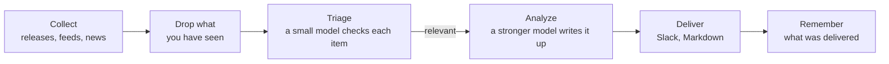

<p align="center">
  <picture>
    <source media="(prefers-color-scheme: dark)" srcset="docs/pochi-dark.svg">
    
  </picture>
</p>

<h1 align="center">Pochi</h1>

<p align="center">
  <strong>A daily briefing on what changed around your project:<br>only what matters, and what to do about it.</strong>
</p>

<p align="center">
  Pochi reads your repository, decides what to watch,<br>
  and sends a short briefing to Slack or Markdown every morning.
</p>

<p align="center">
  <a href="https://github.com/tanatyu12/pochi/actions/workflows/ci.yml"></a>
  <a href="LICENSE"></a>
  
</p>

<p align="center">
  <a href="#quick-start">Quick start</a> ·
  <a href="#how-it-works">How it works</a> ·
  <a href="#documentation">Docs</a>
</p>

<p align="center">
  <sub>
    <a href="README.md">English</a> ·
    <a href="README.ja.md">日本語</a> ·
    <a href="README.zh-CN.md">简体中文</a> ·
    <a href="README.zh-TW.md">繁體中文</a> ·
    <a href="README.es.md">Español</a> ·
    <a href="README.fr.md">Français</a> ·
    <a href="README.de.md">Deutsch</a> ·
    <a href="README.pt-BR.md">Português</a> ·
    <a href="README.ko.md">한국어</a>
  </sub>
</p>

<p align="center">
  
  <br>
  <sub>Checking the setup, then a dry run for a sample help desk SaaS.</sub>
</p>

## What a briefing looks like

Three of the 11 items Pochi found one day for a sample help desk SaaS built on Next.js ([its config](docs/demo/)):

> ### [High] [HTTP2Shell Brotli vulnerability reaches beyond Node.js](https://news.google.com/rss/articles/CBMiowFBVV95cUxNaktOLUVHRnNGOUVQSHZFU2R5SDNxTWJjYlBaLVZfQXpZMFN5Ukl1T2JzNGtCaWp6bS1VTXlfTzRmbHVxanJMRS1nMHRydjRmaUVyeHRNV1VIakhHdE9qZjJKa0xNeWdINWtvWkFzU1ZKYjM5aEo1dkczNFR2ak1kWElKR1pmdEI5M3dfSTdpR2RXaTJ4YlRVSHQ3MUJXeVpSRk44?oc=5)
>
> Check Point reports a Brotli-related flaw, nicknamed HTTP2Shell, that affects more than Node.js. Helpdesk serves Next.js over HTTP, so the flaw could reach it through the runtime, a proxy or a dependency.
>
> **Action:** Check whether Node, your reverse proxy/CDN and any Brotli dependencies are affected, and patch them or disable Brotli/HTTP2 where needed.
>
> ### [Medium] [AI is moving SaaS billing from seats to performance metrics](https://news.google.com/rss/articles/CBMiiAFBVV95cUxQVW1BWTVfNXFvcjhNUTZ3MElJMncybGxiTGdySmtPRHk0LTRBSng3TEhPNUFmbTdJYVE4anFfbXBSXzF0Q3pVQzNHQ3ZKZUR1RXNRMThWbzc2ZFJRTzdmNEREemdPTmhxc2Vid3VEYWRIdkozRmhnc0dneUxJUUFqV1FwSmkxWDVu?oc=5)
>
> SaaS vendors are moving from per-user pricing to outcome-based billing, which matches per-resolution AI pricing in help desks. Seat-based pricing for Helpdesk may come under pressure as AI reduces the number of agents customers need.
>
> **Action:** Model an outcome-based or hybrid pricing option for the AI assistant, and compare it with competitors' per-resolution prices.
>
> ### [Medium] [Zendesk launches employee service AI agents and advanced action flows](https://news.google.com/rss/articles/CBMixwFBVV95cUxQeC1ESnhiT0xmcmNjZGFmalk1dmVuWFNTQlZVX0dsT3ZqSFp3SzE3QWl1OEozVnJEemtkTk5QX25VbUxlZGU0RFpaWXlzbV80WUxuT21yRUx4Ymp2eGUyejE3ZUtWZFhnRVVvYmhySEJUaktCa040MnJJdkc0TldFRklBVWwzay10MFVoWkpHOXNDR3UzRE5Ha0pwMXZPbm5VZkhLSnBBR2pMWjRQYVFORlRmLXdjUW4walpac3pTNnZ2d0RfN1VZ?oc=5)
>
> Zendesk is extending its AI agents to internal employee service and adding action flows for multi-step automation: agents that take actions, not just draft replies.
>
> **Action:** Compare Zendesk's action flows with Helpdesk's roadmap and decide whether action-taking automation should be prioritized.

## Highlights

- **Watches only what your project depends on.** A coding agent reads your repository and proposes the problems and sources to watch, each citing the files behind it. Nothing unrelated is fetched.
- **Says why it matters and what to do.** Every item comes with its relevance, a High, Medium or Low rating, and a suggested action.
- **Never repeats itself.** What you have seen does not come back, several reports of one story arrive as one, and on a quiet day Pochi stays quiet.
- **Runs on the subscription you have.** Use your `claude` or `codex` CLI login, or an Anthropic API key.
- **Free sources.** GitHub releases, RSS and Atom feeds and Google News cost nothing; Tavily web search is optional.
- **Runs every morning on its own.** `pochi schedule install` sets up launchd, cron or GitHub Actions.

## Quick start

You need Node.js 22.18 or later and one of the [`claude`](https://docs.claude.com/en/docs/claude-code) CLI, the [`codex`](https://github.com/openai/codex) CLI, or an `ANTHROPIC_API_KEY`. Pochi is not on npm: click **Use this template** (recommended, so scheduled runs work) or clone this repository.

```sh
git clone https://github.com/tanatyu12/pochi && cd pochi
npm ci && npm run build
alias pochi="node $PWD/dist/pochi.mjs"

pochi init              # answer a few questions to write config/
pochi doctor            # check the setup; sends no prompt, costs nothing
pochi run --dry-run     # print today's briefing without posting it
pochi schedule install  # run it every morning
```

### Let an agent read your repository (recommended)

Instead of answering questions, have a coding agent read your project, read-only, and propose what to watch:

```sh
pochi init --print-prompt > /tmp/pochi-prompt.md
(cd ~/code/your-project && claude -p --allowedTools "Read,Glob,Grep" < /tmp/pochi-prompt.md > /tmp/proposal.md)
pochi init --from /tmp/proposal.md
```

The agent looks at your tech stack, design, business, market and operations, and cites its evidence for every idea. `pochi init --from` lets you pick from the proposal, checks that each repository exists, fetches each source once to show what it carries, and writes `config/context.yml` and `config/sources.yml`. To follow particular players, add `--competitor`, `--adopter` or `--news-site` (all repeatable).

<details>
<summary>Part of what it proposed for Pochi itself</summary>

```json
"problems": [
  { "text": "Changes to Claude Code and Codex CLI flags, JSON output, auth or safe mode that affect how Pochi spawns them",
    "axis": "tech", "evidence": "src/llm/cli.ts, src/llm/codex.ts, src/llm/adapter.ts" },
  { "text": "Launches and pricing of competing AI news digests, release-tracking and changelog-monitoring tools",
    "axis": "market", "evidence": "package.json description 'Daily briefing for your project'" }
],
"repos": [{ "repo": "colinhacks/zod", "evidence": "package.json zod ^4; src/config/schema.ts" }],
"queries": [{ "query": "AI changelog monitoring tool launch", "intent": "competitor", "topic": "news" }]
```

</details>

## How it works



Only items new to you reach the LLM, and only the relevant ones reach the stronger model. A failing source or batch does not stop the run.

## Learn more

| Command | |
| --- | --- |
| `pochi init` | Create the config interactively, or `--from` an agent's proposal |
| `pochi doctor` | Check the config, that the LLM key or login works, keys and state, without sending a prompt |
| `pochi run` | Collect, filter and deliver today's briefing (`--dry-run` to only print it) |
| `pochi schedule install` | Run it on the schedule in `context.yml`, with launchd, cron or GitHub Actions |

Every command has `--help`.

**Configuration.** `config/context.yml` says what your project is, the problems you care about, what to exclude, the briefing's language and where to deliver it; `config/sources.yml` lists the repositories, feeds and searches to watch. The briefing can be written in any language; `pochi init` offers eight.

<details>
<summary>A minimal example</summary>

```yaml
# config/context.yml
version: 1
project:
  name: my-app
  description: A Next.js SaaS app with a Postgres backend and an LLM-powered support chat.
problems:
  - Breaking changes and security fixes in Next.js and React
  - Cheaper or faster LLMs for customer support chat
exclude:
  - Funding news and company acquisitions
notify:
  channels:
    - type: file    # writes reports/<date>.md; or type: slack with SLACK_WEBHOOK_URL
```

```yaml
# config/sources.yml
version: 1
feeds:
  - { id: nextjs, type: github, name: Next.js releases, repo: vercel/next.js }
  - { id: llm-news, type: googlenews, query: customer support LLM }
```

</details>

**Cost.** A small model (Claude Haiku) triages every new item and a stronger one (Claude Sonnet) writes up only the relevant few. The `claude` and `codex` subscriptions are for personal use, so use an API key for CI or anything shared. Tavily's free tier gives 1,000 credits a month, one per query per run.

### Documentation

- [Configuration](docs/configuration.md): every key, environment variables, the state file
- [Scheduling](docs/scheduling.md): launchd, cron and GitHub Actions
- [Updating](docs/updating.md): bringing a new release into your copy
- [Troubleshooting](docs/troubleshooting.md): `pochi doctor` and exit codes
- [Security](SECURITY.md): how keys and untrusted text are handled, and how to report a vulnerability

## Contributing

Issues and pull requests are welcome.

```sh
npm ci
npm run typecheck && npm test
npm run dev -- run --dry-run   # run from source
```

Commits follow [Conventional Commits](https://www.conventionalcommits.org/); releases are cut by release-please.

## License

[MIT](LICENSE)

<p align="center"><sub>Pochi is a Shiba. Try <code>pochi woof</code>.</sub></p>
