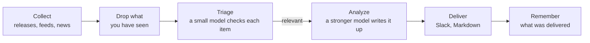

<p align="center">
  <picture>
    <source media="(prefers-color-scheme: dark)" srcset="docs/pochi-dark.svg">
    
  </picture>
</p>

<h1 align="center">Pochi</h1>

<p align="center">
  <strong>Don't chase the flood.<br>Fetch only what your project needs.</strong>
</p>

<p align="center">
  A CLI that picks what to watch from your repository,<br>
  and sends a short daily briefing to Slack or Markdown.
</p>

<p align="center">
  <a href="https://github.com/OWNER/pochi/actions/workflows/ci.yml"></a>
  <a href="LICENSE"></a>
  
</p>

<p align="center">
  <a href="#quick-start">Quick start</a> ·
  <a href="#how-it-works">How it works</a> ·
  <a href="docs/configuration.md">Configuration</a> ·
  <a href="docs/scheduling.md">Scheduling</a> ·
  <a href="README.ja.md">日本語</a>
</p>

<p align="center">
  
  <br>
  <sub>Checking the setup, then a dry run for a sample help desk SaaS.</sub>
</p>

## Why Pochi

There is more news about your stack, your market and your competitors than anyone can follow. Pochi is not a tool that collects everything and filters it. It starts from your project, and fetches only what bears on it.

**It watches only what your project depends on.** A coding agent reads your repository and proposes the problems to care about and the sources to watch: the libraries you use, the services you call, your competitors, your market. Every idea cites the files behind it. What is unrelated to your project is never fetched.

**It passes on only what matters, and says why.** What it fetches is still checked against your problems, one item at a time. What gets through comes with why it matters, how much (High, Medium, Low), and what to do. Nothing you have seen comes back, several reports of one story arrive as one, and on a quiet day Pochi stays quiet.

<sub>Sources: GitHub releases, RSS and Atom feeds, Google News (free), Tavily web search · LLM: your Claude or Codex subscription, or an Anthropic API key · Runs on: launchd, cron or GitHub Actions</sub>

## What you get

The briefing for a sample project on the day this README was written: a help desk SaaS on Next.js that drafts replies with AI ([its config](docs/demo/)). Its 12 sources brought 11 items worth reading that day, on security, the market, competitors and regulation. Three of them, shortened:

> ### [High] [HTTP2Shell Brotli vulnerability reaches beyond Node.js](https://news.google.com/rss/articles/CBMiowFBVV95cUxNaktOLUVHRnNGOUVQSHZFU2R5SDNxTWJjYlBaLVZfQXpZMFN5Ukl1T2JzNGtCaWp6bS1VTXlfTzRmbHVxanJMRS1nMHRydjRmaUVyeHRNV1VIakhHdE9qZjJKa0xNeWdINWtvWkFzU1ZKYjM5aEo1dkczNFR2ak1kWElKR1pmdEI5M3dfSTdpR2RXaTJ4YlRVSHQ3MUJXeVpSRk44?oc=5)
>
> Check Point reports a Brotli-related flaw, nicknamed HTTP2Shell, that affects more than Node.js. Helpdesk serves Next.js over HTTP, so the flaw could reach it through the runtime, a proxy or a dependency.
>
> **Action:** Check whether Node, your reverse proxy/CDN and any Brotli dependencies are affected, and patch them or disable Brotli/HTTP2 where needed.
>
> ### [Medium] [AI is moving SaaS billing from seats to performance metrics](https://news.google.com/rss/articles/CBMiiAFBVV95cUxQVW1BWTVfNXFvcjhNUTZ3MElJMncybGxiTGdySmtPRHk0LTRBSng3TEhPNUFmbTdJYVE4anFfbXBSXzF0Q3pVQzNHQ3ZKZUR1RXNRMThWbzc2ZFJRTzdmNEREemdPTmhxc2Vid3VEYWRIdkozRmhnc0dneUxJUUFqV1FwSmkxWDVu?oc=5)
>
> SaaS vendors are moving from per-user pricing to outcome-based billing, which matches per-resolution AI pricing in help desks. Seat-based pricing for Helpdesk may come under pressure as AI reduces the number of agents customers need.
>
> **Action:** Model an outcome-based or hybrid pricing option for the AI assistant, and compare it with competitors' per-resolution prices.
>
> ### [Medium] [Zendesk launches employee service AI agents and advanced action flows](https://news.google.com/rss/articles/CBMixwFBVV95cUxQeC1ESnhiT0xmcmNjZGFmalk1dmVuWFNTQlZVX0dsT3ZqSFp3SzE3QWl1OEozVnJEemtkTk5QX25VbUxlZGU0RFpaWXlzbV80WUxuT21yRUx4Ymp2eGUyejE3ZUtWZFhnRVVvYmhySEJUaktCa040MnJJdkc0TldFRklBVWwzay10MFVoWkpHOXNDR3UzRE5Ha0pwMXZPbm5VZkhLSnBBR2pMWjRQYVFORlRmLXdjUW4walpac3pTNnZ2d0RfN1VZ?oc=5)
>
> Zendesk is extending its AI agents to internal employee service and adding action flows for multi-step automation: agents that take actions, not just draft replies.
>
> **Action:** Compare Zendesk's action flows with Helpdesk's roadmap and decide whether action-taking automation should be prioritized.

It arrives as a Markdown file in `reports/`, a Slack message, or both.

## Quick start

You need Node.js 22.18 or later, and one of the [`claude`](https://docs.claude.com/en/docs/claude-code) CLI, the [`codex`](https://github.com/openai/codex) CLI, or an `ANTHROPIC_API_KEY`. Slack and Tavily are optional.

Pochi is not on npm: you run it from your own copy of this repository. Click **Use this template** (recommended, so scheduled runs work) or clone it:

```sh
git clone https://github.com/OWNER/pochi && cd pochi
npm ci && npm run build
alias pochi="node $PWD/dist/pochi.mjs"
```

**1. Start from your repository** (recommended). Ask a coding agent for a proposal, read-only, then build your config from it:

```sh
pochi init --print-prompt > /tmp/pochi-prompt.md
(cd ~/code/your-project && claude -p --allowedTools "Read,Glob,Grep" < /tmp/pochi-prompt.md > /tmp/proposal.md)
pochi init --from /tmp/proposal.md
```

Or answer a few questions instead: `pochi init`.

**2. Check, then try a run** that posts nothing:

```sh
pochi doctor          # config, LLM, keys and state; calls no model, costs nothing
pochi run --dry-run   # prints today's briefing
```

**3. Run it every morning:** `pochi schedule install`. See [Scheduling](docs/scheduling.md) for GitHub Actions.

## From your repository to a watchlist

The prompt asks the agent to read your code, docs and config, and nothing secret, along four axes: your tech stack, your business, your market and competitors, and how you operate. Every idea cites its evidence. This is part of what it proposed for Pochi itself (abridged):

```json
"problems": [
  { "text": "Changes to Claude Code and Codex CLI flags, JSON output, auth or safe mode that affect how Pochi spawns them",
    "axis": "tech", "evidence": "src/llm/cli.ts, src/llm/codex.ts, src/llm/adapter.ts" },
  { "text": "Launches and pricing of competing AI news digests, release-tracking and changelog-monitoring tools",
    "axis": "market", "evidence": "package.json description 'Daily briefing for your project'" }
],
"repos": [{ "repo": "colinhacks/zod", "evidence": "package.json zod ^4; src/config/schema.ts" }],
"queries": [{ "query": "AI changelog monitoring tool launch", "intent": "competitor", "topic": "news" }]
```

`pochi init --from` lets you pick from it, checks that every repository exists, fetches each source once to show you what it carries, and writes `config/context.yml` and `config/sources.yml`. To follow particular players, name them: `--competitor`, `--adopter` and `--news-site` (all repeatable).

## How it works



Only items new to you reach the LLM, and only the relevant ones reach the stronger model. A failing source or batch does not stop the run.

## Commands

| Command | |
| --- | --- |
| `pochi init` | Create the config interactively, or `--from` an agent's proposal |
| `pochi doctor` | Check the config, LLM, keys and state without calling a model or sending anything |
| `pochi run` | Collect, filter and deliver today's briefing (`--dry-run` to only print it) |
| `pochi schedule install` | Run it on the schedule in `context.yml`, with launchd, cron or GitHub Actions |

Every command has `--help`.

## Configuration

Two files in `config/`, both written by `pochi init`:

- **`context.yml`**: what your project is, the problems you care about, what to exclude, the language of the briefing, and where to deliver it.
- **`sources.yml`**: the GitHub repositories, feeds, Google News searches and Tavily queries to watch.

<details>
<summary>A minimal example</summary>

```yaml
# config/context.yml
version: 1
project:
  name: my-app
  description: A Next.js SaaS app with a Postgres backend and an LLM-powered support chat.
problems:
  - Breaking changes and security fixes in Next.js and React
  - Cheaper or faster LLMs for customer support chat
exclude:
  - Funding news and company acquisitions
notify:
  channels:
    - type: file    # writes reports/<date>.md; or type: slack with SLACK_WEBHOOK_URL
```

```yaml
# config/sources.yml
version: 1
feeds:
  - { id: nextjs, type: github, name: Next.js releases, repo: vercel/next.js }
  - { id: llm-news, type: googlenews, query: customer support LLM }
```

</details>

Every key is in [docs/configuration.md](docs/configuration.md) and the commented [`config/context.example.yml`](config/context.example.yml) and [`config/sources.example.yml`](config/sources.example.yml).

## Cost

- **LLM.** A small model (Claude Haiku) triages every new item; a stronger one (Claude Sonnet) writes up only the relevant few. With the `claude` or `codex` CLI, runs use your subscription. Use an API key for CI or anything shared: the subscriptions are for personal use.
- **Sources.** GitHub, feeds and Google News are free. Tavily has a free tier of 1,000 credits a month, one per query per run.

## Documentation

- [Configuration](docs/configuration.md): every key, environment variables, the state file
- [Scheduling](docs/scheduling.md): launchd, cron and GitHub Actions
- [Troubleshooting](docs/troubleshooting.md): `pochi doctor` and exit codes
- [Security](SECURITY.md): how keys and untrusted text are handled, and how to report a vulnerability

## Contributing

Issues and pull requests are welcome.

```sh
npm ci
npm run typecheck && npm test
npm run dev -- run --dry-run   # run from source
```

Commits follow [Conventional Commits](https://www.conventionalcommits.org/); releases are cut by release-please.

## License

[MIT](LICENSE)

<p align="center"><sub>Pochi is a Shiba. Try <code>pochi woof</code>.</sub></p>
