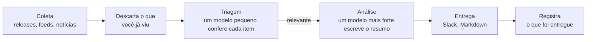

<p align="center">
  <picture>
    <source media="(prefers-color-scheme: dark)" srcset="docs/pochi-dark.svg">
    
  </picture>
</p>

<h1 align="center">Pochi</h1>

<p align="center">
  <strong>Um resumo diário do que mudou em volta do seu projeto:<br>só o que importa, e o que fazer a respeito.</strong>
</p>

<p align="center">
  O Pochi lê o seu repositório, decide o que acompanhar<br>
  e manda toda manhã um resumo curto para o Slack ou em Markdown.
</p>

<p align="center">
  <a href="https://github.com/tanatyu12/pochi/actions/workflows/ci.yml"></a>
  <a href="LICENSE"></a>
  
</p>

<p align="center">
  <a href="#início-rápido">Início rápido</a> ·
  <a href="#como-funciona">Como funciona</a> ·
  <a href="#documentação-em-inglês">Documentação</a>
</p>

<p align="center">
  <sub>
    <a href="README.md">English</a> ·
    <a href="README.ja.md">日本語</a> ·
    <a href="README.zh-CN.md">简体中文</a> ·
    <a href="README.zh-TW.md">繁體中文</a> ·
    <a href="README.es.md">Español</a> ·
    <a href="README.fr.md">Français</a> ·
    <a href="README.de.md">Deutsch</a> ·
    <a href="README.pt-BR.md">Português</a> ·
    <a href="README.ko.md">한국어</a>
  </sub>
</p>

<p align="center"><sub>Esta é uma tradução. Se houver divergência, vale o <a href="README.md">README.md</a> (em inglês).</sub></p>

<p align="center">
  
  <br>
  <sub>Verificando a configuração e depois um teste (dry run) para um SaaS de help desk de exemplo.</sub>
</p>

## Como é um resumo

Três dos 11 itens que o Pochi encontrou num dia para um SaaS de help desk de exemplo feito em Next.js ([a configuração dele](docs/demo/)):

> ### [High] [HTTP2Shell Brotli vulnerability reaches beyond Node.js](https://news.google.com/rss/articles/CBMiowFBVV95cUxNaktOLUVHRnNGOUVQSHZFU2R5SDNxTWJjYlBaLVZfQXpZMFN5Ukl1T2JzNGtCaWp6bS1VTXlfTzRmbHVxanJMRS1nMHRydjRmaUVyeHRNV1VIakhHdE9qZjJKa0xNeWdINWtvWkFzU1ZKYjM5aEo1dkczNFR2ak1kWElKR1pmdEI5M3dfSTdpR2RXaTJ4YlRVSHQ3MUJXeVpSRk44?oc=5)
>
> Check Point reports a Brotli-related flaw, nicknamed HTTP2Shell, that affects more than Node.js. Helpdesk serves Next.js over HTTP, so the flaw could reach it through the runtime, a proxy or a dependency.
>
> **Action:** Check whether Node, your reverse proxy/CDN and any Brotli dependencies are affected, and patch them or disable Brotli/HTTP2 where needed.
>
> ### [Medium] [AI is moving SaaS billing from seats to performance metrics](https://news.google.com/rss/articles/CBMiiAFBVV95cUxQVW1BWTVfNXFvcjhNUTZ3MElJMncybGxiTGdySmtPRHk0LTRBSng3TEhPNUFmbTdJYVE4anFfbXBSXzF0Q3pVQzNHQ3ZKZUR1RXNRMThWbzc2ZFJRTzdmNEREemdPTmhxc2Vid3VEYWRIdkozRmhnc0dneUxJUUFqV1FwSmkxWDVu?oc=5)
>
> SaaS vendors are moving from per-user pricing to outcome-based billing, which matches per-resolution AI pricing in help desks. Seat-based pricing for Helpdesk may come under pressure as AI reduces the number of agents customers need.
>
> **Action:** Model an outcome-based or hybrid pricing option for the AI assistant, and compare it with competitors' per-resolution prices.
>
> ### [Medium] [Zendesk launches employee service AI agents and advanced action flows](https://news.google.com/rss/articles/CBMixwFBVV95cUxQeC1ESnhiT0xmcmNjZGFmalk1dmVuWFNTQlZVX0dsT3ZqSFp3SzE3QWl1OEozVnJEemtkTk5QX25VbUxlZGU0RFpaWXlzbV80WUxuT21yRUx4Ymp2eGUyejE3ZUtWZFhnRVVvYmhySEJUaktCa040MnJJdkc0TldFRklBVWwzay10MFVoWkpHOXNDR3UzRE5Ha0pwMXZPbm5VZkhLSnBBR2pMWjRQYVFORlRmLXdjUW4walpac3pTNnZ2d0RfN1VZ?oc=5)
>
> Zendesk is extending its AI agents to internal employee service and adding action flows for multi-step automation: agents that take actions, not just draft replies.
>
> **Action:** Compare Zendesk's action flows with Helpdesk's roadmap and decide whether action-taking automation should be prioritized.

## Destaques

- **Acompanha só aquilo de que o seu projeto depende.** Um agente de código lê o seu repositório e propõe os problemas e as fontes a acompanhar, cada um citando os arquivos em que se baseia. Nada sem relação é buscado.
- **Explica por que importa e o que fazer.** Cada item vem com a sua relevância, uma classificação High, Medium ou Low e uma ação sugerida.
- **Nunca se repete.** O que você já viu não volta, várias matérias sobre o mesmo assunto chegam como uma só, e em dia parado o Pochi fica quieto.
- **Roda com a assinatura que você já tem.** Use o login da CLI `claude` ou `codex`, ou uma chave de API da Anthropic.
- **Fontes gratuitas.** Releases do GitHub, feeds RSS e Atom e Google News não custam nada; a busca na web do Tavily é opcional.
- **Roda sozinho toda manhã.** `pochi schedule install` configura launchd, cron ou GitHub Actions.

## Início rápido

Você precisa do Node.js 22.18 ou mais recente e de uma destas opções: a CLI [`claude`](https://docs.claude.com/en/docs/claude-code), a CLI [`codex`](https://github.com/openai/codex) ou uma `ANTHROPIC_API_KEY`. O Pochi não está no npm: clique em **Use this template** (recomendado, para que as execuções agendadas funcionem) ou clone este repositório.

```sh
git clone https://github.com/tanatyu12/pochi && cd pochi
npm ci && npm run build
alias pochi="node $PWD/dist/pochi.mjs"

pochi init              # answer a few questions to write config/
pochi doctor            # check the setup; sends no prompt, costs nothing
pochi run --dry-run     # print today's briefing without posting it
pochi schedule install  # run it every morning
```

### Deixe um agente ler o seu repositório (recomendado)

Em vez de responder a perguntas, peça a um agente de código que leia o seu projeto, só com permissão de leitura, e proponha o que acompanhar:

```sh
pochi init --print-prompt > /tmp/pochi-prompt.md
(cd ~/code/your-project && claude -p --allowedTools "Read,Glob,Grep" < /tmp/pochi-prompt.md > /tmp/proposal.md)
pochi init --from /tmp/proposal.md
```

O agente analisa a sua stack técnica, o design, o negócio, o mercado e a operação, e cita a evidência de cada sugestão. Com `pochi init --from` você escolhe o que aproveitar da proposta. Ele confere se cada repositório existe, busca cada fonte uma vez para mostrar o que ela traz e grava `config/context.yml` e `config/sources.yml`. Para acompanhar empresas ou players específicos, adicione `--competitor`, `--adopter` ou `--news-site` (todos podem ser repetidos).

<details>
<summary>Um trecho do que ele propôs para o próprio Pochi</summary>

```json
"problems": [
  { "text": "Changes to Claude Code and Codex CLI flags, JSON output, auth or safe mode that affect how Pochi spawns them",
    "axis": "tech", "evidence": "src/llm/cli.ts, src/llm/codex.ts, src/llm/adapter.ts" },
  { "text": "Launches and pricing of competing AI news digests, release-tracking and changelog-monitoring tools",
    "axis": "market", "evidence": "package.json description 'Daily briefing for your project'" }
],
"repos": [{ "repo": "colinhacks/zod", "evidence": "package.json zod ^4; src/config/schema.ts" }],
"queries": [{ "query": "AI changelog monitoring tool launch", "intent": "competitor", "topic": "news" }]
```

</details>

## Como funciona



Só os itens novos para você chegam ao LLM, e só os relevantes chegam ao modelo mais forte. Se uma fonte ou um lote falhar, o resto da execução continua.

## Saiba mais

| Comando | |
| --- | --- |
| `pochi init` | Cria a configuração de forma interativa, ou com `--from` a partir da proposta de um agente |
| `pochi doctor` | Verifica a configuração, se a chave ou o login do LLM funciona, as chaves e o estado, sem enviar nenhum prompt |
| `pochi run` | Coleta, filtra e entrega o resumo do dia (`--dry-run` só imprime) |
| `pochi schedule install` | Roda no horário definido em `context.yml`, com launchd, cron ou GitHub Actions |

Todo comando aceita `--help`.

**Configuração.** `config/context.yml` diz o que é o seu projeto, os problemas que importam para você, o que excluir, o idioma do resumo e para onde enviá-lo; `config/sources.yml` lista os repositórios, feeds e buscas a acompanhar. O resumo pode ser escrito em qualquer idioma; o `pochi init` oferece oito.

<details>
<summary>Um exemplo mínimo</summary>

```yaml
# config/context.yml
version: 1
project:
  name: my-app
  description: Um SaaS em Next.js com backend Postgres e um chat de suporte com LLM.
problems:
  - Mudanças incompatíveis e correções de segurança no Next.js e no React
  - LLMs mais baratos ou mais rápidos para chat de atendimento ao cliente
exclude:
  - Notícias sobre rodadas de investimento e aquisições de empresas
language: Portuguese
notify:
  channels:
    - type: file    # grava reports/<data>.md; ou type: slack com SLACK_WEBHOOK_URL
```

```yaml
# config/sources.yml
version: 1
feeds:
  - { id: nextjs, type: github, name: Next.js releases, repo: vercel/next.js }
  - { id: llm-news, type: googlenews, query: atendimento ao cliente LLM, locale: pt-BR }
```

</details>

**Custo.** Um modelo pequeno (Claude Haiku) faz a triagem de cada item novo e um mais forte (Claude Sonnet) escreve só sobre os poucos relevantes. As assinaturas do `claude` e do `codex` são para uso pessoal, então use uma chave de API em CI ou em qualquer ambiente compartilhado. O plano gratuito do Tavily dá 1.000 créditos por mês, e cada consulta gasta um crédito por execução.

### Documentação (em inglês)

- [Configuração](docs/configuration.md): todas as chaves, variáveis de ambiente e o arquivo de estado
- [Agendamento](docs/scheduling.md): launchd, cron e GitHub Actions
- [Atualização](docs/updating.md): trazer uma nova versão para a sua cópia
- [Solução de problemas](docs/troubleshooting.md): `pochi doctor` e códigos de saída
- [Segurança](SECURITY.md): como chaves e textos externos são tratados, e como relatar uma vulnerabilidade

## Como contribuir

Issues e pull requests são bem-vindos.

```sh
npm ci
npm run typecheck && npm test
npm run dev -- run --dry-run   # run from source
```

Os commits seguem o [Conventional Commits](https://www.conventionalcommits.org/); as releases são geradas pelo release-please.

## Licença

[MIT](LICENSE)

<p align="center"><sub>O Pochi é um Shiba. Experimente <code>pochi woof</code>.</sub></p>
