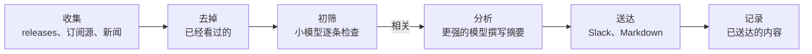

<p align="center">
  <picture>
    <source media="(prefers-color-scheme: dark)" srcset="docs/pochi-dark.svg">
    
  </picture>
</p>

<h1 align="center">Pochi</h1>

<p align="center">
  <strong>每天一份简报，告诉你项目周边发生了什么变化：<br>只讲重要的，以及该怎么做。</strong>
</p>

<p align="center">
  Pochi 会阅读你的仓库，决定要关注什么，<br>
  每天早上把一份简短的简报发到 Slack 或写成 Markdown。
</p>

<p align="center">
  <a href="https://github.com/tanatyu12/pochi/actions/workflows/ci.yml"></a>
  <a href="LICENSE"></a>
  
</p>

<p align="center">
  <a href="#快速开始">快速开始</a> ·
  <a href="#工作原理">工作原理</a> ·
  <a href="#文档英文">文档</a>
</p>

<p align="center">
  <sub>
    <a href="README.md">English</a> ·
    <a href="README.ja.md">日本語</a> ·
    <a href="README.zh-CN.md">简体中文</a> ·
    <a href="README.zh-TW.md">繁體中文</a> ·
    <a href="README.es.md">Español</a> ·
    <a href="README.fr.md">Français</a> ·
    <a href="README.de.md">Deutsch</a> ·
    <a href="README.pt-BR.md">Português</a> ·
    <a href="README.ko.md">한국어</a>
  </sub>
</p>

<p align="center"><sub>本文为译文，如与英文版 README.md 有出入，以英文版为准。</sub></p>

<p align="center">
  
  <br>
  <sub>先检查配置，再为一个示例客服 SaaS 试运行一次。</sub>
</p>

## 简报长什么样

某一天，Pochi 为一个基于 Next.js 的示例客服 SaaS（[它的配置](docs/demo/)）找到了 11 条内容，以下是其中三条。这份示例是用 `language: English` 生成的。

> ### [High] [HTTP2Shell Brotli vulnerability reaches beyond Node.js](https://news.google.com/rss/articles/CBMiowFBVV95cUxNaktOLUVHRnNGOUVQSHZFU2R5SDNxTWJjYlBaLVZfQXpZMFN5Ukl1T2JzNGtCaWp6bS1VTXlfTzRmbHVxanJMRS1nMHRydjRmaUVyeHRNV1VIakhHdE9qZjJKa0xNeWdINWtvWkFzU1ZKYjM5aEo1dkczNFR2ak1kWElKR1pmdEI5M3dfSTdpR2RXaTJ4YlRVSHQ3MUJXeVpSRk44?oc=5)
>
> Check Point reports a Brotli-related flaw, nicknamed HTTP2Shell, that affects more than Node.js. Helpdesk serves Next.js over HTTP, so the flaw could reach it through the runtime, a proxy or a dependency.
>
> **Action:** Check whether Node, your reverse proxy/CDN and any Brotli dependencies are affected, and patch them or disable Brotli/HTTP2 where needed.
>
> ### [Medium] [AI is moving SaaS billing from seats to performance metrics](https://news.google.com/rss/articles/CBMiiAFBVV95cUxQVW1BWTVfNXFvcjhNUTZ3MElJMncybGxiTGdySmtPRHk0LTRBSng3TEhPNUFmbTdJYVE4anFfbXBSXzF0Q3pVQzNHQ3ZKZUR1RXNRMThWbzc2ZFJRTzdmNEREemdPTmhxc2Vid3VEYWRIdkozRmhnc0dneUxJUUFqV1FwSmkxWDVu?oc=5)
>
> SaaS vendors are moving from per-user pricing to outcome-based billing, which matches per-resolution AI pricing in help desks. Seat-based pricing for Helpdesk may come under pressure as AI reduces the number of agents customers need.
>
> **Action:** Model an outcome-based or hybrid pricing option for the AI assistant, and compare it with competitors' per-resolution prices.
>
> ### [Medium] [Zendesk launches employee service AI agents and advanced action flows](https://news.google.com/rss/articles/CBMixwFBVV95cUxQeC1ESnhiT0xmcmNjZGFmalk1dmVuWFNTQlZVX0dsT3ZqSFp3SzE3QWl1OEozVnJEemtkTk5QX25VbUxlZGU0RFpaWXlzbV80WUxuT21yRUx4Ymp2eGUyejE3ZUtWZFhnRVVvYmhySEJUaktCa040MnJJdkc0TldFRklBVWwzay10MFVoWkpHOXNDR3UzRE5Ha0pwMXZPbm5VZkhLSnBBR2pMWjRQYVFORlRmLXdjUW4walpac3pTNnZ2d0RfN1VZ?oc=5)
>
> Zendesk is extending its AI agents to internal employee service and adding action flows for multi-step automation: agents that take actions, not just draft replies.
>
> **Action:** Compare Zendesk's action flows with Helpdesk's roadmap and decide whether action-taking automation should be prioritized.

## 亮点

- **只关注你的项目真正依赖的东西。** 编码智能体会阅读你的仓库，提出值得关心的问题和值得关注的信息源，每条都注明依据的文件。与项目无关的信息不会去获取。
- **说明为什么重要、该怎么做。** 每一条都附有与项目的关联、High、Medium 或 Low 的重要程度，以及行动建议。
- **从不重复。** 看过的内容不会再出现，同一件事的多篇报道会合并成一条，没什么新鲜事的日子，Pochi 就保持安静。
- **用你现有的订阅运行。** 使用你已登录的 `claude` 或 `codex` CLI，或 Anthropic API 密钥。
- **免费的信息源。** GitHub releases、RSS 和 Atom 订阅源以及 Google 新闻都不花钱；Tavily 网页搜索是可选的。
- **每天早上自动运行。** `pochi schedule install` 会设置好 launchd、cron 或 GitHub Actions。

## 快速开始

你需要 Node.js 22.18 或更高版本，以及以下任意一项：[`claude`](https://docs.claude.com/en/docs/claude-code) CLI、[`codex`](https://github.com/openai/codex) CLI 或 `ANTHROPIC_API_KEY`。Pochi 没有发布到 npm：点击 **Use this template**（推荐，这样定时运行才能生效），或者 clone 本仓库。

```sh
git clone https://github.com/tanatyu12/pochi && cd pochi
npm ci && npm run build
alias pochi="node $PWD/dist/pochi.mjs"

pochi init              # answer a few questions to write config/
pochi doctor            # check the setup; sends no prompt, costs nothing
pochi run --dry-run     # print today's briefing without posting it
pochi schedule install  # run it every morning
```

### 让智能体阅读你的仓库（推荐）

不用回答问题，而是让编码智能体以只读方式阅读你的项目，提出要关注的内容：

```sh
pochi init --print-prompt > /tmp/pochi-prompt.md
(cd ~/code/your-project && claude -p --allowedTools "Read,Glob,Grep" < /tmp/pochi-prompt.md > /tmp/proposal.md)
pochi init --from /tmp/proposal.md
```

智能体会从技术栈、设计、业务、市场和运营几个方面审视你的项目，并为每条建议注明依据。`pochi init --from` 让你从提案中挑选要用的条目，确认每个仓库确实存在，把每个信息源抓取一次让你看看它的内容，然后写出 `config/context.yml` 和 `config/sources.yml`。如果想追踪特定对象，可以加上 `--competitor`、`--adopter` 或 `--news-site`（都可以重复指定）。

<details>
<summary>它为 Pochi 自身给出的部分提案</summary>

```json
"problems": [
  { "text": "Changes to Claude Code and Codex CLI flags, JSON output, auth or safe mode that affect how Pochi spawns them",
    "axis": "tech", "evidence": "src/llm/cli.ts, src/llm/codex.ts, src/llm/adapter.ts" },
  { "text": "Launches and pricing of competing AI news digests, release-tracking and changelog-monitoring tools",
    "axis": "market", "evidence": "package.json description 'Daily briefing for your project'" }
],
"repos": [{ "repo": "colinhacks/zod", "evidence": "package.json zod ^4; src/config/schema.ts" }],
"queries": [{ "query": "AI changelog monitoring tool launch", "intent": "competitor", "topic": "news" }]
```

</details>

## 工作原理



只有你没见过的内容才会交给 LLM，也只有相关的内容才会交给更强的模型。某个信息源或某一批处理失败，不会中断整次运行。

## 了解更多

| 命令 | 说明 |
| --- | --- |
| `pochi init` | 以交互方式创建配置，或用 `--from` 基于智能体的提案创建 |
| `pochi doctor` | 检查配置、LLM 密钥或登录是否可用、密钥和状态，不调用模型 |
| `pochi run` | 收集、过滤并送达今天的简报（`--dry-run` 只打印不发送） |
| `pochi schedule install` | 按 `context.yml` 中的时间表，通过 launchd、cron 或 GitHub Actions 定时运行 |

每个命令都支持 `--help`。

**配置。** `config/context.yml` 说明项目是做什么的、你关心的问题、要排除的话题、简报的语言以及送达到哪里；`config/sources.yml` 列出要关注的仓库、订阅源和搜索。简报可以用任何语言撰写；`pochi init` 提供八种语言可选。

<details>
<summary>最小示例</summary>

```yaml
# config/context.yml
version: 1
project:
  name: my-app
  description: 基于 Next.js 和 Postgres 的 SaaS 应用，客服聊天使用 LLM。
problems:
  - Next.js 和 React 的破坏性变更与安全修复
  - 更便宜或更快、适合客服聊天的 LLM
exclude:
  - 融资和企业并购新闻
language: Chinese (Simplified)
notify:
  channels:
    - type: file    # 写入 reports/<日期>.md；或使用 type: slack 并设置 SLACK_WEBHOOK_URL
```

```yaml
# config/sources.yml
version: 1
feeds:
  - { id: nextjs, type: github, name: Next.js releases, repo: vercel/next.js }
  - { id: llm-news, type: googlenews, query: 客服 LLM, locale: zh-CN }
```

</details>

**费用。** 每条新内容由小模型（Claude Haiku）初筛，只有少数相关内容才交给更强的模型（Claude Sonnet）撰写。`claude` 和 `codex` 的订阅仅限个人使用，因此在 CI 或任何共享环境中请使用 API 密钥。Tavily 的免费额度为每月 1,000 积分，每次运行每个查询消耗 1 积分。

### 文档（英文）

- [配置](docs/configuration.md)：所有配置项、环境变量、状态文件
- [定时运行](docs/scheduling.md)：launchd、cron 和 GitHub Actions
- [更新](docs/updating.md)：把新版本合并到你的副本
- [故障排查](docs/troubleshooting.md)：`pochi doctor` 与退出码
- [安全](SECURITY.md)：密钥和不可信文本的处理方式，以及如何报告漏洞

## 参与贡献

欢迎提交 Issue 和 Pull Request。

```sh
npm ci
npm run typecheck && npm test
npm run dev -- run --dry-run   # run from source
```

提交信息请遵循 [Conventional Commits](https://www.conventionalcommits.org/zh-hans/) 规范；版本由 release-please 发布。

## 许可证

[MIT](LICENSE)

<p align="center"><sub>Pochi 是一只柴犬。试试 <code>pochi woof</code>。</sub></p>
