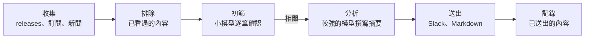

<p align="center">
  <picture>
    <source media="(prefers-color-scheme: dark)" srcset="docs/pochi-dark.svg">
    
  </picture>
</p>

<h1 align="center">Pochi</h1>

<p align="center">
  <strong>每天一份摘要，告訴你專案周遭有什麼變化：<br>只講重要的，以及該怎麼做。</strong>
</p>

<p align="center">
  Pochi 會讀取你的儲存庫、決定該關注什麼，<br>
  每天早上把精簡的摘要送到 Slack 或 Markdown。
</p>

<p align="center">
  <a href="https://github.com/tanatyu12/pochi/actions/workflows/ci.yml"></a>
  <a href="LICENSE"></a>
  
</p>

<p align="center">
  <a href="#快速開始">快速開始</a> ·
  <a href="#運作方式">運作方式</a> ·
  <a href="#文件英文">文件</a>
</p>

<p align="center">
  <sub>
    <a href="README.md">English</a> ·
    <a href="README.ja.md">日本語</a> ·
    <a href="README.zh-CN.md">简体中文</a> ·
    <a href="README.zh-TW.md">繁體中文</a> ·
    <a href="README.es.md">Español</a> ·
    <a href="README.fr.md">Français</a> ·
    <a href="README.de.md">Deutsch</a> ·
    <a href="README.pt-BR.md">Português</a> ·
    <a href="README.ko.md">한국어</a>
  </sub>
</p>

<p align="center"><sub>本文件為翻譯版本，內容如有出入，以 README.md（英文）為準。</sub></p>

<p align="center">
  
  <br>
  <sub>先檢查設定，再針對範例客服 SaaS 試跑一次。</sub>
</p>

## 摘要長什麼樣子

某一天，Pochi 為一個用 Next.js 打造的範例客服 SaaS（[它的設定](docs/demo/)）找到 11 則內容，以下是其中 3 則。這份範例是以 `language: English` 產生的。

> ### [High] [HTTP2Shell Brotli vulnerability reaches beyond Node.js](https://news.google.com/rss/articles/CBMiowFBVV95cUxNaktOLUVHRnNGOUVQSHZFU2R5SDNxTWJjYlBaLVZfQXpZMFN5Ukl1T2JzNGtCaWp6bS1VTXlfTzRmbHVxanJMRS1nMHRydjRmaUVyeHRNV1VIakhHdE9qZjJKa0xNeWdINWtvWkFzU1ZKYjM5aEo1dkczNFR2ak1kWElKR1pmdEI5M3dfSTdpR2RXaTJ4YlRVSHQ3MUJXeVpSRk44?oc=5)
>
> Check Point reports a Brotli-related flaw, nicknamed HTTP2Shell, that affects more than Node.js. Helpdesk serves Next.js over HTTP, so the flaw could reach it through the runtime, a proxy or a dependency.
>
> **Action:** Check whether Node, your reverse proxy/CDN and any Brotli dependencies are affected, and patch them or disable Brotli/HTTP2 where needed.
>
> ### [Medium] [AI is moving SaaS billing from seats to performance metrics](https://news.google.com/rss/articles/CBMiiAFBVV95cUxQVW1BWTVfNXFvcjhNUTZ3MElJMncybGxiTGdySmtPRHk0LTRBSng3TEhPNUFmbTdJYVE4anFfbXBSXzF0Q3pVQzNHQ3ZKZUR1RXNRMThWbzc2ZFJRTzdmNEREemdPTmhxc2Vid3VEYWRIdkozRmhnc0dneUxJUUFqV1FwSmkxWDVu?oc=5)
>
> SaaS vendors are moving from per-user pricing to outcome-based billing, which matches per-resolution AI pricing in help desks. Seat-based pricing for Helpdesk may come under pressure as AI reduces the number of agents customers need.
>
> **Action:** Model an outcome-based or hybrid pricing option for the AI assistant, and compare it with competitors' per-resolution prices.
>
> ### [Medium] [Zendesk launches employee service AI agents and advanced action flows](https://news.google.com/rss/articles/CBMixwFBVV95cUxQeC1ESnhiT0xmcmNjZGFmalk1dmVuWFNTQlZVX0dsT3ZqSFp3SzE3QWl1OEozVnJEemtkTk5QX25VbUxlZGU0RFpaWXlzbV80WUxuT21yRUx4Ymp2eGUyejE3ZUtWZFhnRVVvYmhySEJUaktCa040MnJJdkc0TldFRklBVWwzay10MFVoWkpHOXNDR3UzRE5Ha0pwMXZPbm5VZkhLSnBBR2pMWjRQYVFORlRmLXdjUW4walpac3pTNnZ2d0RfN1VZ?oc=5)
>
> Zendesk is extending its AI agents to internal employee service and adding action flows for multi-step automation: agents that take actions, not just draft replies.
>
> **Action:** Compare Zendesk's action flows with Helpdesk's roadmap and decide whether action-taking automation should be prioritized.

## 特色

- **只關注專案實際依賴的東西。** 由程式開發代理（coding agent）閱讀你的儲存庫，提出值得留意的課題和該追蹤的來源，每個建議都附上依據的檔案。跟專案無關的資訊不會去抓。
- **說明為什麼重要、該怎麼做。** 每個項目都會附上與專案的關聯、High、Medium 或 Low 的影響程度，以及建議行動。
- **絕不重複。** 看過的不會再出現，同一件事的多篇報導會合併成一則，沒什麼事的日子，Pochi 就安安靜靜。
- **用你現有的訂閱執行。** 使用已登入的 `claude` 或 `codex` CLI，或 Anthropic API 金鑰。
- **免費的來源。** GitHub releases、RSS 與 Atom 訂閱和 Google 新聞都不用錢；Tavily 網路搜尋可有可無。
- **每天早上自動執行。** `pochi schedule install` 會設定好 launchd、cron 或 GitHub Actions。

## 快速開始

你需要 Node.js 22.18 以上，以及 [`claude`](https://docs.claude.com/en/docs/claude-code) CLI、[`codex`](https://github.com/openai/codex) CLI 或 `ANTHROPIC_API_KEY` 三者之一。Pochi 沒有發布到 npm：建議按 **Use this template** 建立（這樣排程執行才能正常運作），或 clone 這個儲存庫。

```sh
git clone https://github.com/tanatyu12/pochi && cd pochi
npm ci && npm run build
alias pochi="node $PWD/dist/pochi.mjs"

pochi init              # answer a few questions to write config/
pochi doctor            # check the setup; sends no prompt, costs nothing
pochi run --dry-run     # print today's briefing without posting it
pochi schedule install  # run it every morning
```

### 讓代理閱讀你的儲存庫（建議）

不必回答問題，改請程式開發代理以唯讀方式閱讀你的專案，提出該追蹤的內容：

```sh
pochi init --print-prompt > /tmp/pochi-prompt.md
(cd ~/code/your-project && claude -p --allowedTools "Read,Glob,Grep" < /tmp/pochi-prompt.md > /tmp/proposal.md)
pochi init --from /tmp/proposal.md
```

代理會從技術堆疊、設計、商業模式、市場和營運等面向檢視你的專案，並為每個建議附上依據。`pochi init --from` 讓你從建議中挑選要用的項目，確認每個儲存庫確實存在，並把每個來源各抓一次讓你看看內容，最後寫出 `config/context.yml` 和 `config/sources.yml`。想追蹤特定對象時，可以加上 `--competitor`、`--adopter` 或 `--news-site`（皆可重複指定）。

<details>
<summary>它為 Pochi 本身提出的部分建議</summary>

```json
"problems": [
  { "text": "Changes to Claude Code and Codex CLI flags, JSON output, auth or safe mode that affect how Pochi spawns them",
    "axis": "tech", "evidence": "src/llm/cli.ts, src/llm/codex.ts, src/llm/adapter.ts" },
  { "text": "Launches and pricing of competing AI news digests, release-tracking and changelog-monitoring tools",
    "axis": "market", "evidence": "package.json description 'Daily briefing for your project'" }
],
"repos": [{ "repo": "colinhacks/zod", "evidence": "package.json zod ^4; src/config/schema.ts" }],
"queries": [{ "query": "AI changelog monitoring tool launch", "intent": "competitor", "topic": "news" }]
```

</details>

## 運作方式



只有你沒看過的項目會交給 LLM，也只有相關的項目會交給較強的模型。某個來源或某批處理失敗，也不會中斷整次執行。

## 深入了解

| 指令 | 說明 |
| --- | --- |
| `pochi init` | 以互動方式建立設定，或用 `--from` 從代理的建議建立 |
| `pochi doctor` | 檢查設定、LLM 金鑰或登入是否可用、金鑰和狀態檔，不呼叫模型 |
| `pochi run` | 收集、篩選並送出今天的摘要（加上 `--dry-run` 則只印出來） |
| `pochi schedule install` | 依 `context.yml` 裡的排程，透過 launchd、cron 或 GitHub Actions 定期執行 |

每個指令都有 `--help`。

**設定。** `config/context.yml` 說明專案是什麼、你在意的課題、要排除的內容、摘要的語言，以及送達的地方；`config/sources.yml` 列出要追蹤的儲存庫、訂閱來源和搜尋。摘要可以用任何語言撰寫；`pochi init` 提供八種語言可選。

<details>
<summary>最精簡的設定範例</summary>

```yaml
# config/context.yml
version: 1
project:
  name: my-app
  description: 以 Next.js 和 Postgres 打造的 SaaS 應用程式，客服聊天使用 LLM。
problems:
  - Next.js 和 React 的破壞性變更與安全性修正
  - 更便宜或更快、適合客服聊天的 LLM
exclude:
  - 募資與企業併購新聞
language: Chinese (Traditional)
notify:
  channels:
    - type: file    # 寫入 reports/<日期>.md；若用 Slack，改成 type: slack 並設定 SLACK_WEBHOOK_URL
```

```yaml
# config/sources.yml
version: 1
feeds:
  - { id: nextjs, type: github, name: Next.js releases, repo: vercel/next.js }
  - { id: llm-news, type: googlenews, query: 客服 LLM, locale: zh-TW }
```

</details>

**費用。** 每個新項目由小模型（Claude Haiku）初篩，只有少數相關的項目才交給較強的模型（Claude Sonnet）撰寫摘要。`claude` 和 `codex` 的訂閱方案僅限個人使用，CI 或任何共用環境請改用 API 金鑰。Tavily 的免費額度為每月 1,000 點，每次執行每個查詢用掉 1 點。

### 文件（英文）

- [設定](docs/configuration.md)：所有設定項目、環境變數、狀態檔
- [排程執行](docs/scheduling.md)：launchd、cron 和 GitHub Actions
- [更新](docs/updating.md)：把新版本合併到你的副本
- [疑難排解](docs/troubleshooting.md)：`pochi doctor` 與結束代碼
- [安全性](SECURITY.md)：金鑰與不可信文字的處理方式，以及如何回報漏洞

## 參與貢獻

歡迎提出 Issue 和 Pull Request。

```sh
npm ci
npm run typecheck && npm test
npm run dev -- run --dry-run   # run from source
```

Commit 訊息請遵循 [Conventional Commits](https://www.conventionalcommits.org/zh-hant/) 格式；版本由 release-please 發布。

## 授權

[MIT](LICENSE)

<p align="center"><sub>Pochi 是一隻柴犬。試試看 <code>pochi woof</code>。</sub></p>
