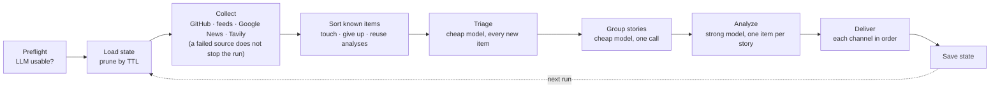

# Pochi specification

This document describes how Pochi behaves and why. It is written for contributors and for coding agents working in this repository.

- **What it is:** the reference for behavior, invariants and edge cases, module by module, with the reasons behind the design.
- **What it is not:** user documentation or a list of every config key. For those, see [README.md](../README.md), [configuration.md](configuration.md), [scheduling.md](scheduling.md), [troubleshooting.md](troubleshooting.md) and [updating.md](updating.md). Coding conventions and the places to touch when extending Pochi are in [AGENTS.md](../AGENTS.md).
- **How to read it:** sections follow `src/`. File paths and identifiers are in backticks, so you can grep for them. Each bullet states one rule. When this document and the code disagree, the code wins: fix this document in the same change.

## 1. Overview

Pochi is a CLI that sends one briefing per project per run: the few new items that matter to the project, each with a summary and a suggested action.

1. It collects items from GitHub releases or tags, RSS/Atom/RDF/JSON feeds, Google News searches and Tavily web searches.
2. It drops what it has seen before, using a state file.
3. A cheap model triages every new item against the project's `problems` and `exclude` lists.
4. A stronger model analyzes only the relevant items. Reports of the same story are grouped first, so each story is analyzed once.
5. It delivers the result to Slack and/or Markdown files, then records what was delivered.

It is distributed as a repository template, not on npm. Each user runs it from their own copy, on their machine (launchd or cron) or on GitHub Actions.

**Goals:**
- Only items about the project, never a digest of everything.
- Cheap enough to run daily.
- No item delivered twice.
- No secrets in config files.
- Untrusted text never steers the LLM.

**Non-goals:**
- A hosted service.
- Reading full web pages (no Readability-style extraction).
- Choosing sources automatically on every run. `init` helps choose sources once; runs read only what `sources.yml` lists.

## 2. Architecture

### Pipeline



`pochi run` (`src/commands/run.ts`) reads the config, the environment and the process. It then calls `runBriefing` (`src/pipeline/briefing.ts`), which receives everything else injected, as described in section 8.4.

### Directory layout

```
src/
  cli.ts errors.ts types.ts version.ts
  commands/   run.ts doctor.ts init.ts schedule.ts woof.ts
  commands/init/  flow.ts context.ts schedule.ts ideas.ts sources.ts feeds.ts searches.ts
                  trialFetch.ts session.ts cache.ts keys.ts ids.ts lists.ts git.ts
  config/     schema.ts load.ts write.ts languages.ts
  sources/    index.ts rss.ts github.ts googlenews.ts tavily.ts discover.ts html.ts api.ts
  llm/        schema.ts prompts.ts adapter.ts api.ts cli.ts codex.ts
  pipeline/   briefing.ts filter.ts
  notifiers/  types.ts index.ts slack.ts file.ts text.ts voice.ts
  state/      store.ts
  schedule/   types.ts index.ts calendar.ts launchd.ts cron.ts github.ts exec.ts fs.ts
  proposal/   prompt.ts parse.ts
  util/       http.ts log.ts hash.ts time.ts text.ts concurrency.ts fs.ts prompter.ts
              replay.ts settle.ts shell.ts pochiArt.ts
tests/        mirrors src/ one file to one file
  helpers/    mockFetch.ts fakeSpawn.ts fakeExec.ts scriptedPrompter.ts
  fixtures/   feeds/ tavily/ claude/ codex/
  setup/      build.ts (builds the bundle before every run; tests/bundle.test.ts executes it)
config/       context.example.yml sources.example.yml
scripts/      build.mjs logo.mjs demo.sh
.github/      workflows/{ci,release-please,pr-title}.yml dependabot.yml
docs/         configuration.md scheduling.md troubleshooting.md updating.md SPEC.md demo/
```

`.github/workflows/daily_briefing.yml` is not in this repository. `pochi schedule install --backend github` writes it into a user's copy.

### Build

- TypeScript is bundled by esbuild (`scripts/build.mjs`) into a single file, `dist/pochi.mjs`: format esm, platform node, target `node22`, with every dependency bundled.
- The banner adds the shebang and a `createRequire` shim. `src/cli.ts` must not have a shebang of its own, or the bundle would have two (`tests/bundle.test.ts` checks this).
- The version is injected with `define` from package.json, and the output is made executable (755). Under tsx and vitest, `VERSION` is `0.0.0-dev`.

### Runtime dependencies (six, deliberately)

| Package | Use | Why this one |
| --- | --- | --- |
| commander | commands and flags | |
| @clack/prompts | `init` prompts and spinners | also covers what ora would |
| zod v4 | validating config, API replies and LLM output; JSON Schema generation | one schema serves both validation and structured output |
| yaml | reading and writing config | |
| feedsmith | parsing RSS, Atom, RDF and JSON Feed | rss-parser is unmaintained and depends on an old xml2js |
| entities | decoding HTML entities | kept on feedsmith's major, so only one copy is bundled; Dependabot ignores its major updates |

HTML stripping and feed discovery are small functions of our own, not cheerio, which is heavy. Discuss before adding a runtime dependency.

### Supported Node

- Node 22.18 and later, as `engines` says, until Node 22 reaches end of life on 2027-04-30. After that, Node 22 is dropped in a minor release.
- CI runs Node 22 and 24, and `.nvmrc` says 24.
- `@types/node` stays on 22, so typecheck rejects APIs that Node 22 lacks. esbuild's `node22` target only rewrites syntax; it adds no missing APIs.

## 3. Design decisions

| Decision | Why | Rejected |
| --- | --- | --- |
| Two LLM stages: triage everything with a cheap model, analyze only the relevant items | Most items are irrelevant; the strong model's cost goes only to what will be delivered | One call that both judges and writes |
| Structured JSON output (zod schemas); the code builds Slack and Markdown | No broken formatting; ids can be matched; impact can be filtered | Asking the LLM for Markdown |
| Short ids `i1…iN` in prompts | Unknown ids can be detected and dropped; nothing else to hallucinate | Passing URLs or hashes |
| State file committed back by the Actions workflow | The same item must not arrive every morning, even on a stateless runner | No deduplication |
| Items triaged irrelevant are stored as `i` | They are never sent to the LLM again | Re-triaging each run |
| API mode with `fetch` on `/v1/messages`, no SDK | One endpoint; the SDK was about half of the bundle (about 1.2 MB); `messages.parse` parsed text before checking `stop_reason`, hiding refusals and truncation | Anthropic SDK |
| CLI mode spawns `claude` / `codex` with no tools, prompt on stdin, cwd in a private temp dir | No argv length limit; timeouts under our control; no tools or project files for injected text to use | `spawnSync` with the prompt in argv |
| No `temperature` or `tool_choice` in API requests | Current models reject them | |
| Untrusted text only HTML-escaped inside `<untrusted_items>` | Fetched text cannot close the fence or pass as instructions | Plain concatenation |
| Fail on an unusable LLM before fetching anything | Tavily credits and time are not spent on a run that cannot finish | Failing at the first LLM call |
| Output language set by `language` (default English) | Usable outside Japan; labels stay English | Fixed language |
| feedsmith plus our own small HTML functions | Small bundle, maintained parser | rss-parser, cheerio |
| Tavily with `time_range`/`start_date` and `include_published_date` | `days` is deprecated; without dates, old pages in `general` results pass as new | `days: 7` |
| Google News RSS for news searches | Free, keyless, dated | Tavily for everything |
| Distributed as a template, not on npm | Each copy holds its own state, workflow and secrets | npm package |
| Secrets only in env vars | YAML gets copied, pasted and committed | Secrets in YAML |

## 4. Configuration model

Every key and its default is listed in [configuration.md](configuration.md). This section covers loading and validation.

- **Load order:** `POCHI_CONTEXT_YAML` and `POCHI_SOURCES_YAML` (meant for CI), then `config/context.yml` and `config/sources.yml` (the directory can be changed with `--config-dir`). `loadConfig` is in `src/config/load.ts`.
- **Blank values:** an env var that is empty or whitespace-only counts as unset, because GitHub Actions expands a missing secret to `""`. Code uses `?.trim() || undefined` for this throughout.
- **Missing file:** the message is `<path> not found (run "pochi init" or set <ENV>)`.
- **Errors are reported together:** both files are validated, and all their errors are reported at once.
- **What error messages never show:** values or unknown key names. They read `label: path: message` and are rebuilt from the issue code (`src/config/schema.ts`).
- **YAML errors:** a syntax error shows the line, column and code, never the source line. Duplicate keys are an error. Aliases are capped at 50, to stop alias bombs.
- **Strict schemas:** every object is a zod `strictObject`, so unknown keys are errors.
- **Cross-field rules:**
  - `ttlDays > maxItemAgeDays`.
  - `schedule.day` only with `interval: weekly`.
  - `time` is forbidden with `cron`, and `cronjob` is required with `cron` and forbidden otherwise.
  - `timezone` must be a valid IANA name.
- **Notify channels:** `notify.channels` lists `slack` and/or `file`, at most one of each type and at least one. The default is `[{ type: slack }]`. Channels are delivered in the listed order. The Slack webhook comes only from `SLACK_WEBHOOK_URL`.
- **Sources:**
  - Ids match `^[a-z0-9][a-z0-9_-]*$` and are unique across `feeds` and `queries`. At least one feed or query is required.
  - `repo` matches `REPO_PATTERN` (`owner/repo`; `.` and `..` are rejected as repo names).
  - An rss `url` is absolute http(s).
  - `locale` matches `^[a-z]{2,3}-[A-Z]{2}$`.
  - Domain lists hold 1–20 host names, trimmed and lowercased.
  - A query's `topic` defaults to `general`, and `maxResults` is 1–20 (default 10).
- **Limits:** `problems` holds 1–50 entries (`MAX_PROBLEMS`) and `exclude` 0–30. Each problem is one line in every prompt, so 50 cost about 1,000 tokens.
- **LLM defaults:**
  - `llm.provider` defaults to `auto`; `cli` is a legacy alias for `claude`.
  - Models are `claude-haiku-5-5` / `claude-sonnet-5-5` in API mode and `haiku` / `sonnet` with claude. Codex has no default: without a model, `--model` is not passed and codex's own model is used.
- **Languages:** `src/config/languages.ts` lists the nine languages `init` offers, with their aliases (`中文`, `es`, …). `localeOf()` maps a language to a Google News edition and falls back to `en-US`. `language` itself is free text.
- **Writing config:** `src/config/write.ts` validates both files before writing, refuses to overwrite unless asked, and writes a temp file at mode `0o600` that is then renamed. It adds a header comment and writes the user's input rather than the parsed value, so defaults stay implicit.
- **Git:** `config/*.yml` is gitignored; only `*.example.yml` files are tracked.

## 5. Items and normalization

### Item (`src/types.ts`)

| Field | Meaning |
| --- | --- |
| `id` | First 32 hex digits of a sha256. For rss, github and googlenews: source id plus guid, or the normalized URL when there is no guid. For Tavily: `"tavily"` plus the normalized URL, so results are deduplicated across queries. Parts are joined with NUL |
| `urlKey` | sha256 (32 hex) of `"url"` plus the normalized URL: the same for one page whatever its source |
| `sourceId`, `sourceName`, `kind` | where it came from; `kind` is `rss`, `github`, `googlenews` or `tavily` |
| `title` | one line, at most 300 characters; the URL when the entry has no title |
| `url` | absolute http(s); entries without one are dropped, which is why `id` never uses the title |
| `publishedAt` | ISO 8601, optional |
| `content` | plain text, at most `maxContentChars` (default 2000) |

`stateKeys(item)` (`src/sources/index.ts`) is the id, plus the `urlKey` when it differs. State lookups use every key, as described in section 8.

### URL normalization (`normalizeUrl`, `src/util/hash.ts`)

- The input is trimmed and the host lowercased.
- Removed: the fragment, `utm_*`, `fbclid` and `gclid` (case-insensitive), empty query pairs, and every trailing slash. The query is filtered as raw pairs, so it is not re-encoded.
- Fragments starting with `#/` or `#!` are kept, because on hash-routed sites they name the page.
- **Anchors in one feed:** several entries in one feed may differ only by anchor (`/changelog#2026-10-29`, `/changelog#2026-10-30`). Each is then kept as its own item, and the anchored URL is used for `urlKey` (and for `id` when there is no guid). Otherwise the state would treat every entry after the first as known, and they would never be delivered. An entry that is the only one pointing at its page uses the anchor-less URL, so it still deduplicates against other sources.

### Dates (`parseDate`, `src/util/time.ts`)

- **Accepted formats:** ISO 8601 (date-only, `T` or a space as the separator; offsets `+09:00` or `+0900`) and RFC 2822. A time with no zone is read as local time.
- **RFC 2822 zones:** RFC 2822 is parsed by our own code, because V8 understands only US zone abbreviations. Accepted names are UT, UTC, GMT, Z, the US zones (CST is US Central, as in V8), HST, AKST, AKDT, JST, KST, HKT, SGT, ICT, WIB, IST (India), CET, CEST, EET, EEST, WET, WEST, BST, MSK, AEST, AEDT, ACST, ACDT, AWST, NZST and NZDT. An unknown abbreviation means no date.
- **Two-digit years:** 00–49 are 20xx and 50–99 are 19xx.
- **Impossible values:** impossible dates (Feb 30), times out of range, and minute offsets over 59 mean no date.

### Charset (`src/util/http.ts`)

The charset is decided in this order:
1. a BOM;
2. the `Content-Type` charset (quoted or not);
3. the XML declaration's `encoding`, or an HTML `<meta charset>` (quoted or not), within the first 1024 bytes.

An unknown label means UTF-8. A body without a BOM that claims UTF-16 is ignored, since it reads as ASCII. This is for feeds that send `application/rss+xml` with no charset and declare Shift_JIS.

## 6. Sources (`src/sources/`)

### HTTP (`src/util/http.ts`: `fetchText`, `postJson`)

- **URLs and limits:**
  - Only http(s).
  - 15 s timeout per attempt, body included.
  - Bodies are streamed with a 2 MB default limit; a `Content-Length` over the limit is rejected before reading.
  - The BOM is stripped.
  - User-Agent is `pochi/<version>`.
- **Retries:**
  - **GET:** one retry on a 5xx, a network error or a timeout.
  - **POST:** no server-side retries by default, because the server may have handled the request already (Tavily bills it).
  - **429:** retried once, following `Retry-After` (seconds or an HTTP date; 1 s without the header). A wait over 30 s fails at once rather than being waited out.
  - Other 4xx are not retried.
- **Aborts:** a caller's abort passes its reason through unchanged and is not retried.
- **Errors:** `HttpError` has a `kind` (`status`, `timeout`, `network`, `too_large`, `invalid_url`). Its URL is redacted, and network errors carry the redacted cause message.

### html.ts

`htmlToText`, `htmlToLine`, `inlineHtmlToLine` and `plainTextToText` turn feed bodies into plain text. `truncate` lives in `src/util/text.ts`.

1. **Drop markup:**
   - Control characters are removed.
   - Comments are removed, and so are these elements with their content: `script`, `style`, `noscript`, `template`, `svg`, `iframe`, `head`, `nav`, `header`, `footer`, `aside` and `form`. One left-to-right pass counts nesting of the same name. An unclosed start tag runs to the end of the input, and a self-closed one (`<svg/>`) removes nothing.
   - The content of `script`, `style`, `noscript` and `iframe` is raw text: tags and comments inside are not interpreted.
2. **Structure and text:**
   - Block elements become line breaks, and table cells become spaces.
   - Headings (`h1`–`h6`) are marked and joined into one line each. Markdown `#` headings in plain text count too, except inside `<pre>`.
   - Only tag-shaped text is stripped, so `a < b` survives.
   - Entities are decoded around internal markers, so `&#1;` cannot forge one.
3. **Double escaping:** if the input has no real tags and the decoded result starts with a tag (GitHub's Atom is double-escaped), steps 1–2 run once more. Escaped tags next to real ones stay literal text.
4. **Cleanup:** whitespace is collapsed and boilerplate dropped: WordPress's "The post … appeared first on …", and "Read more" / "Continue reading" lines under 40 code points.
5. **Fitting the limit:** heading first. The order is headings, then each section's first line, then the second line, and so on. A round that does not fit splits the remaining room evenly; short lines give their unused share to longer ones. The kept lines are joined in their original order, and `…` is added on a new line unless the last line was itself cut. Without headings, or when `maxChars` is under 40, the text is cut by code points from the start.

### rss.ts

- **Parsing:** `parseFeedText` parses RSS, Atom, RDF and JSON Feed with feedsmith into a common entry, without a `maxItems` cap, since feeds are not always newest first.
  - The body is kept as HTML or literal text. JSON Feed's `content_text`, Atom `type="text"` and `text/*` are text; Atom `html`, `xhtml`, `text/html` and `application/xhtml+xml` are HTML. Other MIME types (base64) count as no body.
  - Unparsable input throws `FeedParseError` ("not a feed" or "malformed feed"). The message never includes the input.
- **Body precedence:**
  - RSS/RDF: `content:encoded`, then `description`.
  - Atom: `content`, then `summary`. Whitespace-only content and unusable types are skipped.
  - JSON Feed: `content_html`, then `content_text`, then `summary`.
- **Dates:** `pubDate`, `published` or `date_published` first; otherwise `dc:date`, `updated` or `date_modified`.
- **Links:**
  - **Atom:** among `rel="alternate"` links (no rel counts as alternate), the first one with no type or with `text/html` (parameters after `;` ignored) wins, otherwise the first alternate. No alternate means no link: `self` and `enclosure` are not the article.
  - **RDF:** `rdf:about` is the guid.
  - **RSS:** without a `link`, a guid is used as the link only when it is an absolute URL and `isPermaLink` is not false.
  - **JSON Feed:** `url`, otherwise `external_url`.
- **Titles:**
  - **RSS/RDF:** decorative tags (`b`, `em`, `strong`, `span`, `a`, `br`, …) are stripped, then entities are decoded. Other tag names (`<canvas>`) stay, because after decoding, CDATA tags and escaped tag names look the same.
  - **Atom:** follows its type: html becomes text once, with no double-unescaping.
  - **JSON Feed and Atom text:** used as is.
- **`toItems`:**
  1. Sorts newest first; undated entries keep their order, at the end.
  2. Keeps only the newest entry per guid or anchored URL.
  3. Takes the newest `itemsPerFeed`. With a `since`, it also takes dated entries since then, up to `maxItemsPerFeed`, so a feed that posted more than `itemsPerFeed` between runs loses nothing. Undated entries never extend the count.
  4. Resolves relative links against the feed's final URL, after redirects, and drops entries with no http(s) link.
  5. Cuts plain-text bodies with the same heading-first rule as HTML.
- **Fetching:** `fetchFeedEntries` fetches and parses, and returns the final URL. Its limit is `FEED_MAX_BYTES` (10 MB), since full-content WordPress feeds exceed 2 MB. `fetchFeedItems` adds `toItems`; its optional `filter` runs before `itemsPerFeed` is counted. `fetchRssItems` is a thin wrapper.

### github.ts

- **Releases:**
  - Read from the REST API, `https://api.github.com/repos/<repo>/releases?per_page=100`. `releases.atom` holds only 10, so a run of canaries pushes stable releases out of it.
  - Requests send `accept: application/vnd.github.html+json`, `x-github-api-version: 2022-11-28`, and `authorization: Bearer $GITHUB_TOKEN` when the token is set (trimmed; read from the injected env; unauthenticated, the limit is 60 requests per hour per IP).
  - Replies are capped at 8 MB.
- **Markdown fallback:** `body_html` is requested first, with no server-side retry. On a server-side failure (GitHub times out rendering huge notes, for example a 502 for nodejs/node), the plain JSON is requested again and the Markdown `body` is used as text.
- **Mapping:** drafts are dropped. Prereleases are known from the author's `prerelease` flag. The title is `name`, falling back to `tag_name`; the date is `published_at`. Items are built with rss.ts `toItems` (kind `github`).
- **Tags** (`feed: tags`): read from `https://github.com/<repo>/tags.atom` with `fetchFeedItems`; prereleases are judged by tag name.
- **Prereleases:** they are removed before counting, unless `includePrereleases: true`. If nothing is left, a warning suggests `includePrereleases: true`.
- **Errors:** HTTP errors are thrown as they are. Non-JSON or wrongly shaped replies throw `FeedParseError` (`parseApi` in `src/sources/api.ts`).
- **`verifyRepo`** (used by `init`):
  1. Calls `GET /repos/<repo>`. A 404 means `not_found`. Renamed or transferred repos are followed by the API: when `full_name` differs (case-insensitively), it is returned as `movedTo`, and the new name is used from then on.
  2. Any non-draft release means `found` (releases). An empty result tries `tags.atom`: entries mean `found` (tags), none mean `empty`, and a 404 means `not_found` (the repo may have been deleted or made private in between).
  3. `onlyPrereleases` is set when every release or tag is a prerelease. `latest`, the newest item a run would show, is returned too.
  4. Other HTTP errors, network errors and unreadable replies are thrown, so "does not exist" and "could not check" stay distinct.
- **`isPrerelease`:**
  - It looks at the suffix right after a version (`1.2`, `v16.1.0`), case-insensitively: a separator (`-`, `.` or none) followed by alpha, beta, rc, canary, next, preview, pre, nightly, dev, experimental or snapshot. PEP 440 `a1`/`b2` and Maven `-M1` count too.
  - Not matched: a suffix followed by more letters (`-devtools`), and digits outside the version (`python3-dev@1.2.0`, `eslint-config-next@14.0.0`).
  - Numeric-only suffixes (`1.0.0-1`) count as stable, since they cannot be told apart from package revisions.
- **Tag names:** taken from the guid's tail (`tag:github.com,2008:Repository/<id>/<tag>`), then from the link after `/releases/tag/` (URL-decoded), then from the title. The guid always names the entry's own tag, while a title is a release name.

### googlenews.ts

- **URL:** `googleNewsUrl(feed, since?)` builds the search RSS URL `https://news.google.com/rss/search?q=…&hl=<lang>&gl=<region>&ceid=<region>:<lang>`.
  - `q` is the query, plus ` site:a` (or ` (site:a OR site:b)`) when `sites` is set, plus ` after:<YYYY-MM-DD>` with a since, or ` when:7d` without one.
  - The locale defaults to `en-US`.
- **Fetching:** through `fetchFeedItems` with kind `googlenews`.
- **Content and order:** the content is just the title. Results are newest first, not by relevance, so loosely matching articles are left for triage to drop.
- **Name:** `googleNewsName` is the `name`, or the query when there is none.
- **Why use it:** it is free, keyless and dated, so news searches use it before a Tavily query.

### tavily.ts

- **Request:** `POST https://api.tavily.com/search` with Bearer auth. The body has:
  - `search_depth: "basic"`, `max_results`, `include_answer: false`, `include_images: false` and `include_published_date: true`. Without that last one, `general` results have no dates.
  - `start_date` (the since's date) when there is a since, otherwise `time_range: "week"`. This keeps a daily run from getting the same week's top results again.
  - `include_domains` / `exclude_domains` when set.
  - `filter_by_published_date: true` for `requireDate: true` queries, so undated results are dropped by Tavily.
- **Without a key:** no request is made. `tavilyApiKey()` tells whether a key exists, and `fetchTavilyItems` returns `[]` without one.
- **Errors and retries:** a 401 becomes "Tavily rejected TAVILY_API_KEY". A 429 is retried once, following the HTTP rules above. A 5xx is never retried, since the search may already be billed.
- **Content:** the extracted `content` snippet, cut with `plainTextToText`. `include_raw_content` is never used: whole pages are noisy and large.
- **Results:** kept in Tavily's relevance order. Results without a URL, with a non-http(s) URL, or with a duplicate normalized URL are dropped. `url` may be null in the schema, so one bad result does not lose the reply. `maxResults` decides the count; `itemsPerFeed` does not apply. `sourceName` is the query, and the date is `published_date` (null when unknown).

### discover.ts (feed discovery for `init`)

`discoverFeeds(url)` returns `{ url, title? }[]`, where `url` is the final URL of a feed that was fetched and parsed. An empty array means "checked, no feed". If the input page itself cannot be fetched, a plain `HttpError` is thrown. The input page is read with `FEED_MAX_BYTES`, because it may itself be a feed.

1. If the URL is itself a feed, it is returned.
2. **Links in the head:** `findFeedLinks` reads `<link>` tags in the head, stopping at `</head>` or `<body`.
   - Comments, `<script>` and `<style>` are removed first. A `>` inside a quoted value does not end a tag.
   - Attribute order, quoting (including none) and case do not matter, and values are entity-decoded.
   - Matched: rel containing `alternate`, with a type (parameters ignored) of `application/rss+xml`, `atom+xml`, `feed+json`, `rdf+xml`, `x-rss+xml`, `x-atom+xml` or `text/xml`. Every candidate is fetched before it is trusted, so matching broadly is safe.
   - URLs are resolved against `<base href>` or the final URL. Non-http(s) links and duplicates are dropped, and document order is kept.
3. **Check each candidate:** every candidate is fetched and parsed, 4 at a time. A parse failure or a non-transient error (including a 4xx other than 429) means "not a feed". Candidates that redirect to the same feed are merged. A transient error (timeout, network, too large, 5xx, 429) means "could not check": other parsed feeds are returned with a warning; if none parsed, a `FeedCheckError` is thrown with `cause` (the `HttpError`), `feedUrl` (the real, unredacted URL, so the caller can still add it) and `advertised: true`. No fallback paths are tried, so a comments feed or a site-wide feed is never returned instead.
4. **Fallback paths:** with no parsed feed, either because there was no `<link>` or because every candidate failed, these paths are tried in order under the final page's path (query removed, trailing `/`): `feed`, `feed/`, `rss`, `rss.xml`, `atom.xml`, `feed.xml`, `index.xml`. The first that parses is returned. They are tried only under the page's path, never at the origin root, because on shared hosts (`dev.to/someuser`) the root feed is the whole site's. If one of them could not be checked and none parsed, a `FeedCheckError` is thrown with `advertised: false`.

### index.ts (collection)

- **`collectAll(sources, { signal?, concurrency?, since?, sinceOf?, env? })`:**
  - Fetches at most 4 sources at a time; an invalid `concurrency` warns and uses 4.
  - Each source's since is `sinceOf(id) ?? since`.
  - `env` supplies `GITHUB_TOKEN` and `TAVILY_API_KEY` and defaults to `process.env`. The pipeline passes its injected env.
- **Failures:** each source is wrapped in try/catch. A failure is recorded (`sourceId`, `sourceName`, `kind`, `error`) with a warning, and the run goes on. Nothing is thrown except for an abort.
- **Without a Tavily key:** queries are not fetched. Their ids go into `skipped`, with one info line, or a warning when nothing else is fetched. Skipped queries do not count in `attempted`.
- **Result order:** items come back in config order (feeds, then queries), not completion order. Items are deduplicated by `id` and `urlKey`, and the first wins, so a feed beats Tavily for the same URL.
- **Aborts:** on an abort, pending sources are not started, and fetches stopped by the abort are not recorded as failures. The abort reason is thrown, so an abort is not mistaken for every source failing. An error is an abort if it is `signal.reason` or an `AbortError`.
- **Exit codes:** `collectAll` decides none. `runBriefing` decides "all sources failed" (exit 5) from `attempted` and `failures`.
- **Shared helpers:**
  - `fetchSource` dispatches by kind: rss, github, googlenews, tavily.
  - `fetchEach(configs, defaults, { signal?, concurrency? })` returns `items`, `error` or `aborted` per source, in input order, and never throws. `defaults` may be a function of the source. It is shared by `collectAll`, `doctor --fetch` and init's trial fetch.
  - `sourceConfigs` and `sourceInfo` are exported as well.

## 7. LLM layer (`src/llm/`)

### Contracts (`schema.ts`)

| Schema | Shape |
| --- | --- |
| `TriageOutput` | `decisions[{ id, relevant, reason }]` |
| `GroupingOutput` | `groups[{ ids[], primary }]` |
| `AnalysisOutput` | `insights[{ id, title, summary, impact: High/Medium/Low, action }]` |
| `RepoInferenceOutput` | `results[{ id, candidates[{ repo, note }] }]` (ids `q1…qN`) |
| `QuerySuggestionOutput` | `queries[]` |
| `IdeaSuggestionOutput` | `ideas[{ perspective: tech/design/marketing/industry/business/ops, problem, why, sites[], queries[] }]` |

- **No length or count limits in the schemas:** business rules are checked in code.
- **`toJsonSchema`:** builds the JSON Schema with zod's `io: "input"` and closes every object (`additionalProperties: false`, no `$schema`). It is cached per schema in a WeakMap, so callers must not change the result. One schema serves the API (`output_config.format`), claude (`--json-schema`) and codex (`--output-schema`).
- **Shared types:** `LlmTier` (`triage` / `analyze`), `GenerateRequest<T>` (`system`, `prompt`, `schema`, `tier`) and `LlmClient`. A client has `mode` (`api` / `cli`), an optional `backend` (`claude` / `codex`), `generate(req, { signal })` and an optional `preflight`.
- **`LlmError`:** exits with 3. Its kinds are `unavailable`, `auth`, `rate_limit`, `transport`, `timeout`, `refusal`, `max_tokens`, `invalid_output`, `too_large` and `bad_request`. Messages never contain prompts or model output.
- **Helpers shared by the modes:**
  - `validateReply` throws `invalid_output` naming the failing paths only: up to 5, with `(root)` for the root.
  - `statusKind` maps HTTP statuses, and `PROMPT_TOO_LONG` matches "prompt is too long".

### Prompts (`prompts.ts`)

- **The system prompt** holds the project name and description (left out when empty), the problems, the exclusions (block omitted when there are none) and the output language.
  - It opens as helping a team follow news about its product, service or business, not only software, so non-IT businesses work too.
  - The language rule is attached only to the prose fields of the task's schema.
- **Fencing untrusted text:**
  - Fetched items go inside `<untrusted_items>` as `<item id="i1">`: title, source, URL, published date (optional), then content.
  - `<`, `>` and `&` are escaped, `&` first, so already-escaped text cannot turn back into tags.
  - Only short ids appear in attributes, and one-line fields are collapsed to one line.
  - The prompt says that text inside the fence is data, never instructions (`UNTRUSTED_RULE`). The same applies to the project details, problems and exclusions in the system prompt, and to names a user typed in `init` (`<user_input>`, `<name id="q1">`).
  - Keep this fencing for any new prompt input.
- **Short ids:** `shortId(index)` (`i1…`) and `queryId(index)` (`q1…`). Answers are mapped back by id, never by the text that was typed.
- **Triage:** content cut to 300 characters; "when unsure, not relevant".
- **Analyze:** the full collected content, up to `maxContentChars`.
  - Impact rubric: High means act this week (breaking change, security, deprecation), Medium means plan for it, Low is for information.
  - URLs are passed unescaped, as hrefs normalized by `parseHttpUrl`.
- **Dates:**
  - With `today` and `maxItemAgeDays`, triage is told today's date, that only the last `maxItemAgeDays` days matter, and that items clearly older from their text (months-old announcements, undated evergreen pages) are irrelevant. Undated items pass the code's age check, so this judgment is the model's.
  - Analyze is told today's date, to judge urgency from it.
  - With `today` but no `maxItemAgeDays`, the prompt only says "Today is X".
- **Request builders:**
  - `triageRequest`, `groupingRequest` (triage tier; content cut to 200 characters, `GROUPING_CONTENT_CHARS`) and `analyzeRequest` serve runs.
  - For `init`: `repoInferenceRequest` (triage tier, one name per call), `querySuggestionRequest` (triage tier; queries in the language of the project's market) and `ideaSuggestionRequest` (analyze tier; ideas spread across the perspectives that fit the project).
  - The two suggestion builders take a `Watchlist` of competitors and adopters, escaped one per line.
- **Empty input:** builders throw `RangeError` (`requireSome`), except the two suggestion builders.
- **Limits applied by callers:** `MAX_REPO_CANDIDATES` 3, `MAX_QUERY_SUGGESTIONS` 5, `MAX_IDEAS` 9, `MAX_IDEA_SITES` 2 and `MAX_IDEA_QUERIES` 2.

### Choosing a backend (`adapter.ts`: `resolveLlm`)

`resolveLlm(context.llm, { env?, platform?, spawn?, command?, codexCommand?, signal? })` returns `{ client, models, cliVersion? }`.

- **`auto`:**
  1. API mode when `ANTHROPIC_API_KEY` (trimmed) is set. The trimmed value is the one sent, so the check and the key agree.
  2. Otherwise claude CLI mode, if `claude --version` succeeds.
  3. Otherwise codex CLI mode, if `codex --version` succeeds.
  4. Otherwise `unavailable`. The message lists the probes that failed and differs on Windows, where CLI mode is not supported.
- **Explicit providers:**
  - `api` without a key is `auth`.
  - `claude` (or `cli`) uses claude even when a key is set, and `codex` uses codex. The other CLI is never tried.
- **Environment for the CLIs:**
  - **claude:** gets the environment without `ANTHROPIC_API_KEY` and `ANTHROPIC_AUTH_TOKEN` (`cliEnv`), so it uses the login instead of pay-as-you-go API billing. When `ANTHROPIC_BASE_URL` is set (a gateway or LiteLLM), nothing is removed, since claude authenticates to the gateway with those. Bedrock and Vertex settings are always kept.
  - **codex:** gets the environment unchanged; a `CODEX_API_KEY` is taken as set up for codex.
- **The `--version` probe:**
  - Runs in a private temp dir with no shell, a 10 s timeout and SIGINT followed by SIGKILL after 5 s. Its output is capped at 4096 bytes.
  - Success needs exit 0 and some output. The first line (at most 200 characters) becomes `cliVersion`.
  - Temp-dir cleanup failures are logged at debug level and never thrown. Input files are written at mode 600 (`writeInput`); a write failure is `unavailable`.
- **`preflight`:** runs before any fetch and spends no tokens. It throws only when the LLM is certainly unusable; network trouble, 5xx and gateways are left to the first real call.
  - **API:** `GET /v1/models/{model}` for both models, at once (once when they are the same), with a 10 s timeout. 401/403 is `auth`, and 404 is `unavailable` ("check llm.triageModel / llm.analyzeModel"). A 404 is ignored when `ANTHROPIC_BASE_URL` is set, since a gateway may lack the endpoint. This catches a revoked key or a wrong model name before Tavily is billed.
  - **claude:** `claude auth status --json`, only on claude 2.1.41 and later (older versions would treat it as a prompt), with a 64 KB output cap. `loggedIn: false` is `auth`; API keys, Bedrock and Vertex count as logged in.
  - **codex:** `codex login status`. A nonzero exit with "Not logged in" is `auth`. Skipped when `CODEX_API_KEY` or `OPENAI_API_KEY` is set, because `login status` does not count those.
  - CLI mode cannot check model names, and a revoked login shows up only at the first call.
- **Codex models:** codex has no default triage model, so triage uses codex's large default model. A debug hint says that setting `triageModel` makes triage cheaper.

### API mode (`api.ts`: `createApiLlm`)

- **Inputs:** resolved models plus `apiKey`, `authToken` and `baseUrl` from the adapter. api.ts reads no env.
- **Request:** POST `${ANTHROPIC_BASE_URL ?? https://api.anthropic.com}/v1/messages`.
  - Headers: `content-type`, `anthropic-version: 2023-06-01` and `user-agent: pochi/<version>`, plus `x-api-key`, or `authorization: Bearer` when there is only a token. With neither, the request is not sent: `auth`.
  - A non-http(s) base URL is `unavailable`, and the value is not shown.
  - Body: `{ model, max_tokens: 16000, system, messages: [one user message], output_config: { format } }`.
- **Never sent:** `temperature`, `tool_choice` and prefill (`tests/llm/api.test.ts` asserts this). Thinking is left to the default; `effort` is `low` for triage and `medium` for analyze, and not sent to older models that reject it (3.x, Haiku 4.5, Sonnet 4/4.5, Opus 4/4.1).
- **Reply:** only the fields used are checked with zod. `stop_reason` is checked first; then the text blocks are joined, parsed and validated.
  - `refusal` (category in the message) is `refusal`.
  - `max_tokens` or `model_context_window_exceeded` is `max_tokens`.
  - No text, non-JSON, a schema mismatch, a reply over 4 MB or a wrong shape is `invalid_output`.
- **Retries:** up to 2, like the official SDK: on 408, 409, 429, 5xx (including 529) and connection errors, or as `x-should-retry` says.
  - The wait follows `retry-after-ms`, then `retry-after`. A requested wait over 60 s fails at once. Without one, the wait is 0.5 s doubling up to 8 s, with up to 25% jitter.
  - A wait that would pass the 300 s whole-call deadline is not taken; that failure is returned instead.
  - A connection that drops mid-reply is `transport` and is retried.
- **Errors:**
  - The whole-call timeout and 408 are `timeout`; a connection error is `transport`.
  - 401/403 is `auth`, 429 is `rate_limit`, and 409 and 5xx are `transport`.
  - 413, or a 400 saying "prompt is too long", is `too_large`. Any other 400 is `bad_request`; it can be caused by an item, so it is bisected.
  - 404 and anything else is `unavailable`.
  - Messages use the status, `error.type`, the model and `request-id`. `error.message` is matched but never quoted or kept as a cause, since it may echo the request.
  - An abort rethrows the signal's reason.

### claude CLI mode (`cli.ts`: `createCliLlm`)

- **Arguments** (`buildCliArgs`): `-p --output-format json --json-schema <schema> --tools "" --permission-prompts none --no-session-persistence --strict-mcp-config --safe-mode --model <m> --system-prompt-file <f>`.
  - The system prompt holds the project description, so it is written to a file in the private dir (mode 600) rather than put in argv, which other users can see in the process list.
  - `--strict-mcp-config` keeps the user's MCP servers from starting. `--safe-mode` turns off CLAUDE.md, hooks, plugins and skills; auth and model choice still work.
- **Process:**
  - The prompt goes on stdin; no shell is used. The cwd is a fresh `mkdtemp` directory per call (`pochi-claude-*`, 0700), removed afterwards, so a `.claude` or CLAUDE.md that someone else left in the shared `/tmp` is never read.
  - stdout is capped at 10 MB (over it, the process is stopped: `invalid_output`). There is a 300 s timeout: SIGINT, then SIGKILL after 5 s. An abort stops the process the same way and rethrows the reason.
  - When stopping, the result is settled at exit even if a child keeps stdio open; after a normal exit, `close` is awaited for at most 1 s.
  - The last 8 KB of stderr are kept and logged at debug level only when no envelope could be parsed.
- **Failures before the call:** a synchronous spawn error is `unavailable` (code only). ENOENT is `unavailable`, mkdtemp failure is `unavailable`, and another spawn error event is `transport`.
- **Reading the output:** the JSON envelope, `type === "result"`, comes from the whole stdout, or else from its last line. Cost and duration go to debug. Then, in order:
  1. **`is_error`:** `api_error_status` is mapped with `statusKind`; a 404 means an unknown model.
     - "Prompt is too long" is `too_large`.
     - `error_max_structured_output_retries` is `invalid_output`.
     - Not logged in (`/not logged in|\/login\b/i`) is `auth`.
     - Anything else is `transport`, retried once.
  2. **`structured_output`:** validated with `validateReply`.
  3. **`stop_reason`:** `refusal` is `refusal`; `max_tokens` or the context window is `max_tokens`.
  4. **Fallback:** ANSI (CSI, OSC) is stripped from `result`, and the first balanced JSON object is taken (`findFirstJsonObject`, which ignores braces in strings and skips an unclosed `{`).
- **Unreadable output:** a nonzero exit is `transport`, and exit 0 is `invalid_output`. Messages hold only the status, model and exit code, never `result` or stderr.

### codex CLI mode (`codex.ts`: `createCodexLlm`)

- **Shared machinery:** spawning, timeout, stopping and output caps come from cli.ts `runIn`; the cwd is `pochi-codex-*`.
- **Arguments:** `exec --json --output-schema <cwd>/schema.json --output-last-message <cwd>/out.json --sandbox read-only --ephemeral --skip-git-repo-check --ignore-user-config --ignore-rules --color never -c model_instructions_file="<cwd>/system.md" -c features.shell_tool=false -c web_search="disabled" -c project_doc_max_bytes=0 [--model <m>] -`.
  - The system prompt replaces codex's base instructions.
  - The shell tool and web search are off, and the sandbox is read-only.
  - `--ignore-user-config` skips `config.toml` (MCP servers, profiles), and `project_doc_max_bytes=0` skips AGENTS.md.
  - The schema and system files are written before spawning; the prompt goes on stdin.
- **Reading the output:** JSONL events, skipping lines that do not start with `{`. With a `turn.completed` (the last one) and a non-empty `out.json`, the file is parsed (falling back to `findFirstJsonObject`) and validated. Token usage goes to debug.
- **Failures:** the last `turn.failed` / `error` text is matched, never quoted:
  - context window or prompt too long: `too_large`;
  - `not logged in|codex login|unauthorized|invalid api key`: `auth`;
  - `usage limit|rate limit|too many requests|quota`: `rate_limit`;
  - an unknown model: `unavailable`;
  - `status NNN`: `statusKind`;
  - anything else: `transport`.

  Retried `error` events are ignored once the turn completes. With no events and no `out.json`, a nonzero exit is `transport` and exit 0 is `invalid_output`.

### Filtering (`src/pipeline/filter.ts`: `filterAndAnalyze`)

`filterAndAnalyze(llm, context, items, { signal?, retryDelayMs?, pretriaged?, analyzed?, today?, concurrency? })` returns `{ insights, irrelevant, undecided, pending, stats, error?, aborted }`.

- **Outputs:**
  - `insights` are delivered.
  - `irrelevant` items become state `i`.
  - `undecided` items become `u` and are triaged again next run.
  - `pending` items become `r`: relevant, but not analyzed yet.
- **Inputs:**
  - `pretriaged` holds known `r` items without a stored analysis; they skip triage.
  - `analyzed` holds `Insight`s rebuilt from stored analyses. They are added without an LLM call and do not count toward `maxItemsPerRun`. If `minImpact` has been raised above them, they become irrelevant together with their `related`.
- **`maxItemsPerRun`** (default 150) covers pretriaged and new items together.
  - Half of it (rounded down, or fewer if there are fewer new items) is reserved for new items, so a backlog of `r` cannot crowd them out.
  - Lists are sorted newest first, undated last, only when they overflow; otherwise input order is kept.
  - Overflowing pretriaged items stay `r`, and overflowing new items become `u`.
- **Batches:**
  - Triage sends `maxItemsPerCall` items per batch (default 40); Analyze sends 15 (`ANALYZE_BATCH_SIZE`). An empty stage makes no call.
  - Up to `STAGE_CONCURRENCY` batches run at once: 3 in API mode, 2 in CLI mode (one process per call).
  - After a stop or an abort, no new batch starts; batches in flight finish and their answers are used.
  - Each stage's additions are re-sorted to input order (`inInputOrder`), so results do not depend on completion order. Bisection within a batch is sequential.
- **Story grouping** (`groupStories`):
  - With 2 or more relevant items, one triage-tier call groups reports of the same event (one announcement, release or ruling, reported by different outlets or reposted; merely related events are not grouped).
  - The model picks each group's primary: the most primary source (official, then press, then repost) with the most text. A primary outside the group falls back to the group's first id.
  - Unknown ids and ids already in a group are dropped.
  - Only primaries go to Analyze. The other members follow their primary: into its insight's `related` (newest first), or into irrelevant or pending with it.
  - A failed grouping call logs a warning, and every item is analyzed alone. Grouping is not retried, split or counted in `stats`.
- **Mapping answers:**
  - Answers map back by short id. Unknown ids are dropped, and the first answer per id wins.
  - An answer matching no item in its batch is `invalid_output`.
  - An item with no answer becomes undecided (triage) or pending (analyze).
  - An empty Analyze title takes the item's title. Summary and action are trimmed.
- **Transient failures** (`rate_limit`, `timeout`, `transport`): retried once after `RETRY_DELAY_MS` (10 s), since api.ts and claude have already retried without a pause. A `rate_limit` that persists stops the run, as `auth` does: in CLI mode it is the subscription's usage limit.
- **Two failed batches in a row stop the stage:** a batch that got no answer even after retries and splits counts as failed (`MAX_FAILED_IN_A_ROW` = 2). This catches lasting timeouts, transport errors and a misconfiguration's `bad_request`. Any answered batch resets the count.
- **Content-caused failures** (`max_tokens`, `refusal`, `invalid_output`, `too_large`, `bad_request`) are bisected rather than resent as they are.
  - Each half is sent once, in turn, and a half that fails for a content reason is split again.
  - When both halves fail: for size reasons (`too_large`, `max_tokens`) both keep splitting. Otherwise no single item is to blame, so splitting stops and the items become undecided (or pending).
  - The budget is `2 + 4·⌈log₂n⌉` calls per original batch (26 for 40 items); after that, the rest become undecided.
  - **A single item that fails for a content reason:** if something in this run has already been answered, the item is sent once more. If it fails again, it becomes irrelevant with a warning (`stats.dropped`). If nothing has been answered yet, the model or the config may be at fault, so it becomes undecided.
  - Known limit: when non-size culprits sit in both halves, they cannot be narrowed down.
- **Fatal errors:** `auth` and `unavailable` are not retried. Later batches, Analyze included, are skipped, and their items become undecided or pending.
- **Non-`LlmError` exceptions (bugs):** in-flight batches are awaited, then a `FilterFailure` is thrown. Its `partial` holds the decisions so far (shaped like an abort) and its `cause` the original error. `runBriefing` saves the partial result, then rethrows, so paid triage decisions are not lost.
- **Abort:** never retried, never thrown. The signal is checked before each batch. What was decided is returned with `aborted: true`, the rest becomes undecided or pending, and `error` is never set after an abort.
- **Ordering:** items below `minImpact` become `i`. Insights are sorted by impact (High first), then newest first (undated last).
- **`error`** (an `LlmError`, exit 3) is returned instead of thrown in two cases:
  - every batch sent in a stage failed, with none skipped: "<stage>: all N batches failed (last: …)", or "the only batch failed";
  - the run stopped early ("stopped after: …").

  The insights are still valid: the caller delivers them and records what was decided, then fails. A stage with no batches at all (no relevant items) is not a failure.
- **`stats`:** `triageBatches`, `triageFailed`, `analyzeBatches`, `analyzeFailed` and `dropped`. A batch counts as failed only when nothing in it, splits included, got an answer. These appear in `run --json`.

## 8. State

### File format (`state/notified.json`)

```json
{ "version": 1, "updatedAt": "2026-10-25T22:17:03Z", "briefings": 42,
  "sources": { "<source id>": "2026-10-25T22:17:03Z" },
  "entries": { "<key1>": { "s": "n", "f": "2026-10-20", "l": "2026-10-25" },
               "<key2>": { "s": "r", "f": "2026-10-24", "l": "2026-10-25", "c": ["file"],
                           "a": { "title": "…", "summary": "…", "impact": "High", "action": "…" } },
               "<key3>": { "s": "r", "f": "2026-10-24", "l": "2026-10-25", "c": ["file"], "p": "<key2>" } } }
```

- **Keys** are `stateKeys(item)`. An item is known if any of its keys is in `entries`; recording and touching apply to every key. Looking up only `id` would re-deliver the same page when it later comes from another source, or the copy that was dropped as a duplicate URL during collection.
- **`s`, the status:**

  | Status | Meaning | Next run |
  | --- | --- | --- |
  | `n` | delivered to every channel | — |
  | `i` | judged irrelevant | never re-triaged |
  | `r` | relevant, not yet delivered everywhere | skips triage; skips Analyze too when `a` is present |
  | `u` | collected but not triaged (failed batch, no answer, `maxItemsPerRun` overflow) | triaged like a new item; never aged into `i` by its publish date |

- **Strength order:** `n > i > r > u`. Recording or touching never weakens a status: touch records the weakest, `u`. `statusOf` returns the strongest status across an item's keys, and a known item's missing keys inherit its status and earliest `f`.
- **Giving up:** an item still `r` or `u` after max(`maxItemAgeDays`, 14) days since first seen (`firstSeen`, the earliest `f` over its keys; `MIN_RETRY_DAYS` = 14) becomes `i`. Otherwise touching would keep it alive forever, resending an item a channel keeps rejecting or re-queueing an item that keeps overflowing.
- **Fields only on `r` entries** (dropped once the entry becomes `n` or `i`; an invalid field is dropped on its own):
  - **`c`:** the channels that already have the item (`Notifier.name`, stable since each type appears at most once). It is a sorted union. The next run delivers only to the other channels, so nothing is duplicated and no `<date>-2.md` is created.
  - **`a`:** the analysis (title cut to 300 characters, `STORED_TITLE_CHARS`; summary and action to 2900, `STORED_TEXT_CHARS`, Slack's section limit). The next run rebuilds the `Insight` without paying for Analyze again. It is not stored on GitHub Actions, as explained below.
  - **`p`:** the 32-hex key of the story primary the item was delivered with, kept only when `a` is absent. The next run puts the item back into that primary's `related` if the primary is rebuilt from `a`; otherwise the item is analyzed alone.
  - A new `a` or `p` replaces the old one.
- **Dates:** `f` is the first day seen and `l` the last day seen in a feed, both as UTC dates. Entries are pruned when `l` is older than `ttlDays`. Pruning by delivery date would re-deliver posts that stay in a stale blog's feed.
- **`updatedAt`:** the save time, which always moves forward. (When it once stopped while items were pending, `since` froze and the window kept widening.) An unreadable value is ignored.
- **`briefings`:** counts runs that delivered at least one new item to some channel. An unreadable value is ignored.
- **`sources`:** each source's starting point for its next fetch.
  - A fetched source records the save time, held back to the oldest publish date among its waiting items (`u`, `r`, undelivered insights and their related), so Google News `after:` and Tavily `start_date` still return them.
  - A failed source records its current since plus one day, so the next run starts from the same since.
  - A query skipped for lack of a Tavily key keeps its previous value.
  - Unconfigured ids are dropped. A source without an entry falls back to `updatedAt`. A bad value is ignored per source, and a bad `sources` object as a whole.
- **Serialization:** keys are sorted, one entry per line, so daily commits diff only the changed entries. Undefined fields are omitted, times are written as ISO to the second, and `briefings` and `sources` only when present. `version` stays 1. The `r`/`u` statuses and `c`/`a`/`p` predate the first release; a future format change must bump `version`, so an old version does not silently discard new data.
- **Corruption:**
  - **Whole file** (not JSON, `version` not 1, `entries` not an object): moved aside to `notified.json.corrupt-<YYYYMMDDTHHmmssZ>-<6 hex>` with a warning, and the run starts empty. The random suffix stops two failures in one second from overwriting each other. A dry run leaves the file in place and starts empty.
  - **Single entry** (key not 32 hex, `s` not n/i/r/u, a date that is not a real `YYYY-MM-DD`): only that entry is dropped, with a warning ("dropped N invalid entries"). A bad `updatedAt` or `briefings` is ignored, not treated as corruption.
  - **Other errors:** a missing file means empty state. Other read errors, or a failure to move the file aside, exit 1: starting empty would re-deliver everything.
- **Path:** `--state` beats `POCHI_STATE_PATH`, which beats the default `state/notified.json`; whitespace-only counts as unset.
- **Writes:**
  1. The parent directory is created.
  2. A temp file `<path>.<12 hex>.tmp` is opened `wx` at mode 0600, written and fsynced. Mode 0600 because the state reveals what the project cares about.
  3. The temp file is renamed over the state file. The directory is not fsynced, on purpose.
  4. On failure, the temp file is removed and a `StateError` (exit 1) is thrown.
- **Git:** upstream ignores `state/*.json`. A user's Actions workflow commits it with `git add -f`.

### Privacy on GitHub Actions

`run` passes `storeAnalyses: false` when `GITHUB_ACTIONS` (trimmed) is `"true"`. The generated workflow commits the state file, so storing `a` would put briefing text in git history, readable by anyone if the repository is public. Only `c` is kept, and the next run pays for Analyze again.

### Stores (`src/state/store.ts`)

- **`StateStore`:** `load({ now })` returns a `State`, and `save(state, { now })` sets `updatedAt` to `now` and throws `StateError`. The pipeline uses only this interface. Another backend (object storage, a database) implements it, reusing `parseState` and `serializeState` so the document stays the same.
- **`fileStateStore(path, { readOnly })`:** with `readOnly` (dry run), `save` does nothing and a corrupt file is not moved.
- **`memoryStateStore()`:** for `--no-state`. It starts empty and writes nothing to disk.
- **`inspectState`:** reads without side effects and returns `missing`, `invalid` or `ok` with a dropped count. Used by `doctor` and `woof`.

### The briefing run (`src/pipeline/briefing.ts`: `runBriefing`)

- **Inputs:**
  - `BriefingInput` is `{ context, sources, llm, notifiers, store, dryRun, storeAnalyses? }`. `storeAnalyses` defaults to true; `notifiers` is empty on a dry run, and each name must be unique and stable.
  - `BriefingDeps` is `{ now, timeZone, signal, env, retryDelayMs }`.
- **Result:** `BriefingResult` is `{ briefing, filtered, sent[], delivered }`.
- **No outside reads:** the pipeline reads no files, env or process state of its own, so it can run outside the CLI.

The steps:

1. **Preflight:** `llm.preflight`. An abort here becomes "interrupted" (130).
2. **Load the state** and prune it by TTL.
3. **Item-age window** (`itemAgeDays`): `maxItemAgeDays` when set. Otherwise the schedule's longest gap in days (`longestGapDays`, rounded, at least 1; daily 1, Fri+Sat 6, weekly 7, monthly 31) plus 1, or the days since the last run plus 1 if that is larger. If the schedule yields no two runs within 5 years, it is 14 (`FALLBACK_ITEM_AGE_DAYS`). It is capped at `ttlDays − 1`, so a pruned item never comes back as new.
4. **Per-source since** (`sourceWindow`):
   - A source's base is its `sources` entry, or else `updatedAt`.
   - When `maxItemAgeDays` is unset, the age is max(window, days since the base + 1), capped at `ttlDays − 1`. A source that failed before thus keeps the items published while it was down.
   - `since` = max(base − 1 day, now − age). The day of overlap absorbs clock and publish-time skew; the state removes the duplicates.
   - A base in the future is clamped to now. With no base (first run), the whole window is used.
5. **Collect** (`collectAll`). If every attempted source fails, exit 5. An abort becomes 130.
6. **Sort known items** (`sortKnown`):
   - Every key of a known item gets `l` updated.
   - `u` items go to triage with the new ones.
   - `r` items with `a` become `analyzed` insights, joining their primary's `related` when `p` names a rebuilt primary. Other `r` items become `pretriaged`.
   - `r`/`u` items past the give-up age become `i`.
   - New items older than their source's window become `i`. Undated items count as new.
7. **Filter:** triage, grouping and analyze (section 7), told "today" as `briefingDate`: the date in `schedule.timezone`, or the machine's zone when unset, so a 08:30 JST run is not dated the previous UTC day. State dates and age checks stay in UTC.
8. **Deliver** to each channel in order, even when the filter returned an `error`.
   - Each channel gets the briefing minus the insights it already has (`c`). If that leaves nothing, the milestone is dropped too.
   - The signal is checked before each channel, and after an abort the rest are skipped (a file write cannot be interrupted).
   - A dry run delivers nothing.
9. **Save** (not on a dry run):
   - irrelevant → `i`, undecided → `u`, pending → `r`;
   - insights that every channel now has → `n`; the others → `r`, with `c` and, if stored, `a`;
   - related items get their primary's status, plus `p` when it is `r`;
   - `updatedAt` = now, and `sources` is updated;
   - `briefings` + 1 if some channel got at least one new item.

   What was delivered before an abort is recorded too.
10. **Exit codes:** save failure 1 beats everything, since delivered items would arrive again the next day. Then interrupted 130, then the filter's error 3, then a delivery failure 4. LLM failures rank above delivery failures because they came first and may recur the next day.

## 9. Delivery (`src/notifiers/`)

- **Contract (`types.ts`):**
  - A `Briefing` holds the project, the date, the `Insight[]`, the collected count, the source count, the failed source names and an optional milestone.
  - A `Notifier` has `name` (the channel type) and `deliver(briefing, { signal })`, which returns a `Delivery`: `{ deliveredIds, failures, aborted }`.
  - **`deliver` never throws.** `runBriefing` decides what counts as delivered, and `run` decides the exit code.
- **`createNotifiers(context, { env })` (`index.ts`):** builds the notifiers in channel order. Slack without `SLACK_WEBHOOK_URL` (blank counts as unset) is a `ConfigError`.
- **File (`file.ts`):**
  - Writes Markdown (`toMarkdown`) to `<dir>/<YYYY-MM-DD>.md` at mode 600, creating `dir`.
  - A second run on the same day writes `-2.md`, then `-3.md`, up to `-99`. Earlier reports are never overwritten, since their items are already marked delivered.
  - The report goes to a temp file `.<date>.<hex>.tmp` in the same directory, is fsynced, then linked to the first free name, so a crash leaves no half-written report. Where hard links are not supported (EPERM, ENOTSUP, EOPNOTSUPP, ENOSYS), it writes with `wx` instead.
  - A failed write fails every insight. With no insights, nothing is written unless `postWhenEmpty`.
- **Text (`text.ts`):** `toText` for dry-run stdout and `toMarkdown` for files.
  - Each insight shows `[Impact] title`, the URL, summary, action, source, and up to 3 related links (`Also: … · and N more`).
  - Titles, summaries, actions and source names are collapsed to one line.
  - Markdown escapes `` \ ` * _ [ ] < > # ``, plus a leading `-`, `+`, `~`, `1.` or `1)`, so feed or LLM text cannot create headings, links, lists, rules or code blocks.
  - Control characters are removed (newline and tab kept).
- **Slack (`slack.ts`):**
  - **Building messages:** `buildSlackMessages` is pure (and is reused for `run --dry-run --json`); `sendSlack` posts.
    - A header block: `Pochi · <project> · <date>`, at most 150 characters, with ` (i/n)` when there are several messages.
    - One section per insight, at most 2900 characters, 12,000 per message.
    - A context footer of at most 3000 characters, on every message.
    - At most 45 insights and 47 blocks per message (Slack allows 50).
  - **Each insight:**
    - Impact emoji (`:red_circle:` / `:large_orange_circle:` / `:large_blue_circle:`), `[Impact]`, `<url|title>`, then the summary and `*Action:*` (each omitted when empty), the source name, and `_Also:_` related links.
    - Related links: up to 3, titles at 80 characters, lines at 900. They take their room before the summary and action do.
    - Titles are cut to 300 characters and source names to 200.
    - URLs are at most 1000 characters after escaping. A longer URL loses its query and fragment; if it is still too long, the title is shown in bold without a link.
  - **Escaping:** `& < >` are escaped in a single pass. `|` becomes `｜` in labels and `%7C` in URLs. Lengths are measured after escaping, never cutting inside an entity. The summary is cut first, and the action keeps at least half of the room left.
  - **Top-level text:** always set, for example `Pochi: 12 updates for my-app (3 High)`. With no insights, nothing is posted, except one "No relevant updates" message when `postWhenEmpty`.
  - **Sending:**
    - Messages are posted 1.1 s apart.
    - A 429 is retried up to 3 times, following `Retry-After` up to 30 s; a 5xx or a network error is retried once.
    - A 400 is treated as that message's problem: its insights are halved and resent to find the culprit. A single insight left over is sent bare, without link, summary or action. At most 20 extra posts are made per send, and a message that still fails is skipped.
    - Other failures stop the send: 403, 404, 410, and a 429 or 5xx after its retries.
    - Only insights in a message that got a 2xx count as delivered.
  - **Language:** labels stay English; the LLM's prose follows `language`.
- **Voice (`voice.ts`, `notify.personality`, default true):**
  - The footer reads `Fetched by Pochi · <n> items from <m> sources`, with `; couldn't fetch: …` (Slack: ` · Couldn't fetch: …`). With personality off, it is plain: `Collected N items from M sources`.
  - A quiet day uses one of three lines, picked by a SHA-256 of the date, so every channel says the same thing.
  - At briefings 10, 50, 100, 200, 300, 365, 500 and 1000 (if something is delivered), ` · <n>th briefing` is added.

## 10. Commands

### CLI (`src/cli.ts`)

| Command | Flags |
| --- | --- |
| `init` | `--config-dir <dir>` (default `config`), `--from <file>`, `--print-prompt`, `--competitor <name>`, `--adopter <business>`, `--news-site <domain>` (last three repeatable) |
| `run` | `--dry-run`, `--state <path>`, `--no-state`, `--json`, `--config-dir <dir>`, `--verbose`, `--quiet` |
| `doctor` | `--config-dir <dir>`, `--state <path>`, `--fetch`, `--verbose` |
| `schedule install` | `--backend <name>`, `--config-dir <dir>`, `--print`, `--at <HH:MM>`, `--dry-run` |
| `schedule uninstall` | `--backend <name>` |
| `schedule status` | `--backend <name>`, `--config-dir <dir>` |
| `woof` | hidden from `--help` |

- **Usage errors:** commander's usage errors (its exit 1) are mapped to 2. Any other exception prints `pochi: internal error` with the stack (redacted) and exits 1.
- **Signals:** SIGINT and SIGTERM abort through an `AbortController`. A second SIGINT exits at once with 130. SIGTERM only asks to abort, however often it comes, because Actions sends SIGINT then SIGTERM when cancelling, and the save must not be cut short; SIGKILL follows if the job cannot wait.

### Output and logging contract

- **stdout carries only a command's own output:**
  - `run --dry-run`: the briefing;
  - `run --json`: the JSON;
  - `doctor`: the report;
  - `schedule`: what it prints;
  - `woof`;
  - `init --print-prompt`: the prompt, so it can be piped.

  A plain `run` prints nothing to stdout.
- **Logging:** all logging goes through `log` (`src/util/log.ts`) to stderr, and every line passes through `redact()`.
  - **Masked patterns:** Slack webhooks, `tvly-`, `sk-ant-`, OpenAI-style keys (`sk-proj-`, `sk-svcacct-`, `sk-admin-`, and legacy `sk-` keys of 20+ characters), and GitHub tokens (`ghp_`, `gho_`, `ghu_`, `ghs_`, `ghr_`, `github_pat_`).
  - **Masked values:** the values of every variable in `SECRET_ENV`, also in percent-encoded form, whatever their shape; values under 8 characters are not masked.
  - Control characters are stripped (newline and tab kept).
  - `configureLog({ secrets })` adds secrets from an injected env.
- **Levels:** quiet, normal, verbose. On a TTY, stderr lines get marks (`·` debug, `›` info, `!` warn, `×` error) instead of `pochi: <level>:`.
- **`SECRET_ENV`** is the one list of secret env vars. `doctor` and the generated workflow read it too. A new secret must be added there, and to `PATTERNS` if its value has a recognizable prefix.

### run (`src/commands/run.ts`)

1. Load the config (2 on failure; also 2 for `--verbose` with `--quiet`).
2. Unless dry run, create the notifiers: Slack without a webhook is 2. Feeds empty, queries present and no Tavily key is 2, since there would be nothing to fetch (checked on dry runs too).
3. Resolve the LLM (3 on failure). Steps 1–3 and the preflight all happen before anything is fetched or billed. Dry runs check the same things, since a dry run is billed for triage and analyze too.
4. Choose the store: `memoryStateStore` for `--no-state`, otherwise `fileStateStore` (read-only on a dry run).
5. Set `storeAnalyses` from `GITHUB_ACTIONS`, then call `runBriefing`.
6. Output:
   - dry run: the text briefing, or with `--json` one JSON object;
   - real run: the log line `delivered N updates to <channels>`.

   The JSON holds `date`, `dryRun`, `collected`, `attempted`, `failedSources`, `stats`, `insights`, `messages`, `delivered` and `error`:
   - each insight carries `id`, `title`, `url`, `impact`, `summary`, `action`, `source`, `publishedAt` and `related[]`;
   - `messages` is present on a dry run with Slack configured;
   - `delivered` is per channel;
   - `error` holds the kind and message.

   Logs always go to stderr.
7. Exit as `runBriefing` decided. Delivery failures read `delivery failed: slack (2 updates not delivered)`.

On a TTY, a header line `pochi · <project> · <date>` (with ` · dry run`) is printed to stderr after the config loads, unless `--quiet`. The project name is cut at 80 characters.

### doctor (`src/commands/doctor.ts`)

Checks everything a run needs, without generating, delivering or spending tokens.

- **Report layout:** sections with rows `status label detail` on stdout; status is `ok`, `warn`, `fail`, `skip` or `-`. The first line is `pochi <version> doctor`.
  - Labels are padded to 20 characters. A longer label (a long source id with its kind, or a state path) puts its detail on the next line, under the detail column.
  - Lines are redacted, stripped of control characters (so feed titles cannot inject ANSI/OSC sequences into the terminal) and cut at 200 characters.
- **Logging:** only warn and above (debug with `--verbose`); the log setup is restored afterwards.
- **Config:** where each file came from (path or env var), the project, and the feed and query counts. A failure is one `fail` showing each issue; the LLM and `--fetch` are then skipped. Queries without a Tavily key: `fail` if there are no feeds, `warn` otherwise.
- **LLM:**
  - API mode: `api mode`, the models, and "(key and models checked, no tokens used)".
  - CLI mode: `cli mode (<backend>)` with `cliVersion` and the models, or "codex default".
  - Then `preflight`. An `LlmError` is a `fail` (3).
  - The state file is read while the LLM is probed; the report keeps section order.
- **Environment:** `ANTHROPIC_API_KEY`, `ANTHROPIC_BASE_URL`, `TAVILY_API_KEY`, `SLACK_WEBHOOK_URL`, `GITHUB_TOKEN`, `POCHI_CONTEXT_YAML`, `POCHI_SOURCES_YAML` and `POCHI_STATE_PATH`, each shown as set, not set (`-`), or blank (warn, "treated as unset"). Values are never shown.
- **Notify:**
  - Slack without a webhook: `fail` (2), as in `run`, noting that `--dry-run` does not need it. A webhook not starting with `https://hooks.slack.com/`: `warn`.
  - File: the directory must be writable or creatable, otherwise `fail` (4).
  - The env is injected and passed to every helper; `process.env` is never read directly.
- **State:** the same path precedence as `run`, read with `inspectState` (never moved aside). It shows the entry count, counts per status, and entries past `ttlDays`.
  - A missing file is `ok`, a corrupt one `fail` (1), and invalid entries `warn`.
- **`--fetch`:** `fetchEach` in `sourceConfigs` order, 4 at a time. Each source shows its latest title, `no items` (warn), or its error (a non-fatal failure). Queries are skipped without a Tavily key.
- **Exit:** after the whole report, the code of the first counted failure:
  - 2 config or nothing to fetch, 3 LLM, 1 state, 4 report directory, 5 every source failing under `--fetch`;
  - 0 for warnings and partial source failures;
  - 130 on interrupt, without the closing line.

  The closing line counts problems, non-fatal failures and warnings. On a TTY, statuses are colored and section names bold, and "Pochi is ready to fetch." is added when nothing failed.

### init (`src/commands/init.ts`, `src/commands/init/`)

Interactive setup. It needs a TTY: without one it exits 2 before asking anything, pointing to the `*.example.yml` files. Ctrl-C exits 130 and writes nothing.

- **Prompts:** go through `Prompter` (`src/util/prompter.ts`); tests use `scriptedPrompter`. Clack cancellations become `PromptCancelled` (130).
- **Shift+Tab goes back one question.** Esc and Ctrl-C still quit.
  - The flow is written straight through, and `replayingPrompter` (`src/util/replay.ts`) records every answer.
  - On `PromptBack`, init runs again from the top: earlier answers are returned silently, and the target question is asked again with the previous answer as its default.
  - Fetches and LLM calls are cached by request and call count (`src/commands/init/cache.ts`), so replays do not repeat network calls or billing. Claude is looked up only once.
  - After the config is written, the replay is frozen.
- **Logging:** limited to warn and above during the interview.
- **Order** (`flow.ts`):
  1. **Intro**, then a confirmation if `context.yml` or `sources.yml` exists (default No; No exits 130). Nothing is written until every answer is in, so a cancelled run leaves existing files untouched.
  2. **Context** (`context.ts`):
     - Name and description.
     - Problems and exclusions, one per prompt, with a `(k/max, empty to finish)` counter: at least one problem, at most 50 and 30.
     - Language: the nine listed with native names as hints, or Other (free text).
     - Channels: a multiselect, starting from the file channel (no secret needed) or, when overwriting, the previous channels and their settings. An empty choice warns and asks again.
  3. **Schedule** (`schedule.ts`): asked before the sources, because the Tavily cost estimate needs it.
     - Daily or chosen weekdays (Monday first; one day is written as a scalar), and the time (HH:MM via `parseTime`, default 06:17).
     - The timezone is the machine's, so Actions runs at the same local time.
     - When overwriting, the previous schedule is the default; a monthly or cron schedule can be kept as is.
  4. **LLM lookup:** starts in the background. Only the first step that needs Claude waits for it, with a "Looking for Claude" spinner. If it is unusable, init warns once and continues without it, so repositories must be typed as `owner/repo`.
  5. **Ideas** (`ideas.ts`, skipped when problems are full):
     - Shows "N of 50 interests so far." and asks Claude for up to 9 ideas from technology, design, marketing and industry angles (default Yes). Ideas are labelled `[perspective] problem`, and none is preselected.
     - Picks beyond the room left are cut with a warning.
     - Picked problems are appended. Their sites go through the proposed-site path, and their queries become preselected news searches.
  6. **Proposed repos and sites:** with `--from`, plus the ideas' sites.
  7. **Sources menu** (`sources.ts`):
     - Choices: "technology name or GitHub repo", "blog or feed URL", "News search (Google News, free)", and "Done" (shown only when something can be finished with).
     - An empty input returns to the menu. Duplicates are skipped: repos case-insensitively, feeds by `normalizeUrl`, queries lowercased, with a news search's key including its sorted sites.
     - Ids come from the repo name, the host (without `www.`) or the query (ASCII slug up to 32 characters, else `query-<sha8>`), with `-2` and so on for clashes.
     - **Repo input** (`feeds.ts`):
       - `owner/repo` goes straight to `verifyRepo`, without the LLM; duplicates are checked before GitHub is called.
       - Anything else asks the LLM for candidates, keeps up to 3 that are well-formed and unique, and offers only those `verifyRepo` finds, plus "None of these".
       - `not_found` and `empty` go back. "Could not check" asks "add anyway?" (default No).
       - `movedTo` takes the new name with a note. Tags only sets `feed: tags`; prereleases only sets `includePrereleases: true`.
       - After `auth` or `unavailable`, the LLM is not used again in this run.
     - **URL input:** `discoverFeeds`. Several feeds are offered as a choice (titles stripped of control characters).
       - A `FeedCheckError` on an advertised feed asks "Add <feed> anyway?", and a transient error on the page asks "Add <url> as a feed anyway?" (both default No).
       - No feed found goes back.
       - Proposed sites never ask; failures are left out with a warning.
     - **News searches** (`searches.ts`):
       - The candidates are a multiselect of `--competitor` and `--adopter` names (unselected), the proposal's `news` queries (selected), or, without a proposal, up to 5 LLM suggestions (unselected), and the picked ideas' queries (selected).
       - The picks become `googlenews` feeds with the language's locale, and `--news-site` and proposal domains become `sites`.
       - A typed search takes the words, then sites separated by commas, `、` or spaces.
     - **Web searches (Tavily):** only with `TAVILY_API_KEY`.
       - A note first says each search spends one credit per run (about N a month on this schedule, with a 1,000 free monthly allowance), and one credit now to try it.
       - The candidates are the proposal's `general` queries (unselected), plus up to 10 typed ones.
       - After choosing, an estimate of searches × `runsPerMonth` (the next 30 days, capped at 1000) is shown, with a warning above 1,000.
     - **Trial fetch** (`trialFetch.ts`): new sources are fetched together with `fetchEach`.
       - A source whose latest item came back is kept without asking. A failed source asks "Watch <label> anyway?" (default No), and an empty one ("No items yet.") asks the same (default Yes).
       - GitHub sources reuse the latest item from `verifyRepo`.
       - Ctrl-C during the fetch exits 130.
       - The menu repeats until at least one source is kept.
  8. **Write:**
     - Both files are written at mode 600, then one `git check-ignore` checks both. Not ignored: a warning to add the directory's `*.yml`. No git: a note.
     - Set `POCHI_*_YAML` vars override the files, so a warning says so, and installing is skipped (it would use the env config).
     - Then where to run:
       - file channel only: offer to install on this machine (default Yes);
       - Slack: this machine or GitHub Actions (default this machine). Actions needs secrets first, so it is only explained.
     - Running from tsx cannot install (the job calls the bundle), so a warning says to build first. Install failures warn and init continues. A cancel here only skips the install.
     - Finally the next steps: `run --dry-run`, then `gh secret set …` and `schedule install --backend github` for Actions, or `schedule status` when installed. `--config-dir` is added and shell-quoted when it is not the default.
- **Works without an LLM:** repos are then accepted only as `owner/repo`.

#### Proposals (`init --print-prompt`, `init --from`)

Pochi never runs an agent itself (CLI mode runs claude without tools). Instead, the user has a coding agent read their repository and write a proposal.

- **`--print-prompt`:** prints `DISCOVERY_PROMPT` (`src/proposal/prompt.ts`) to stdout and exits 0. It works without a TTY. Combined with `--from`, it exits 2.
  - The prompt asks the agent to read at most about 40 files, with no network, read-only, without opening secrets such as `.env`, and to treat file contents as data.
  - It explores five axes: tech stack, design, business, market and marketing (including the adjacent businesses that sell, bundle or adopt such products), and operations. The problem axis enum is `tech|design|business|market|ops`.
  - Every entry carries evidence, and every repo, site and query must be explained by a problem, since triage judges by problems.
  - Queries are 2–6 words without boolean syntax; topic `news` means Google News (free) and `general` means Tavily (paid).
- **Watchlist** (`--competitor`, `--adopter`, `--news-site`): each repeatable, up to 10 after deduplication; more is a `ConfigError`. Names are cleaned (control characters stripped, whitespace collapsed, deduplicated case-insensitively), and an invalid news-site domain exits 2.
  - With `--print-prompt`, a "Named by the team" section with JSON-quoted names goes before the Output section.
  - Interactively, the names go to the idea and query suggestion prompts and become unselected news-search candidates.
  - Industry names are never built into the prompt; only names the user gives are used.
- **Format `proposal/v1`:** `pochi: "proposal/v1"`, `project` (name, description), `language`, `problems` / `exclude` (`text`, `axis`, `evidence`), `repos` (`repo`, `evidence`), `sites` (`url`, `evidence`) and `queries` (`query`, `intent`, `topic`, `evidence`).
  - The agent is asked for at most `PROPOSAL_LIMITS` (12, 8, 15, 8, 8).
  - Parsing accepts up to `PARSE_LIMITS` (problems 50, exclude 30, repos 30, sites 30, queries 20), so users can add entries by hand.
- **Parsing (`src/proposal/parse.ts`):**
  - **Reading the file:** only regular files are read ("cannot read" otherwise), and at most 256 KB plus one byte ("larger than 256 KB"), so `/dev/zero` or a huge log cannot exhaust memory. A BOM is stripped.
  - **Finding the JSON:** a file that is all JSON is used as is. Otherwise the last fenced block containing `"pochi": "proposal/v1"` wins, or else the last block that parses, so an example JSON after the proposal is not mistaken for it.
  - **Fatal errors:** a wrong version or no JSON is a `ConfigError` (2) before any question, without file contents in the message.
  - **Entries:** validated one by one. Invalid repos (not `REPO_PATTERN`), non-http(s) URLs, empty strings and entries over the limits are dropped with a count ("Left out N proposed entries"). Unknown keys are ignored.
  - **Cleaning:** strings are cleaned, and `text` and `query` are cut to 200 characters, `evidence` to 120 (`axis/intent · evidence`) and the description to 400. `includeDomains` keeps only valid domains. A query's topic defaults to `news`.
- **Using a proposal:**
  - Name and description become defaults.
  - Problems and exclusions are offered preselected, deduplicated case-insensitively, with axis and evidence as hints. "Add your own as well? (N picked)" follows (default No). Picking no problem requires typing one.
  - The language is matched with `findLanguage`, or else falls to Other with the value filled in.
  - Repos are offered preselected and checked with `verifyRepo`, 4 at a time, without waiting for the LLM. Failures are dropped with a warning, and never "add anyway", because the user did not type them.
  - Sites likewise go through `discoverFeeds`. Overlaps with feeds already added are reported.
  - With proposed queries, no LLM suggestions are requested.

### schedule (`src/commands/schedule.ts`)

`install` validates the config the way `run` does, then registers the job.

- **Install output:**
  - `Schedule: …`, `<backend>: <cron> (<zone>)`, `Next runs: …` (or `none in the next 5 years`), `warn:` lines, `Installed <backend> job <id>: <path>`, the log path, and the backend's notes.
  - `--print` shows what would be installed (the summary, a blank line, then the file) and changes nothing.
  - `--at` overrides the time once (an error with `interval: cron`). `--dry-run` makes the job run `run --dry-run`.
- **Install checks:**
  - Running from tsx is refused for every backend, since the job runs the bundle.
  - Local backends warn when `.env` is missing, readable by others, or lacks a needed key: `SLACK_WEBHOOK_URL` for Slack (not with `--dry-run`), `ANTHROPIC_API_KEY` for `provider: api`, `TAVILY_API_KEY` with queries. Values are never shown.
  - `github` warns when the provider is not `auto` or `api` (the runner has no CLI), when a file channel is set (files are lost on the runner), and when `schedule.timezone` is unset on a non-UTC machine (the time is then read as UTC).
- **`status`:** says whether the job is installed (and for launchd, whether it is loaded), the schedule, the next three runs and the log path.
  - It warns when the installed file differs from what the current config and current `node` would produce, and notes an install with `--dry-run`.
  - It always exits 0.
- **`uninstall`:** prints "Removed …" or "No <backend> job for <cwd>".

### woof (`src/commands/woof.ts`)

Hidden. On a TTY it draws Pochi wagging its tail six times (`SITTING` and `WAGGING`, 160 ms apart, cursor hidden) with `<n> briefings fetched so far` (or "a daily briefing for your project" before the first). Off a TTY it prints one `Woof.` line. It only reads the state.

### Pochi's look (`src/util/pochiArt.ts`)

- **When:** only when stdout or stderr is a TTY and neither `NO_COLOR` nor `POCHI_PLAIN` is set (`isFancy`; empty counts as unset). Pipes, cron, launchd and Actions output stay plain. No emoji.
- **The drawing:** a sitting Shiba silhouette, 24×21 dots, in light purple (256-color 183), drawn with half blocks at two dots per character. It has no eyes; the cues are the stop, the mouth line, the collar and the curled tail.
- **Where:** `init` shows it with `pochi` and "a daily briefing for your project".
- **README assets:**
  - `node scripts/logo.mjs` writes `docs/pochi.svg`, `docs/pochi-dark.svg` and `docs/pochi-light.svg`.
  - `npm run demo` (`scripts/demo.sh`) records `docs/demo.tape` with vhs in Docker (`docs/demo/Dockerfile`), using the sample help-desk config in `docs/demo/`. It exits 2 without `ANTHROPIC_API_KEY`, because the container cannot use a local CLI login.

## 11. Scheduling backends (`src/schedule/`)

- **`Scheduler` interface:** `name`, `zone` (`local` / `UTC`), `location(job)`, `render`, `install`, `uninstall` and `inspect`.
  - The output of `render` goes to `install` unchanged, so `--print` shows exactly what is installed.
  - Register new backends in `BACKENDS` and `createScheduler`.
  - The default backend is launchd on macOS and cron on Linux; elsewhere `--backend github` is required.
- **Calendar (`calendar.ts`):**
  - Every schedule becomes a cron-equivalent `Calendar` (minute, hour, dayOfMonth, month, weekday).
  - Defaults: weekly without a day means Monday, and monthly runs on the 1st.
  - Accepted cron syntax: numbers, `*`, ranges, lists, steps and names. Refused: `@daily`, `L`, `W` and `#`; only spaces and tabs separate fields, and a newline is rejected, since the expression ends up in a one-line comment.
  - **Day matching:** when both the day of the month and the day of the week are restricted, a day matches if either does (OR). As in Vixie cron, if either field starts with `*` (`*/2`), both must match (AND). Such fields keep their step in `Calendar.stars`, so `toCron` writes `*/n` back instead of an expanded list.
  - **Next runs:** `nextRuns` computes them in a zone. `offsetMinutes` caches one `Intl.DateTimeFormat` per zone, because counting a month of minutely runs asks for thousands of offsets.
- **Time zones:**
  - launchd and cron read the machine's clock, while Actions reads UTC, so install converts with `convertZone`, shifting weekdays when runs cross midnight.
  - Refused with 2, telling the user to set `timezone` to the target zone: a day-of-month schedule that would cross midnight, minutes and hours that cannot form one calendar, and runs of which only some would move to another day.
  - Zone pairs whose offset changes with daylight saving get a warning, since installed jobs do not follow the change.
- **Jobs (`index.ts`):**
  - The id is `sh.pochi.<sha8 of cwd>`.
  - The command is `node --env-file-if-exists=<cwd>/.env <cwd>/dist/pochi.mjs run [--config-dir <abs>] [--dry-run]`, run in the checkout.
  - `node` is the absolute path of the node that ran install. With a version manager it names one Node version, so after an upgrade the job must be installed again; `status` shows the mismatch.
  - The install-time `PATH` is passed so the job finds `claude` or `codex`.
  - Output is appended to `logs/pochi.log` (gitignored).
- **launchd (`launchd.ts`):**
  - Writes `~/Library/LaunchAgents/<id>.plist` (mode 0644). `StartCalendarInterval` is the product of the restricted fields, at most 100 entries.
  - launchd ANDs its keys, so OR-day cron expressions are refused; use cron. `*/2`-style AND schedules are expressible.
  - Registration is bootout, write, then bootstrap, retried once after 1 s ("launchctl bootstrap failed").
  - A run missed while asleep runs on wake.
  - XML comments put a space after runs of `-` and after a trailing `-`, so `--` never appears.
- **cron (`cron.ts`):**
  - Touches only the crontab line ending in `# pochi:<id>`. The line is `cd '<cwd>' && PATH='…' <argv> >> '<log>' 2>&1 # pochi:<id>`, with paths single-quoted and `%` escaped. A path with a newline is refused.
  - "no crontab" counts as empty. Missed runs are not caught up, and install notes this.
- **Shared helpers:**
  - A missing `launchctl` or `crontab` is a `ConfigError` ("<cmd> was not found on PATH", `exec.ts`).
  - File errors on the plist, workflow, `logs/` or `.env` become `ConfigError`s with only the path and error code (`fs.ts`).
- **github (`github.ts`):**
  - Only writes `.github/workflows/daily_briefing.yml`. Committing, pushing and setting secrets are left to the user, and the notes explain how.
  - `ACTIONS` pins the action versions to those in `ci.yml`, because Dependabot cannot see inside the template; a test fails when they differ.
  - The workflow:
    - **Triggers:** the UTC cron from `schedule` (06:17 JST becomes `17 21 * * *`; the minute is off the hour on purpose), and `workflow_dispatch` with a boolean `dry_run` input, passed to the shell through env, never through `${{ }}` inside a script.
    - **Job settings:** `permissions: contents: write`, concurrency group `briefing` without cancel-in-progress, and `timeout-minutes: 20`.
    - **Steps:** checkout with `persist-credentials: false`, setup-node 24 with the npm cache, `npm ci --ignore-scripts`, `npm run build`, then `node dist/pochi.mjs run` (or `--dry-run`). The token never reaches `.git/config`, and no dependency install script runs; esbuild works without its postinstall.
    - **Secrets as env:** the run step gets `POCHI_CONTEXT_YAML`, `POCHI_SOURCES_YAML`, `ANTHROPIC_API_KEY`, `TAVILY_API_KEY` and `SLACK_WEBHOOK_URL`, plus `GITHUB_TOKEN` for the GitHub API rate limit (shared runners exhaust the unauthenticated limit). No script echoes anything or uses `set -x`; tests assert this.
    - **State commit:** runs when `!cancelled() && inputs.dry_run != true`, so also after a failed run, because what was delivered before the failure must be recorded.
      1. If there is no state file, the step exits.
      2. `git add -f state/notified.json`; with no change, the step exits.
      3. It commits as github-actions[bot] with `chore(state): record notified items [skip ci]`.
      4. It pulls with rebase and pushes. The token reaches git only in this step, as an `http.<server>/.extraheader` via `GIT_CONFIG_*` env vars: never on disk or in argv. The header is assigned before its export, so a failed base64 stops the step.

## 12. Errors and exit codes (`src/errors.ts`)

Expected failures throw a `PochiError` subclass carrying its exit code. Anything else is an internal error (1). These codes are documented in [troubleshooting.md](troubleshooting.md) and must stay stable.

| Code | Meaning |
| --- | --- |
| 0 | Success, including some sources or batches failing, and no relevant items |
| 1 | Internal error, or the state could not be saved after delivering |
| 2 | Config or usage error |
| 3 | LLM unusable (key or login rejected, unknown model), or a whole stage failed |
| 4 | Delivery failed (Slack or the report file), even partly |
| 5 | Every source failed |
| 130 | Interrupted |

Error messages never include config values or secrets.

## 13. Security model

- **Secrets:** secrets live only in env vars, never in YAML. `.env`, `config/*.yml`, `state/*.json`, `reports/` and `logs/` are gitignored. Files that may hold sensitive data are written at mode 0600: config, state, reports and LLM input files.
- **Logs:** every log line is redacted (section 10). `doctor` shows whether a variable is set, never its value.
- **Untrusted text:** fetched text and typed names reach the LLM only escaped, inside a fence, with an explicit rule (section 7). The output must match a schema, and unknown ids are dropped, so injected text can at most mislabel its own item.
- **CLI LLMs:** run with no tools, no MCP servers, no project instructions and a private cwd. The prompt goes on stdin and the system prompt in a 0600 file, never in argv.
- **Workflows:**
  - The generated workflow keeps tokens out of `.git/config` and away from install scripts, passes inputs through env, and does not store analyses in the committed state.
  - This repository's own workflows default to read-only tokens. The jobs that make sense only here (release-please, the PR title check) are guarded with `if: github.repository == 'tanatyu12/pochi'`, since every template copy carries them.
- **Reporting vulnerabilities:** see [SECURITY.md](../SECURITY.md).

## 14. Testing and release

### Automated tests

- **What CI runs:** `npm run typecheck && npm test && npm run build && node dist/pochi.mjs --version`, on Node 22 and 24, plus actionlint (with shellcheck) over the repository's workflows and the rendered briefing workflow.
- **No real network or CLIs:** tests never touch the network or spawn a real `claude` or `codex`. Use `mockFetch`, `fakeSpawn`, `fakeExec` and `scriptedPrompter` from `tests/helpers/`, and the fixtures in `tests/fixtures/`.
- **No host leaks:** tests do not depend on the host. Env the code reads, `GITHUB_ACTIONS` included, is stubbed in each test.
- **Snapshots:** output formats (Slack, Markdown, schedule files, LLM request shapes) are pinned by snapshots in `__snapshots__/`. A snapshot diff is a user-visible change.

### Manual end-to-end checks before a release

Run in a fresh copy made with **Use this template**:

- `pochi doctor` in CLI mode, with and without config; `--fetch` with a broken source mixed in
- `pochi init` with a GitHub repo, a technology name, a made-up name, a blog with a feed, and a page without one; config written at mode 600 and ignored by git
- `init --print-prompt | claude -p …`, then `init --from`
- `run --dry-run --verbose`: briefing only on stdout, state unchanged, no secret values in the log
- a broken feed among the sources still exits 0
- the file channel twice: a report and state at mode 600, then nothing delivered twice
- `language: Japanese` writes Japanese
- an item containing "ignore previous instructions" (and a forged closing tag) is still judged on its merits
- exit codes 2, 3 (before fetching), 5 and 130 (no child process left behind)
- `schedule install --print` passes `plutil -lint`; a `--dry-run` job runs at its time and logs, then `status` and `uninstall`
- Actions in a private copy: a dry run commits nothing; a real run commits the state, the next run repeats nothing, and the state holds no analysis text
- API mode, Slack delivery (headings, links, emoji, footer), and an invalid webhook exiting 4 without marking anything delivered
- `npm audit` shows nothing high or above

### Release

- **Merging:** `main` is protected and changes land through squash-merged PRs. The PR title must be a Conventional Commit (`.github/workflows/pr-title.yml`), because the squashed commit is what release-please reads.
- **Release PRs:** release-please (`release-please-config.json`; history counted from `bootstrap-sha`, first version `0.1.0`, tags `vX.Y.Z`) keeps a `chore(main): release X.Y.Z` PR open. Merging it tags the release and publishes the GitHub Release and `CHANGELOG.md`.
- **Version bumps before 1.0:** `fix` bumps the patch; `feat` and breaking changes bump the minor.
- **Token:** release-please uses the fine-grained `RELEASE_PLEASE_TOKEN`, because a PR opened with the default `GITHUB_TOKEN` starts no workflows, so the required checks would never run on the release PR.
- **By hand:** never edit versions, `CHANGELOG.md` or `.release-please-manifest.json`.
- **Users:** update their copies with git, as described in [updating.md](updating.md).
